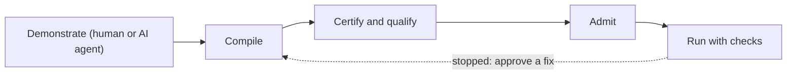

<div align="center">

# OpenAdapt

**Give your agent a program, not a mouse.**

The open-source, verified execution layer for computer-use agents.

[](https://github.com/OpenAdaptAI/OpenAdapt/actions/workflows/main.yml) [](https://github.com/OpenAdaptAI/OpenAdapt/actions/workflows/packages.yml) [](https://pypi.org/project/openadapt/) [](https://www.python.org/downloads/) [](https://github.com/OpenAdaptAI/OpenAdapt/blob/main/LICENSE) [](https://discord.gg/yF527cQbDG)

[What it can do](https://github.com/OpenAdaptAI/OpenAdapt/blob/main/CAPABILITIES.md) · [Documentation](https://docs.openadapt.ai) · [Quickstart](https://docs.openadapt.ai/tutorials/quickstart/) · [Live demo](https://app.openadapt.ai/demo) · [Website](https://openadapt.ai) · [Get updates](https://openadapt.ai/#updates) · [Discord](https://discord.gg/yF527cQbDG)

</div>

Wrap any AI agent with before-click checks, fresh-reload read-back, and signed Ed25519 receipts. **0% silent errors** (vs. 15% for unwrapped frontier models), **+12.5 pp** higher completion on HealthAdminBench, and **1,000x cheaper and 5x faster** on repeating workflows once compiled.

A computer-use agent looks at the screen and chooses every click again, on
every run. OpenAdapt lets a person record a task (once for a simple path, or a
few times with `openadapt compile --induce` to cover variations), or lets an AI
agent perform it once while OpenAdapt records it, ideally on test data, in a
web, Windows, macOS, Linux or remote-desktop app. It compiles the demonstration
into a program,
and your agent calls the program as one tool. The program runs with no model
calls and sends no screenshots anywhere. It confirms the right record before
each save, checks the save after it, and returns a plain outcome that says
how the save was checked. When anything doesn't match, it stops and tells your agent
instead of guessing.

## Clean-room benchmark summary

### Real-upgrade UI drift across 4 web apps (`N = 60`, Gitea / Vikunja / Memos / Mealie)

Evaluated across real upstream app upgrades with 100-run cost amortization (paired unwrapped `gpt-5.4` subset `N = 20`):

| System | Survival | Silent errors | Amortized cost / run | Warm p50 latency |
|---|---|---|---|---|
| **OpenAdapt (`CommitJIT`)** | **70.0%** (42/60) | **0.0%** (0/60) | **$0.000015** (1,188x cheaper than `gpt-5.4`) | **1.88 s** (5.1x faster) |
| Unwrapped `gpt-5.4` (paired `N = 20`) | 80.0% (16/20) | 15.0% (3/20) | $0.017824 | 9.53 s |
| Stagehand-style unverified self-heal | 71.7% (43/60) | 3.3% (2/60) | $0.000205 | 4.47 s |
| Static Playwright | 6.7% (4/60) | — | — | — |
| Prompt-AWM (ICML 2025) | 1.7% (1/60) | — | — | — |

### Zero-leak Stanford `HealthAdminBench` (`N = 24` paired, `gpt-5.4` + `claude-sonnet-5-5`, 132 real reloads)

| Metric | Unwrapped baseline | With OpenAdapt verification | Delta |
|---|---|---|---|
| Silent errors | 70.8% | **45.8%** | **-25.0 pp** (`p = 0.03125`, zero regressions) |
| Full task completion | 29.2% | **41.7%** | **+12.5 pp** |

## Measured on OpenEMR and openIMIS

One new-patient referral in a test copy of OpenEMR, the open-source EHR whose
7.0 release is ONC-certified, timed from a fresh
browser through sign-in, the entry and the saved record read back (median):

| Who does the entry | Time per referral | Saved correctly | Model cost |
|---|---|---|---|
| Agent alone (Claude Sonnet 5.5 computer use) | `██████████████████` 36.5 s | 62 of 63 | about $0.08 |
| OpenAdapt program, screen steps | `███████████` 22.5 s | 18 of 18 | $0 |
| OpenAdapt program, API step | `██` 3.3 s | 18 of 18 | $0 |

The API step replaces the program's 41 screen steps with the one form
submission the app itself sends, then reads the record back. In both program
rows a possible-duplicate referral stopped without saving, as it should. Both
program rows ran on 19 Oct on one copy of the app, interleaved, with the
approval gate off; the benchmark harness admitted the API step. The agent row
is the 14 to 15 Oct timing study, on its own copy of the app.
[SCOREBOARD.md](https://github.com/OpenAdaptAI/OpenAdapt/blob/main/packages/flow/benchmark/scoreboard/SCOREBOARD.md#openemr-agent-screen-program-and-api-step)
has every run.

On a test copy of openIMIS, the open-source insurance and claims system that
runs Nepal's national health insurance scheme, the compiled program entered
149 synthetic claims with no model calls: 148 read back correct and none were
saved wrong. Each saved claim was checked through a read-only database role on
the test copy; the 149th stopped before saving
([SCOREBOARD.md](https://github.com/OpenAdaptAI/OpenAdapt/blob/main/packages/flow/benchmark/scoreboard/SCOREBOARD.md#openimis)).

## One harness, three modes

| Mode | What happens | Model calls |
|---|---|---|
| **Explore** | A person records the task (once, or several times with `openadapt compile --induce` for variations), or an AI agent runs it once while OpenAdapt records every action, ideally on test data. The save is checked before anything compiles. | Your agent's, on your own key |
| **Run** | The compiled program repeats the task with new inputs. It checks the record before each save and reads the result back after. | None |
| **Repair** | When the app changes, the run stops before saving. An agent shows the fix, the program tries it up to the save without saving, and a person approves it. | Only when something changed, on your own key |

## The 3-level verification ladder

Most enterprise deployments do not give an automation tool direct SQL access,
and OpenAdapt does not require it. OpenAdapt picks the strongest layer the app
supports:

- **Promote to API or MCP when an endpoint exists:** Record the task in the
  GUI, compile it into direct form/RPC calls and MCP tools (`openadapt-agent serve`)
  whenever the app exposes an endpoint, and avoid replaying pixels where a
  compiled API step is ~7x faster (3.3 s vs. 22.5 s on OpenEMR above).
- **Level 1 (Before-click local guard: 100% of apps, 0 DB needed):** Checks
  the active record and entity identity across tabs, enforces policy and
  consent gates before consequential writes, and checks screenshots locally for
  UI drift or prompt injection. If anything looks wrong, it stops and asks a
  person instead of guessing.
- **Level 2 (Post-action UI and confirmation read-back: ~90% of portals, 0 DB needed):**
  Reads back submitted fields, server confirmation IDs, or generated PDFs in a
  separate session to confirm what the portal actually recorded.
- **Level 3 (Direct API or DB read-back: optional upgrade):** When you own the
  system or have read-only FHIR, REST, or SQL access, reads the system of
  record directly and mints a signed `VERIFIED` receipt.

### Why independent checks beat a "Saved" screen

In controlled fault tests, a success banner on screen is not enough to prove a
write landed. We injected 8 kinds of bad save into a test app (a save that
never landed, landed partly, landed twice, went to the wrong record, or changed
another record), 9 runs each, alongside clean runs:

| How the save was checked | Bad saves reported as saved |
|---|---|
| The app's "Saved" message on screen | 54 of 72 |
| A read of the record over the app's REST API | 9 of 72 (all writes to a table it didn't read) |
| A read of every table in the database | 0 of 72 |

The test app's database is SQLite with two record tables, so "every table"
there is two tables; a real system has many more. Separately, 9 of the 18
correct saves stopped in every arm because the server committed the save after
its response timed out, so the write step halted before any read-back ran.
[EFFECT_E2E.md](https://github.com/OpenAdaptAI/OpenAdapt/blob/main/packages/flow/benchmark/effect_e2e/EFFECT_E2E.md)
has the fault set, the method and the raw results.

An agent working alone misses the same faults. In controlled runs on OpenEMR
and MockMed with 30 injected bad saves each, Claude Sonnet 5.5 computer use
reported all 30 bad saves as done. Running `openadapt-flow verify-run` caught
25 of 30 on OpenEMR and 30 of 30 on MockMed, while confirming all clean saves
with zero false alarms
([SCOREBOARD.md](https://github.com/OpenAdaptAI/OpenAdapt/blob/main/packages/flow/benchmark/scoreboard/SCOREBOARD.md#the-agents-claims-versus-the-read-back)).

## Try it in one command

```bash
uvx --python 3.12 openadapt@latest quickstart --break-it
```

No account or API key. [uv](https://docs.astral.sh/uv/getting-started/installation/)
fetches Python 3.12 if you need it, and `@latest` runs the newest release. With
Python 3.11 or 3.12 already installed, `python -m pip install --upgrade openadapt`
then `openadapt quickstart --break-it` does the same. The browser runs hidden
and progress shows in the terminal; add `--watch` to see the browser window.

### What it shows

The command runs a synthetic clinic task twice on your computer. The first run
saves an entry and confirms it through the app's read-only API. For the second
run, the test server is set up to reject the save, so it never reaches the
record. This is the output from `openadapt` 1.17.0, with the break-it lines in
the current wording:

```text
[1/5] Record the demonstration against a real persistence boundary
[2/5] Compile and propose a fixture-specific effect contract
[3/5] Certify against the clinical-write policy
[4/5] Admit and execute under the standard profile
      VERIFIED in 5.6s; 0 model calls; the system of record holds 1 record(s)
[5/5] Emit the local run receipt
...
--- break-it: the same certified bundle, with the save set to fail ---

  Injected fault:      'optimistic' -- the server rejects the write
  On screen:           every on-screen check passed, including the saved message
  The verifier found:  1/2 declared effect(s) REFUTED by an independent
                       read of the system of record, which holds 0 record(s)
  The engine did:      HALTED at the consequential step instead of claiming
                       success (transaction: RECONCILIATION_REQUIRED, billable: no)
  Result:              Check the record. A save may have gone through. A person checks the record before anything is retried.
```

The [quickstart tutorial](https://docs.openadapt.ai/tutorials/quickstart/) walks through every line.

## Build with it

### Compile your agent's run

Your agent (Claude or OpenAI computer use, or your own loop, on your own model
key) does the task once while OpenAdapt records it, ideally on test data. A person reviews and admits
the draft program, or a registered agent admits it under a policy a person
signed. After that, the program runs instead of the agent.

```python
from openadapt_flow.jit import compile_agent

jit = compile_agent(my_agent, task=task, app=app, verifier=verifier,
                    policy="clinical-write", cache_dir="jit-cache", model_key=key)
jit.run(note="Follow up in two weeks")    # the agent does it; a DRAFT is saved
# a person reviews, runs the canary, and admits the draft
jit.run(note="Recheck knee in ten days")  # the program runs: 0 model calls, save read back
```

[Compile a computer-use agent's run](https://github.com/OpenAdaptAI/OpenAdapt/blob/main/packages/flow/docs/JIT.md) has the full
example. The same path takes an agent's run through the web, Windows, macOS,
Linux, RDP and Citrix backends.

### Call programs from your agent

```bash
claude mcp add openadapt -- uvx --python 3.12 openadapt-agent serve
```

Each compiled workflow becomes one tool call. The agent decides what to enter;
OpenAdapt makes the entry, checks it, and returns an outcome instead of the
agent driving the screen. With no bundles, the server offers a synthetic
sandbox workflow that returns every outcome. To serve your own workflows, run
`openadapt services agent serve --mode production --bundles ./bundles`; without
`--mode production` the agent can list them but not run them.
`openadapt-agent emit-skill <bundle>` writes an Agent Skill for one workflow,
and `openadapt verify effect` judges a write made by any agent or script
against the system of record. `openadapt hooks install --agent claude-code`
(or `codex`) checks a coding agent's writes to the databases, APIs and MCP
servers you declare: each is pre-checked, read back and given a signed
receipt. The hooks are advisory; see
[HOOKS.md](https://github.com/OpenAdaptAI/OpenAdapt/blob/main/packages/flow/docs/HOOKS.md).
[Connect an agent](https://docs.openadapt.ai/how-to/connect-an-agent/)
covers other clients.

### Hand results from agent to agent

When one agent hands a result to another, the run's signed receipt goes with
it, and the receiving agent verifies it against keys it pins:

```bash
openadapt handoff send result.json --run RUN_DIR --out result.handoff.json
openadapt handoff verify result.handoff.json --keys trusted-keys.json
```

The verdict says who signed, which checks passed and which were not checked,
and any change confirmed in the other party's own system. A valid signature
proves who signed, not that the claim is true. Handoffs travel over MCP
(`serve --handoffs`), HTTP and webhooks (`--post URL`), files and email
(`--detached`), and the A2A (Agent2Agent) protocol (`openadapt agent serve
--a2a`, with an Agent Card, after `pip install 'openadapt[a2a]'`).
[HANDOFFS.md](https://github.com/OpenAdaptAI/OpenAdapt/blob/main/packages/flow/docs/HANDOFFS.md)
has the details.

### Record a task by hand

Recording works the same way on every surface; only the target differs:
`--url` for a web app, `--window` (and `--window-title`) for a Windows or macOS
app window or a local RDP or Citrix client window. Linux and network RDP record
the whole local desktop, so they take no target.

```bash
python -m pip install --upgrade openadapt
openadapt record --backend <web|windows|macos|linux|rdp|citrix> <target> --out rec

# A web app
openadapt record --backend web --url https://staging.your-app.example --out rec
openadapt compile rec --out bundle --name my-first-workflow
openadapt run --replay bundle --url https://staging.your-app.example --run-dir run

# A desktop app (macOS here; Windows and Citrix take --window too).
# Desktop recording and macOS replay are separate extras.
python -m pip install --upgrade 'openadapt[capture,macos]'
openadapt record --backend macos --window "Your App" --out rec
openadapt compile rec --out bundle --name my-first-workflow
openadapt run --replay bundle --macos-app "Your App" --run-dir run
```

`run --replay` drives the app and performs every recorded action,
including saves you can't undo. It doesn't ask first and doesn't check the
saved record. Point it at a test or staging copy, never at production data.

The commands for every surface, including Linux, RDP and Citrix, are in
[SURFACES.md](packages/flow/docs/SURFACES.md#first-workflow-per-surface).

The existing engine command remains available for scripts:

```bash
openadapt flow replay bundle --url https://staging.your-app.example --run-dir run
```

`flow replay` performs every recorded action, including real saves. Use a test
or staging copy; it does not ask for approval or check the saved record.

A program that writes to a real system also needs record checks, a deployment
file, certification, qualification, and an admission; then `openadapt run`
runs it. By default each save waits for a person to approve it in OpenAdapt
Desktop or on a paired phone. [Your first workflow](https://docs.openadapt.ai/tutorials/first-workflow/)
walks through it. Several recordings of the same task can become one program
with branches and loops (`openadapt compile --induce`).

To record a desktop app, install the recorder and your operating system's
adapter, for example `python -m pip install "openadapt[capture,windows]"`, or
use [OpenAdapt Desktop](https://openadapt.ai/download).

`openadapt --help` lists the task commands. `openadapt wrap --help` shows the
options for running an agent task once and reusing its checked compiled tool.
The [CLI reference](docs/cli.md) lists task paths and their original aliases.

### Judge or train any agent

`openadapt verify effect` judges a write made by any agent or script against
the system of record. `openadapt-flow services reward` turns the same check into a
reward for training or evaluating computer-use agents
([REWARD_WORKER.md](https://github.com/OpenAdaptAI/OpenAdapt/blob/main/packages/flow/docs/REWARD_WORKER.md)).

## An agent alone, and an OpenAdapt program

The same referral task on a local OpenEMR 8.0.0.3 test copy with synthetic
patients, 62 timed runs each (14 and 15 October 2026), judged by the same
database read-back:

| | Claude computer-use agent | OpenAdapt program |
|---|---|---|
| Model calls | On every step of every run | 0 |
| Screenshots sent to a model | Throughout every run | 0 |
| Model cost per referral | About $0.08 at list price | $0 |
| Path through the app | Chosen again each run | The same compiled steps |
| Median time | 36.5 s | 29.7 s |
| Referrals saved correctly | 62 of 63 | 62 of 63 |

The program drove every page, as the agent does. The API step compiled from
the recording's network traffic removes those page steps: 3.3 s per referral,
in the table at the top. [Every result](https://openadapt.ai/compare/computer-use-agents)
is published. OpenAdapt isn't affiliated with the OpenEMR project.

## Every backend

Record, compile and run take every surface; the evidence differs by surface
([BACKEND_PARITY.md](packages/flow/docs/BACKEND_PARITY.md)). Self-repair is
qualified on browser runs ([benchmark/auto_repair](packages/flow/benchmark/auto_repair/README.md))
and end to end on native macOS AX ([#1715](https://github.com/OpenAdaptAI/OpenAdapt/pull/1715)). Outside a browser it
runs with `repair.session` ([#1717](https://github.com/OpenAdaptAI/OpenAdapt/pull/1717)), and native and pixel backends admit
its new clicks by element identity ([#1709](https://github.com/OpenAdaptAI/OpenAdapt/pull/1709)). Teaching the fix for a
halted run and rollback are tested on browser runs. Where
the app exposes its structure, OpenAdapt uses it; on remote desktops it works
from pixels.

| Surface | What OpenAdapt reads | Validated on |
|---|---|---|
| Web apps | The screen, plus the page's DOM | OpenEMR, Odoo and openIMIS test copies; CI runs in-tree apps on every build |
| Windows apps | The screen, plus UI Automation | 3 of 3 saves in a WinForms test app |
| macOS apps | The screen, plus Accessibility | 3 of 3 saves in TextEdit |
| Linux apps (X11) | The screen, plus AT-SPI | Recording and an AT-SPI read in CI; backend actions are unit-tested |
| Remote desktop (RDP) | The screen | 105 runs through the stock Remote Desktop client on a real AVC444 session: 55 saves confirmed in the database, 0 wrong-record saves, 40 false stops |
| Citrix | The screen | A Citrix stand-in app with no DOM: 3 healthy runs, 3 stops on drift |

Each application on each surface needs its own qualification.
[Surfaces](https://docs.openadapt.ai/explanation/surfaces/) and [Limits](https://docs.openadapt.ai/explanation/limits/)
have the details.

## How it works



For each step the compiler uses the most reliable layer the app offers: page
structure first (DOM, Windows UI Automation, macOS Accessibility, Linux
AT-SPI), a direct API call where one is bound, and pixels (template, text and
layout matching) only where nothing else exists, such as a remote desktop.
Qualification runs the program against normal and fault cases before an
admission lets that exact version run. At each save the program checks that
the right record is on screen, makes the entry, and reads the record back.

## How it compares

| | Computer-use agent | Agent with a replay cache | Traditional RPA | OpenAdapt |
|---|---|---|---|---|
| How you define the task | A goal in plain language | One agent run | A script or flow built in a designer | A person's recording or an agent's run |
| What runs each time | A model chooses each step from the screen | The recorded steps; the agent takes over on a miss | The fixed script | A compiled program you can read |
| Model calls per run | At least one per step | None on a hit; the agent's calls on a miss | None | None with default settings |
| When the screen changes | The model tries to adapt | The agent improvises live | A selector stops matching, or matches the wrong control | The run stops before saving; a fix is proposed and a person approves it |
| Right record? | The model judges from the screen | Usually only that the screen looks as recorded | Whatever the developer scripted | Checked before every save |
| Did the save land? | The model judges from the screen | The screen | Whatever the developer scripted | Reported verified only when a read outside the acting session confirms it; weaker checks are named as such |
| Strongest for | New or changing tasks | Repeated tasks where a wrong save is cheap | Stable processes with a team to maintain the scripts | The same entry many times, where a wrong save is costly |

## What it can do

- **Learns from any successful run**, a person's demonstration or a computer-use agent's verified run, and compiles it into a program that runs with no calls to a hosted AI model.
- **Uses the most reliable layer the app allows**: page structure (DOM, UI Automation, Accessibility), direct API calls where one is bound, and pixels only for remote desktops.
- **Builds branching programs** from several demonstrations, repeated halts and background runs, and routes each item to the right verified variant.
- **Works across surfaces**: web, Windows, macOS, Linux and RDP backends, chained in one workflow.
- **Confirms the right record before every write and checks the saved record after it**. A run is reported verified only when a read outside the acting session confirms the save: the system of record where one can be read, or a separate session. Weaker checks are reported at their own level.
- **Stops instead of guessing**, never retries an uncertain save, and says what changed before a stop.
- **Binds each approval to exactly what will be saved**, with one-tap answers on a paired phone.
- **Repairs itself when the app changes**, probing a fix up to the save and asking a person to approve it (qualified on browser runs and end to end on native macOS).
- **Works as a safety layer under any agent**: MCP tools, a guarded save, Agent Skills and a CLI.
- **Hands results from agent to agent with their receipts**, over MCP, HTTP, files and the A2A protocol, and verifies a handoff on arrival.
- **Runs locally**: no calls to a hosted AI model on healthy runs, personal and health data redacted, signed receipts.

[CAPABILITIES.md](https://github.com/OpenAdaptAI/OpenAdapt/blob/main/CAPABILITIES.md) has the evidence and code for each.

## What your agent gets back

| You see | `transaction_outcome` | An agent gets | What happens next |
|---|---|---|---|
| Done and checked | `VERIFIED` | `done` | Nothing. Only this result gets a shareable receipt. |
| Stopped before saving | `HALTED_BEFORE_EFFECT` | `needs_review` | Fix the cause, or show the program the fix, and run again. |
| Check the record | `RECONCILIATION_REQUIRED` | `not_sure_if_saved` | A save may have gone through. A person checks the record before anything is retried. |
| Finished, not checked | `COMPLETED_UNVERIFIED` | `not_sure_if_saved` | Fine for testing; not a production success. |
| Saved, waiting for its check | `SAVED_AWAITING_CHECK` | `not_sure_if_saved` | The save's check is a later report (a claim acknowledgment, an export). Don't rerun it. `openadapt-flow verify deferred settle` counts it as done only when the report confirms it. |
| Didn't run | `REJECTED_POLICY`, `CANCELED`, `FAILED_PLATFORM` | `did_not_run` | Fix the gate or the environment and run again. |

The console's last line can read `HALTED` for both the second and third rows.
`transaction_outcome` in `report.json` tells them apart, so base every rerun on
it. [Run outcomes](https://docs.openadapt.ai/reference/outcomes/) lists every value.

## When to use something else

- **You already have a clean, documented API client for the task.** Call the
  API directly. (If the app only exposes an internal form or RPC endpoint,
  OpenAdapt can record it in the GUI and compile it into a direct API/MCP
  step instead of replaying pixels.)
- **Every task is one-off.** Use a computer-use agent. OpenAdapt pays off when
  the same entry repeats or needs repeatable verification.
- **You need a `VERIFIED` receipt with zero read-back path at all.** Level 1
  before-click guards work on 100% of apps with no database access, and Level 2
  UI confirmation read-back covers ~90% of portals with no database access.
  Level 3 direct API/FHIR/SQL read-back is an optional upgrade when you own the
  system. If a target exposes neither a UI read-back nor an API/DB read-back, a
  run finishes as checked-before-click (`COMPLETED_UNVERIFIED`) rather than
  `VERIFIED`.


## Packages

`pip install openadapt` installs the `openadapt` command, the engine, and the
MCP server. The product packages live in this repository:

| Package (PyPI) | What it is | Source |
|---|---|---|
| [`openadapt`](https://pypi.org/project/openadapt/) | The `openadapt` command | [`openadapt/`](https://github.com/OpenAdaptAI/OpenAdapt/tree/main/openadapt) |
| [`openadapt-flow`](https://pypi.org/project/openadapt-flow/) | The engine: record, compile, check, qualify, run, repair | [`packages/flow/`](https://github.com/OpenAdaptAI/OpenAdapt/tree/main/packages/flow) |
| [`openadapt-agent`](https://pypi.org/project/openadapt-agent/) | The MCP server and Agent Skills | [`packages/agent/`](https://github.com/OpenAdaptAI/OpenAdapt/tree/main/packages/agent) |
| [`openadapt-types`](https://pypi.org/project/openadapt-types/) | Shared request, result, and receipt models | [`packages/types/`](https://github.com/OpenAdaptAI/OpenAdapt/tree/main/packages/types) |
| [`openadapt-capture`](https://pypi.org/project/openadapt-capture/) | The desktop recorder: `openadapt[capture]` | [`packages/capture/`](https://github.com/OpenAdaptAI/OpenAdapt/tree/main/packages/capture) |
| [`openadapt-privacy`](https://pypi.org/project/openadapt-privacy/) | Finds and redacts personal and health data: `openadapt[privacy]` | [`packages/privacy/`](https://github.com/OpenAdaptAI/OpenAdapt/tree/main/packages/privacy) |
| [`openadapt-desktop`](https://pypi.org/project/openadapt-desktop/) | OpenAdapt Desktop ([download](https://openadapt.ai/download)) | [`packages/desktop/`](https://github.com/OpenAdaptAI/OpenAdapt/tree/main/packages/desktop) |
| [`openadapt-tray`](https://pypi.org/project/openadapt-tray/) | Menu-bar and system-tray controls and status for OpenAdapt Desktop | [`packages/tray/`](https://github.com/OpenAdaptAI/OpenAdapt/tree/main/packages/tray) |

Each package installs only what it imports. For example, `pip install openadapt-privacy` doesn't install the engine or the desktop app. CI checks each package's install size and dependency list ([install weight](https://github.com/OpenAdaptAI/OpenAdapt/blob/main/docs/monorepo/INSTALL_WEIGHT.md)).

Research on GUI agents lives in separate repositories:
[openadapt-evals](https://github.com/OpenAdaptAI/openadapt-evals) (benchmarks)
and [openadapt-ml](https://github.com/OpenAdaptAI/openadapt-ml) (model
training). The [packages map](https://docs.openadapt.ai/reference/packages/) has the full list.

## Security and procurement

Screens, typed values, and recordings stay on the computer or runner that runs
OpenAdapt. The shareable receipt and the Cloud dashboard hold counts, digests,
and closed values. A sanitized copy leaves only after a person approves it, and
screenshots go to a model host only if you turn on model grounding.
[Security & procurement](https://docs.openadapt.ai/security/) covers data handling, deployment
boundaries, evidence, subprocessors, and release integrity. Plans are on the
[pricing page](https://openadapt.ai/pricing).

<details>
<summary>Release status</summary>

The block below is generated from the signed public lifecycle record.

<!-- BEGIN PRODUCTION LIFECYCLE -->
The signed ledger has seven active target admissions. Their evidence class
is `remote-safe-synthetic`, not MockMed `production_acceptance`. They remain
valid until revoked; there's no expiry date. `pip install openadapt` is the
admitted runtime (launcher 1.16.0, Flow 1.35.1). Desktop's admitted artifact
is the 0.16.0 wheel. Native Mac DMGs stay ad-hoc signed 0.15.0; don't treat
those as admitted. A Production run still needs a workflow admission for the
exact compiled bundle, application, and environment.
[Check the live signed Production record](https://docs.openadapt.ai/production-lifecycle.json).
<!-- END PRODUCTION LIFECYCLE -->

</details>

## Earlier versions

The pre-1.0 version (v0.46.0) is frozen under
[`legacy/`](https://github.com/OpenAdaptAI/OpenAdapt/tree/main/legacy).
[docs/LEGACY_FREEZE.md](https://github.com/OpenAdaptAI/OpenAdapt/blob/main/docs/LEGACY_FREEZE.md)
explains how to install it and how to migrate.

## Contributing

Launcher, engine, MCP server, and contract changes all belong in this
repository; engine changes go in [`packages/flow/`](https://github.com/OpenAdaptAI/OpenAdapt/tree/main/packages/flow).
[Contribution guide](https://github.com/OpenAdaptAI/OpenAdapt/blob/main/CONTRIBUTING.md) ·
[Issues](https://github.com/OpenAdaptAI/OpenAdapt/issues) ·
[Discussions](https://github.com/OpenAdaptAI/OpenAdapt/discussions) ·
[Report a vulnerability](https://github.com/OpenAdaptAI/OpenAdapt/blob/main/SECURITY.md) ·
[Code signing policy](https://github.com/OpenAdaptAI/OpenAdapt/blob/main/CODE_SIGNING_POLICY.md)

Maintained by [OpenAdaptAI](https://github.com/OpenAdaptAI) under the
[MIT License](https://github.com/OpenAdaptAI/OpenAdapt/blob/main/LICENSE).
