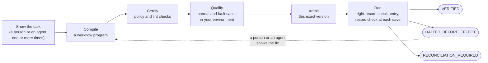

# OpenAdapt

[](https://github.com/OpenAdaptAI/OpenAdapt/actions/workflows/main.yml)
[](https://github.com/OpenAdaptAI/OpenAdapt/actions/workflows/packages.yml)
[](https://pypi.org/project/openadapt/)
[](https://www.python.org/downloads/)
[](https://github.com/OpenAdaptAI/OpenAdapt/blob/main/LICENSE)
[](https://discord.gg/yF527cQbDG)

OpenAdapt turns a task in an application with no usable API into a program
that runs the same way every time. A person or an agent shows the task in the
real application. OpenAdapt compiles one or more of these demonstrations into
a workflow program you can read, tests it in your environment, and runs it with
new inputs. At each save, it checks that the right record is on screen, makes
the entry, and reads the record back to confirm it. When a check fails, the run
stops instead of guessing. A healthy run makes no AI model calls.

The engine is open source under the MIT license.
[Documentation](https://docs.openadapt.ai) · [Live demo](https://app.openadapt.ai/demo) ·
[Website](https://openadapt.ai)

## How it works



- `VERIFIED`: every save was read back and matched. Only this result gets a
  receipt.
- `HALTED_BEFORE_EFFECT`: a check failed before anything was saved, so the run
  stopped and asked a person.
- `RECONCILIATION_REQUIRED`: a save may have gone through. A person checks the
  record before anything is retried.

[Run outcomes](https://docs.openadapt.ai/reference/outcomes/) lists every outcome, and the
[glossary](https://docs.openadapt.ai/reference/glossary/) defines each term.

## Try it

```bash
uvx --python 3.12 openadapt quickstart --break-it
```

[uv](https://docs.astral.sh/uv/getting-started/installation/) downloads
Python 3.12 for the command if you don't have it. With Python 3.10, 3.11, or
3.12, `python -m pip install --upgrade openadapt` followed by
`openadapt quickstart --break-it` does the same. You don't need an account or
an API key.

The command runs a synthetic clinic task twice on your computer. The first run
saves a note and confirms it through the app's read-only API. In the second
run, the app shows "saved" but the server drops the write. The record check
finds no new note, so the run stops with `RECONCILIATION_REQUIRED` instead of
reporting success. The [quickstart tutorial](https://docs.openadapt.ai/tutorials/quickstart/)
explains the output.

## Automate your own workflow

Record a demonstration, compile it, and look at what it compiled into:

```bash
python -m pip install --upgrade openadapt
openadapt flow record --url https://staging.your-app.example --out rec
openadapt flow compile rec --out bundle --name my-first-workflow
openadapt flow replay bundle --url https://staging.your-app.example --run-dir run
```

`replay` drives the app at `--url` and performs every recorded action,
including saves you can't undo. It doesn't ask first and doesn't check the
saved record. Point it at a test or staging copy, never at production data.

A program that writes to a real system also needs record checks, a deployment
file, certification against a policy, qualification on your normal and fault
cases, and an admission. Then `openadapt flow run` runs it. By default, a
person approves each save in OpenAdapt Desktop before it happens; the operator
can choose another approval mode for the run.
[Your first workflow](https://docs.openadapt.ai/tutorials/first-workflow/) and
[Run a workflow](https://docs.openadapt.ai/how-to/run/) walk through each step.

To record a desktop app instead of a browser, install the recorder and the
adapter for your operating system, for example
`python -m pip install "openadapt[capture,windows]"`. For a visual app, use
[OpenAdapt Desktop](https://openadapt.ai/download).

## Give a workflow to an AI agent

Your agent decides what to enter. OpenAdapt makes the entry and checks it. The
MCP server gives the agent each compiled workflow as one tool call, and the
agent gets back an outcome instead of driving the screen:

```bash
openadapt agent serve --mode production --bundles ./bundles
```

Without `--mode production`, the agent can list workflows but not run them.
Only the outcome `done` means the save was confirmed.
[Connect an agent](https://docs.openadapt.ai/how-to/connect-an-agent/) covers client setup and a
sandbox that needs no account.

## Where it runs

| Surface | How OpenAdapt finds targets | Tested so far |
|---|---|---|
| Web apps | DOM, then image, text, and position | Required CI on every build, plus runs against OpenEMR |
| Windows apps | UI Automation, then image, text, and position | 3 of 3 saves in a WinForms test app |
| macOS apps | Accessibility, then image, text, and position | 3 of 3 saves in TextEdit |
| Linux apps (X11) | AT-SPI, then image, text, and position | A GTK3 app in CI |
| Remote desktop (RDP) | Screen image, text, and position | 3 of 3 trials into Windows 11 over a real network |
| Citrix | Screen image, text, and position | A stand-in app only; no run over a real Citrix session yet |

Each application on each surface still needs its own qualification.
[Surfaces](https://docs.openadapt.ai/explanation/surfaces/) has the details, and
[Limits](https://docs.openadapt.ai/explanation/limits/) lists what OpenAdapt doesn't do.

## Measured so far

On a local OpenEMR 8.0.0.3 test copy with synthetic referrals, on 14 and
15 October 2026, OpenAdapt and a Claude computer-use agent each entered
referrals in 62 timed runs. The median time was 29.7 seconds for OpenAdapt and
36.5 seconds for the agent. OpenAdapt made no model calls; the agent cost about
$0.08 a run at list price. Both saved 62 of 63 normal referrals correctly,
judged by the same database read-back. The agent matched or beat OpenAdapt in
three other tests. [How we measured](https://openadapt.ai/compare/computer-use-agents)
has every result. OpenAdapt isn't affiliated with the OpenEMR project.

## Packages

`pip install openadapt` installs the `openadapt` command, the engine, and the
MCP server. Install anything else only for the reason in the last column.

| Package | What it is | Source | Do you need it? |
|---|---|---|---|
| [`openadapt`](https://pypi.org/project/openadapt/) | The `openadapt` command | [`openadapt/`](https://github.com/OpenAdaptAI/OpenAdapt/tree/main/openadapt) | Yes. Start here. |
| [`openadapt-flow`](https://pypi.org/project/openadapt-flow/) | The engine: recording, compiling, checks, qualification, runs, repair | [`packages/flow/`](https://github.com/OpenAdaptAI/OpenAdapt/tree/main/packages/flow) | Installed by `openadapt` |
| [`openadapt-agent`](https://pypi.org/project/openadapt-agent/) | The MCP server and Agent Skills | [`packages/agent/`](https://github.com/OpenAdaptAI/OpenAdapt/tree/main/packages/agent) | Installed by `openadapt` |
| [`openadapt-types`](https://pypi.org/project/openadapt-types/) | Shared request, result, and receipt models | [`packages/types/`](https://github.com/OpenAdaptAI/OpenAdapt/tree/main/packages/types) | Installed with the engine |
| [`openadapt-capture`](https://pypi.org/project/openadapt-capture/) | The desktop recorder | [openadapt-capture](https://github.com/OpenAdaptAI/openadapt-capture) | To record desktop apps: `openadapt[capture]` |
| [`openadapt-privacy`](https://pypi.org/project/openadapt-privacy/) | Finds and redacts personal and health data | [openadapt-privacy](https://github.com/OpenAdaptAI/openadapt-privacy) | For redaction: `openadapt[privacy]` |
| [`openadapt-desktop`](https://pypi.org/project/openadapt-desktop/) | The OpenAdapt Desktop app | [openadapt-desktop](https://github.com/OpenAdaptAI/openadapt-desktop) | For the app: [openadapt.ai/download](https://openadapt.ai/download) |
| [`openadapt-evals`](https://pypi.org/project/openadapt-evals/) | Benchmarks for GUI agents | [openadapt-evals](https://github.com/OpenAdaptAI/openadapt-evals) | Research only |
| [`openadapt-ml`](https://pypi.org/project/openadapt-ml/) | Model training for GUI agents | [openadapt-ml](https://github.com/OpenAdaptAI/openadapt-ml) | Research only |

On `main`, the agent and types code lives inside the engine, as
`openadapt_flow.agent` and `openadapt_flow.contracts`; the `openadapt-agent`
and `openadapt-types` packages keep the old imports and commands working. The
former `openadapt-agent` and `openadapt-types` repositories are archived, and
the former `openadapt-flow` repository is frozen. Open issues and pull requests
here. The [packages map](https://docs.openadapt.ai/reference/packages/) lists every repository.

## Security and procurement

Recordings and screens stay on the computer that runs OpenAdapt unless you
approve sharing them. Runs on native apps, RDP, and Citrix happen on a runner you
control. [Security & procurement](https://docs.openadapt.ai/security/) covers data handling,
deployment boundaries, evidence, subprocessors, and release integrity. Plans
are on the [pricing page](https://openadapt.ai/pricing). To hand off a
workflow, write to us at [openadapt.ai/contact](https://openadapt.ai/contact).

## Release status

The block below is generated from the signed public lifecycle record.

<!-- BEGIN PRODUCTION LIFECYCLE -->
The signed ledger has seven active target admissions. Their evidence class
is `remote-safe-synthetic`, not MockMed `production_acceptance`. They remain
valid until revoked; there's no expiry date. `pip install openadapt` is the
admitted runtime (launcher 1.16.0, Flow 1.35.1). Desktop's admitted artifact
is the 0.16.0 wheel. Native Mac DMGs stay ad-hoc signed 0.15.0; don't treat
those as admitted. A Production run still needs a workflow admission for the
exact compiled bundle, application, and environment.
[Check the live signed Production record](https://docs.openadapt.ai/production-lifecycle.json).
<!-- END PRODUCTION LIFECYCLE -->

## Earlier versions

The pre-1.0 version (v0.46.0) is frozen under
[`legacy/`](https://github.com/OpenAdaptAI/OpenAdapt/tree/main/legacy).
[docs/LEGACY_FREEZE.md](https://github.com/OpenAdaptAI/OpenAdapt/blob/main/docs/LEGACY_FREEZE.md)
explains how to install it and how to migrate.

## Contributing

Launcher, packaging, engine, MCP server, and contract changes all belong in
this repository. Engine changes go in
[`packages/flow/`](https://github.com/OpenAdaptAI/OpenAdapt/tree/main/packages/flow).

[Contribution guide](https://github.com/OpenAdaptAI/OpenAdapt/blob/main/CONTRIBUTING.md) ·
[Issues](https://github.com/OpenAdaptAI/OpenAdapt/issues) ·
[Discussions](https://github.com/OpenAdaptAI/OpenAdapt/discussions) ·
[Discord](https://discord.gg/yF527cQbDG) ·
[Report a vulnerability](https://github.com/OpenAdaptAI/OpenAdapt/blob/main/SECURITY.md)

Maintained by [OpenAdaptAI](https://github.com/OpenAdaptAI) under the
[MIT License](https://github.com/OpenAdaptAI/OpenAdapt/blob/main/LICENSE).
