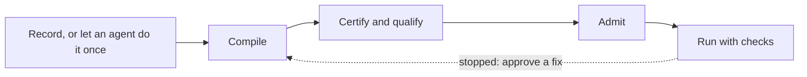

<div align="center">

# OpenAdapt

**Give your agent a program, not a mouse.**

The open-source harness that compiles computer-use agent runs into verified programs.

[](https://github.com/OpenAdaptAI/OpenAdapt/actions/workflows/main.yml) [](https://github.com/OpenAdaptAI/OpenAdapt/actions/workflows/packages.yml) [](https://pypi.org/project/openadapt/) [](https://www.python.org/downloads/) [](https://github.com/OpenAdaptAI/OpenAdapt/blob/main/LICENSE) [](https://discord.gg/yF527cQbDG)

[What it can do](https://github.com/OpenAdaptAI/OpenAdapt/blob/main/CAPABILITIES.md) · [Documentation](https://docs.openadapt.ai) · [Quickstart](https://docs.openadapt.ai/tutorials/quickstart/) · [Live demo](https://app.openadapt.ai/demo) · [Website](https://openadapt.ai) · [Discord](https://discord.gg/yF527cQbDG)

</div>

A computer-use agent looks at the screen and chooses every click again, on
every run. OpenAdapt lets your agent, or a person, do a task once in any app:
web, Windows, macOS, Linux, RDP or Citrix. It compiles that run into a program,
and your agent calls the program as one tool. The program runs with no model
calls and sends no screenshots anywhere. It confirms the right record before
each save, reads the save back from the system of record after it, and returns
a plain outcome. When anything doesn't match, it stops and tells your agent
instead of guessing.

## One harness, three modes

| Mode | What happens | Model calls |
|---|---|---|
| **Explore** | Your agent, or a person, does the task once while OpenAdapt records every action. The save is read back before anything compiles. | Your agent's, on your own key |
| **Run** | The compiled program repeats the task with new inputs. It checks the record before each save and reads it back after. | None |
| **Repair** | When the app changes, the run stops before saving. An agent shows the fix, the program tries it up to the save without saving, and a person approves it. | Only when something changed, on your own key |

## An agent alone, and an OpenAdapt program

The same referral task on a local OpenEMR 8.0.0.3 test copy with synthetic
patients, 62 timed runs each (14 and 15 October 2026), judged by the same
database read-back:

| | Claude computer-use agent | OpenAdapt program |
|---|---|---|
| Model calls | On every step of every run | 0 |
| Screenshots sent to a model | Throughout every run | 0 |
| Model cost per referral | About $0.08 at list price | $0 |
| Path through the app | Chosen again each run | The same compiled steps |
| Median time | 36.5 s | 29.7 s |
| Referrals saved correctly | 62 of 63 | 62 of 63 |

Both were equally correct here, and the agent matched or beat OpenAdapt in
three other tests. [Every result](https://openadapt.ai/compare/computer-use-agents)
is published. The program was only about a fifth faster because it still drives
every page, as the agent does; direct API steps compiled from the recording's
network traffic are in review
([#1269](https://github.com/OpenAdaptAI/OpenAdapt/pull/1269)). OpenAdapt isn't
affiliated with the OpenEMR project.

## Why the read-back matters

A success screen is not proof of a save. In a fault test through the real
replayer, 72 of 90 runs left a wrong record behind a success screen: a save that
never landed, landed partly, landed twice, or changed another record. Each check
below was asked whether those 72 runs had succeeded:

| How the save was checked | Wrong records reported as saved |
|---|---|
| The app's "Saved" message on screen | 54 of 72 |
| A read of the record over the app's REST API | 9 of 72 (all writes to a table it didn't read) |
| A read of every table the save touched | 0 of 72 |

The faults are a small, hand-written set, so this measures coverage, not a
real-world error rate. [EFFECT_E2E.md](https://github.com/OpenAdaptAI/OpenAdapt/blob/main/packages/flow/benchmark/effect_e2e/EFFECT_E2E.md)
has the method and raw results.

## Try it in one command

```bash
uvx --python 3.12 openadapt quickstart --break-it
```

No account or API key. [uv](https://docs.astral.sh/uv/getting-started/installation/)
fetches Python 3.12 if you need it; with Python 3.10 to 3.12 already installed,
`python -m pip install --upgrade openadapt` then `openadapt quickstart --break-it`
does the same.

### What it shows

The command runs a synthetic clinic task twice on your computer. The first run
saves an entry and confirms it through the app's read-only API. For the second
run, the test server is set up to reject the save, so it never reaches the
record. This is the output from `openadapt` 1.17.0, with the break-it lines in
the current wording:

```text
[1/5] Record the demonstration against a real persistence boundary
[2/5] Compile and propose a fixture-specific effect contract
[3/5] Certify against the clinical-write policy
[4/5] Admit and execute under the standard profile
      VERIFIED in 5.6s; 0 model calls; the system of record holds 1 record(s)
[5/5] Emit the local run receipt
...
--- break-it: the same certified bundle, with the save set to fail ---

  Injected fault:      'optimistic' -- the server rejects the write
  On screen:           every on-screen check passed, including the saved message
  The verifier found:  1/2 declared effect(s) REFUTED by an independent
                       read of the system of record, which holds 0 record(s)
  The engine did:      HALTED at the consequential step instead of claiming
                       success (transaction: RECONCILIATION_REQUIRED, billable: no)
  Result:              Check the record. A save may have gone through. A person checks the record before anything is retried.
```

The [quickstart tutorial](https://docs.openadapt.ai/tutorials/quickstart/) walks through every line.

## Build with it

### Compile your agent's run

Your agent (Claude or OpenAI computer use, or your own loop, on your own model
key) does the task once while OpenAdapt records it. A person reviews and admits
the draft program, or a registered agent admits it under a policy a person
signed. After that, the program runs instead of the agent.

```python
from openadapt_flow.jit import compile_agent

jit = compile_agent(my_agent, task=task, app=app, verifier=verifier,
                    policy="clinical-write", cache_dir="jit-cache", model_key=key)
jit.run(note="Follow up in two weeks")    # the agent does it; a DRAFT is saved
# a person reviews, runs the canary, and admits the draft
jit.run(note="Recheck knee in ten days")  # the program runs: 0 model calls, save read back
```

[Compile a computer-use agent's run](https://github.com/OpenAdaptAI/OpenAdapt/blob/main/packages/flow/docs/JIT.md) has the full
example. This path runs web apps today. On Windows, RDP and Citrix, an agent can
already drive a recording through the MCP server's recording tools (on `main`,
not yet released), and the same compile path for those surfaces is being
built.

### Call programs from your agent

```bash
claude mcp add openadapt -- uvx --python 3.12 openadapt-agent serve
```

Each compiled workflow becomes one tool call. The agent decides what to enter;
OpenAdapt makes the entry, checks it, and returns an outcome instead of the
agent driving the screen. With no bundles, the server offers a synthetic
sandbox workflow that returns every outcome. To serve your own workflows, run
`openadapt agent serve --mode production --bundles ./bundles`; without
`--mode production` the agent can list them but not run them.
`openadapt-agent emit-skill <bundle>` writes an Agent Skill for one workflow,
and `openadapt flow verify-run` judges a write made by any agent or script
against the system of record. [Connect an agent](https://docs.openadapt.ai/how-to/connect-an-agent/)
covers other clients.

### Record a task by hand

```bash
python -m pip install --upgrade openadapt
openadapt flow record --url https://staging.your-app.example --out rec
openadapt flow compile rec --out bundle --name my-first-workflow
openadapt flow replay bundle --url https://staging.your-app.example --run-dir run
```

`replay` drives the app at `--url` and performs every recorded action,
including saves you can't undo. It doesn't ask first and doesn't check the
saved record. Point it at a test or staging copy, never at production data.

A program that writes to a real system also needs record checks, a deployment
file, certification, qualification, and an admission; then `openadapt flow run`
runs it. By default each save waits for a person to approve it in OpenAdapt
Desktop or on a paired phone. [Your first workflow](https://docs.openadapt.ai/tutorials/first-workflow/)
walks through it. Several recordings of the same task can become one program
with branches and loops (`openadapt flow induce`).

To record a desktop app, install the recorder and your operating system's
adapter, for example `python -m pip install "openadapt[capture,windows]"`, or
use [OpenAdapt Desktop](https://openadapt.ai/download).

### Judge or train any agent

`openadapt flow verify-run` judges a write made by any agent or script against
the system of record. `openadapt-flow serve-reward` turns the same check into a
reward for training or evaluating computer-use agents
([REWARD_WORKER.md](https://github.com/OpenAdaptAI/OpenAdapt/blob/main/packages/flow/docs/REWARD_WORKER.md)).

## Every backend

The same record, compile, run and repair steps work on every surface. Where
the app exposes its structure, OpenAdapt uses it; on remote desktops it works
from pixels.

| Surface | What OpenAdapt reads | Tested so far |
|---|---|---|
| Web apps | The screen, plus the page's DOM | Required CI on every build, plus runs against OpenEMR |
| Windows apps | The screen, plus UI Automation | 3 of 3 saves in a WinForms test app |
| macOS apps | The screen, plus Accessibility | 3 of 3 saves in TextEdit |
| Linux apps (X11) | The screen, plus AT-SPI | A GTK3 app in CI |
| Remote desktop (RDP) | The screen | 3 of 3 trials into Windows 11 over a real network |
| Citrix | The screen | A stand-in app only; no run over a real Citrix session yet |

Each application on each surface needs its own qualification.
[Surfaces](https://docs.openadapt.ai/explanation/surfaces/) and [Limits](https://docs.openadapt.ai/explanation/limits/)
have the details.

## How it works



For each step the compiler uses the most reliable layer the app offers: page
structure first (DOM, Windows UI Automation, macOS Accessibility, Linux
AT-SPI), a direct API call where one is bound, and pixels (template, text and
layout matching) only where nothing else exists, such as RDP and Citrix.
Qualification runs the program against normal and fault cases before an
admission lets that exact version run. At each save the program checks that
the right record is on screen, makes the entry, and reads the record back.

## How it compares

| | Computer-use agent | Agent with a replay cache | Traditional RPA | OpenAdapt |
|---|---|---|---|---|
| How you define the task | A goal in plain language | One agent run | A script or flow built in a designer | A person's recording or an agent's run |
| What runs each time | A model chooses each step from the screen | The recorded steps; the agent takes over on a miss | The fixed script | A compiled program you can read |
| Model calls per run | At least one per step | None on a hit; the agent's calls on a miss | None | None with default settings |
| When the screen changes | The model tries to adapt | The agent improvises live | A selector stops matching, or matches the wrong control | The run stops before saving; a fix is proposed and a person approves it |
| Right record? | The model judges from the screen | Usually only that the screen looks as recorded | Whatever the developer scripted | Checked before every save |
| Did the save land? | The model judges from the screen | The screen | Whatever the developer scripted | Read back from the system of record |
| Strongest for | New or changing tasks | Repeated tasks where a wrong save is cheap | Stable processes with a team to maintain the scripts | The same entry many times, where a wrong save is costly |

## What it can do

- **Learns from any successful run**, a person's demonstration or a computer-use agent's verified run, and compiles it into a program that runs with no model calls.
- **Uses the most reliable layer the app allows**: page structure (DOM, UI Automation, Accessibility), direct API calls where one is bound, and pixels only for remote desktops.
- **Builds branching programs** from several demonstrations, repeated halts and background runs, and routes each item to the right verified variant.
- **Works across surfaces**: web, Windows, macOS, RDP and Citrix, in one workflow.
- **Confirms the right record before every write and reads the saved record back** from the system of record, never just the screen.
- **Stops instead of guessing**, never retries an uncertain save, and says what changed before a stop.
- **Binds each approval to exactly what will be saved**, with one-tap answers on a paired phone.
- **Repairs itself when the app changes**, probing a fix up to the save and asking a person to approve it.
- **Works as a safety layer under any agent**: MCP tools, a guarded save, Agent Skills and a CLI.
- **Runs locally**: no model calls on healthy runs, patient data redacted, signed receipts.

[CAPABILITIES.md](https://github.com/OpenAdaptAI/OpenAdapt/blob/main/CAPABILITIES.md) has the status, evidence and code for each,
including the few still being merged.

## What your agent gets back

| You see | `transaction_outcome` | An agent gets | What happens next |
|---|---|---|---|
| Done and checked | `VERIFIED` | `done` | Nothing. Only this result gets a shareable receipt. |
| Stopped before saving | `HALTED_BEFORE_EFFECT` | `needs_review` | Fix the cause, or show the program the fix, and run again. |
| Check the record | `RECONCILIATION_REQUIRED` | `not_sure_if_saved` | A save may have gone through. A person checks the record before anything is retried. |
| Finished, not checked | `COMPLETED_UNVERIFIED` | `not_sure_if_saved` | Fine for testing; not a production success. |
| Didn't run | `REJECTED_POLICY`, `CANCELED`, `FAILED_PLATFORM` | `did_not_run` | Fix the gate or the environment and run again. |

The console's last line can read `HALTED` for both the second and third rows.
`transaction_outcome` in `report.json` tells them apart, so base every rerun on
it. [Run outcomes](https://docs.openadapt.ai/reference/outcomes/) lists every value.

## When to use something else

- **The app has an API for the task.** Call the API.
- **Every task is new.** Use a computer-use agent. OpenAdapt pays off when the
  same entry repeats.
- **There's no way to read the record back.** The record check needs read
  access to the system of record: an API, the database, FHIR, or a separate
  signed-in session. Without one, a run can only end as finished but not
  checked.


## Packages

`pip install openadapt` installs the `openadapt` command, the engine, and the
MCP server. The product packages live in this repository:

| Package (PyPI) | What it is | Source |
|---|---|---|
| [`openadapt`](https://pypi.org/project/openadapt/) | The `openadapt` command | [`openadapt/`](https://github.com/OpenAdaptAI/OpenAdapt/tree/main/openadapt) |
| [`openadapt-flow`](https://pypi.org/project/openadapt-flow/) | The engine: record, compile, check, qualify, run, repair | [`packages/flow/`](https://github.com/OpenAdaptAI/OpenAdapt/tree/main/packages/flow) |
| [`openadapt-agent`](https://pypi.org/project/openadapt-agent/) | The MCP server and Agent Skills | [`packages/agent/`](https://github.com/OpenAdaptAI/OpenAdapt/tree/main/packages/agent) |
| [`openadapt-types`](https://pypi.org/project/openadapt-types/) | Shared request, result, and receipt models | [`packages/types/`](https://github.com/OpenAdaptAI/OpenAdapt/tree/main/packages/types) |
| [`openadapt-capture`](https://pypi.org/project/openadapt-capture/) | The desktop recorder: `openadapt[capture]` | [`packages/capture/`](https://github.com/OpenAdaptAI/OpenAdapt/tree/main/packages/capture) |
| [`openadapt-privacy`](https://pypi.org/project/openadapt-privacy/) | Finds and redacts personal and health data: `openadapt[privacy]` | Moving into `packages/` |
| [`openadapt-desktop`](https://pypi.org/project/openadapt-desktop/) | OpenAdapt Desktop ([download](https://openadapt.ai/download)) | Moving into `packages/` |

Research on GUI agents lives in separate repositories:
[openadapt-evals](https://github.com/OpenAdaptAI/openadapt-evals) (benchmarks)
and [openadapt-ml](https://github.com/OpenAdaptAI/openadapt-ml) (model
training). The [packages map](https://docs.openadapt.ai/reference/packages/) has the full list.

## Security and procurement

Screens, typed values, and recordings stay on the computer or runner that runs
OpenAdapt. The shareable receipt and the Cloud dashboard hold counts, digests,
and closed values. A sanitized copy leaves only after a person approves it, and
screenshots go to a model host only if you turn on model grounding.
[Security & procurement](https://docs.openadapt.ai/security/) covers data handling, deployment
boundaries, evidence, subprocessors, and release integrity. Plans are on the
[pricing page](https://openadapt.ai/pricing).

<details>
<summary>Release status</summary>

The block below is generated from the signed public lifecycle record.

<!-- BEGIN PRODUCTION LIFECYCLE -->
The signed ledger has seven active target admissions. Their evidence class
is `remote-safe-synthetic`, not MockMed `production_acceptance`. They remain
valid until revoked; there's no expiry date. `pip install openadapt` is the
admitted runtime (launcher 1.16.0, Flow 1.35.1). Desktop's admitted artifact
is the 0.16.0 wheel. Native Mac DMGs stay ad-hoc signed 0.15.0; don't treat
those as admitted. A Production run still needs a workflow admission for the
exact compiled bundle, application, and environment.
[Check the live signed Production record](https://docs.openadapt.ai/production-lifecycle.json).
<!-- END PRODUCTION LIFECYCLE -->

</details>

## Earlier versions

The pre-1.0 version (v0.46.0) is frozen under
[`legacy/`](https://github.com/OpenAdaptAI/OpenAdapt/tree/main/legacy).
[docs/LEGACY_FREEZE.md](https://github.com/OpenAdaptAI/OpenAdapt/blob/main/docs/LEGACY_FREEZE.md)
explains how to install it and how to migrate.

## Contributing

Launcher, engine, MCP server, and contract changes all belong in this
repository; engine changes go in [`packages/flow/`](https://github.com/OpenAdaptAI/OpenAdapt/tree/main/packages/flow).
[Contribution guide](https://github.com/OpenAdaptAI/OpenAdapt/blob/main/CONTRIBUTING.md) ·
[Issues](https://github.com/OpenAdaptAI/OpenAdapt/issues) ·
[Discussions](https://github.com/OpenAdaptAI/OpenAdapt/discussions) ·
[Report a vulnerability](https://github.com/OpenAdaptAI/OpenAdapt/blob/main/SECURITY.md)

Maintained by [OpenAdaptAI](https://github.com/OpenAdaptAI) under the
[MIT License](https://github.com/OpenAdaptAI/OpenAdapt/blob/main/LICENSE).
