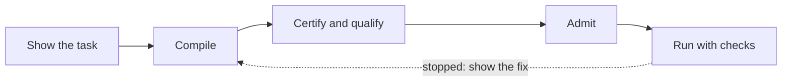

<div align="center">

# OpenAdapt

**A person or an agent shows a task in an application with no usable API. OpenAdapt compiles it into a program that makes the same entry every time, checks that it's the right record, and reads the save back.**

[](https://github.com/OpenAdaptAI/OpenAdapt/actions/workflows/main.yml) [](https://github.com/OpenAdaptAI/OpenAdapt/actions/workflows/packages.yml) [](https://pypi.org/project/openadapt/) [](https://www.python.org/downloads/) [](https://github.com/OpenAdaptAI/OpenAdapt/blob/main/LICENSE) [](https://discord.gg/yF527cQbDG)

[What it can do](CAPABILITIES.md) · [Documentation](https://docs.openadapt.ai) · [Quickstart](https://docs.openadapt.ai/tutorials/quickstart/) · [Live demo](https://app.openadapt.ai/demo) · [Website](https://openadapt.ai) · [Discord](https://discord.gg/yF527cQbDG)

</div>

## What OpenAdapt does

- **Learns from any successful run**, a person's demonstration or a computer-use agent's verified run, and compiles it into a program that runs with no model calls.
- **Uses the fastest layer the app allows**: direct API calls where possible, then page structure (DOM, UI Automation, Accessibility), and pixels only for remote desktops.
- **Builds branching programs** from several demonstrations, repeated halts and background runs, and routes each item to the right verified variant.
- **Works across surfaces**: web, Windows, macOS, RDP and Citrix, in one workflow.
- **Confirms the right record before every write and reads the saved record back** from the system of record, never just the screen.
- **Stops instead of guessing**, never retries an uncertain save, and says what changed before a stop.
- **Binds each approval to exactly what will be saved**, with one-tap answers on a paired phone.
- **Repairs itself when the app changes**, probing a fix up to the save and asking a person to approve it.
- **Works as a safety layer under any agent**: MCP tools, a guarded save, Agent Skills and a CLI.
- **Runs locally**: no model calls on healthy runs, patient data redacted, signed receipts.

Status, evidence and code for each, including the few still being merged: [CAPABILITIES.md](CAPABILITIES.md).

```bash
uvx --python 3.12 openadapt quickstart --break-it
```

No account or API key. [uv](https://docs.astral.sh/uv/getting-started/installation/)
fetches Python 3.12 if you need it; with Python 3.10 to 3.12 already installed,
`python -m pip install --upgrade openadapt` then `openadapt quickstart --break-it`
does the same.

## What the quickstart shows

The command runs a synthetic clinic task twice on your computer. The first run
saves an entry and confirms it through the app's read-only API. For the second
run, the test server is set up to reject the save, so it never reaches the
record. This is the output from `openadapt` 1.17.0, with the break-it lines in
the current wording:

```text
[1/5] Record the demonstration against a real persistence boundary
[2/5] Compile and propose a fixture-specific effect contract
[3/5] Certify against the clinical-write policy
[4/5] Admit and execute under the standard profile
      VERIFIED in 5.6s; 0 model calls; the system of record holds 1 record(s)
[5/5] Emit the local run receipt
...
--- break-it: the same certified bundle, with the save set to fail ---

  Injected fault:      'optimistic' -- the server rejects the write
  On screen:           every on-screen check passed, including the saved message
  The verifier found:  1/2 declared effect(s) REFUTED by an independent
                       read of the system of record, which holds 0 record(s)
  The engine did:      HALTED at the consequential step instead of claiming
                       success (transaction: RECONCILIATION_REQUIRED, billable: no)
  Result:              Check the record. A save may have gone through. A person checks the record before anything is retried.
```

The [quickstart tutorial](https://docs.openadapt.ai/tutorials/quickstart/) walks through every line.

## How it compares

| | Computer-use agent | Traditional RPA | OpenAdapt |
|---|---|---|---|
| How you define the task | A goal in plain language | A script or flow built in a designer | One or more demonstrations, by a person or an agent |
| What runs each time | A model chooses each next step from the screen | The fixed script | A compiled program you can read |
| Model calls per run | At least one per step | None | None with default settings |
| When the screen changes | The model tries to adapt | A selector stops matching, or matches the wrong control | The run stops before saving; a person or an agent shows the fix |
| Checking the save | The model judges from the screen | Whatever the developer scripted | The right-record check before each save and a record check after |
| Strongest for | New or changing tasks | Stable processes with a team to maintain the scripts | The same entry many times, where a wrong save is costly |

An agent and OpenAdapt also work together: the agent decides what to enter,
and OpenAdapt makes the entry and checks it.

## How it works



OpenAdapt works from the screen, so it runs where there's no usable API: web
apps, native Windows, macOS and Linux apps, and RDP and Citrix windows. A
person or an agent shows the task. The compiler turns one or more
demonstrations into a program, and qualification runs it against your normal
and fault cases before an admission lets that exact version run. At each save
the program checks that the right record is on screen, makes the entry, and
reads the record back.

## Run outcomes

| You see | `transaction_outcome` | An agent gets | What happens next |
|---|---|---|---|
| Done and checked | `VERIFIED` | `done` | Nothing. Only this result gets a shareable receipt. |
| Stopped before saving | `HALTED_BEFORE_EFFECT` | `needs_review` | Fix the cause, or show the program the fix, and run again. |
| Check the record | `RECONCILIATION_REQUIRED` | `not_sure_if_saved` | A save may have gone through. A person checks the record before anything is retried. |
| Finished, not checked | `COMPLETED_UNVERIFIED` | `not_sure_if_saved` | Fine for testing; not a production success. |
| Didn't run | `REJECTED_POLICY`, `CANCELED`, `FAILED_PLATFORM` | `did_not_run` | Fix the gate or the environment and run again. |

The console's last line can read `HALTED` for both the second and third rows.
`transaction_outcome` in `report.json` tells them apart, so base every rerun on
it. [Run outcomes](https://docs.openadapt.ai/reference/outcomes/) lists every value.

## Automate your own workflow

```bash
python -m pip install --upgrade openadapt
openadapt flow record --url https://staging.your-app.example --out rec
openadapt flow compile rec --out bundle --name my-first-workflow
openadapt flow replay bundle --url https://staging.your-app.example --run-dir run
```

`replay` drives the app at `--url` and performs every recorded action,
including saves you can't undo. It doesn't ask first and doesn't check the
saved record. Point it at a test or staging copy, never at production data.

A program that writes to a real system also needs record checks, a deployment
file, certification, qualification, and an admission; then `openadapt flow run`
runs it. The operator sets each run's approval mode: by default the run waits
for a person to approve each save in OpenAdapt Desktop, and with `not_gated` it
doesn't pause and the report says so. [Your first workflow](https://docs.openadapt.ai/tutorials/first-workflow/) walks through it.

To record a desktop app, install the recorder and your operating system's
adapter, for example `python -m pip install "openadapt[capture,windows]"`, or
use [OpenAdapt Desktop](https://openadapt.ai/download). An agent can record
too, through the MCP server's recording tools; on Windows, RDP and Citrix that
support is on `main` and not yet released.

## Give a workflow to an AI agent

```bash
claude mcp add openadapt -- uvx --python 3.12 openadapt-agent serve
```

With no bundles, the server offers a synthetic sandbox workflow that returns
every outcome. To serve your own compiled workflows, run
`openadapt agent serve --mode production --bundles ./bundles`; without
`--mode production` the agent can list them but not run them. Each workflow is
one tool call, and the agent gets an outcome back instead of driving the
screen. [Connect an agent](https://docs.openadapt.ai/how-to/connect-an-agent/) covers other clients.

## Measured so far

On a local OpenEMR 8.0.0.3 test copy with synthetic referrals (14 and
15 October 2026), OpenAdapt and a Claude computer-use agent each entered 63
new-patient referrals in timed runs. Median time over the correct runs was 29.7 seconds for
OpenAdapt and 36.5 seconds for the agent. OpenAdapt made no model calls; the agent cost about
$0.08 a run at list price. Both saved 62 of 63 normal referrals correctly,
judged by the same database read-back, and the agent matched or beat OpenAdapt
in three other tests. [Every result](https://openadapt.ai/compare/computer-use-agents)
is published, and the [run data](https://github.com/OpenAdaptAI/OpenAdapt/blob/main/packages/flow/benchmark/openemr_referral_timing/README.md)
is in this repository. OpenAdapt isn't affiliated with the OpenEMR project.

In a fault test through the real replayer, 72 of 90 runs left a wrong record
behind a success screen. A check of the success banner reported success on 54
of those 72; a full read of the database caught all 72. The faults were a fixed
list injected into our own engine: a coverage test, not a real-world error rate. [How a save is checked](https://docs.openadapt.ai/explanation/verification/) has the method.

<details>
<summary>Where it runs</summary>

| Surface | What OpenAdapt reads | Tested so far |
|---|---|---|
| Web apps | The screen, plus the page's DOM | Required CI on every build, plus runs against OpenEMR |
| Windows apps | The screen, plus UI Automation | 3 of 3 saves in a WinForms test app |
| macOS apps | The screen, plus Accessibility | 3 of 3 saves in TextEdit |
| Linux apps (X11) | The screen, plus AT-SPI | A GTK3 app in CI |
| Remote desktop (RDP) | The screen | 3 of 3 trials into Windows 11 over a real network |
| Citrix | The screen | A stand-in app only; no run over a real Citrix session yet |

Each application on each surface needs its own qualification.
[Surfaces](https://docs.openadapt.ai/explanation/surfaces/) and [Limits](https://docs.openadapt.ai/explanation/limits/)
have the details.

</details>

## Packages

`pip install openadapt` installs the `openadapt` command, the engine, and the
MCP server. The product packages live in this repository:

| Package (PyPI) | What it is | Source |
|---|---|---|
| [`openadapt`](https://pypi.org/project/openadapt/) | The `openadapt` command | [`openadapt/`](https://github.com/OpenAdaptAI/OpenAdapt/tree/main/openadapt) |
| [`openadapt-flow`](https://pypi.org/project/openadapt-flow/) | The engine: record, compile, check, qualify, run, repair | [`packages/flow/`](https://github.com/OpenAdaptAI/OpenAdapt/tree/main/packages/flow) |
| [`openadapt-agent`](https://pypi.org/project/openadapt-agent/) | The MCP server and Agent Skills | [`packages/agent/`](https://github.com/OpenAdaptAI/OpenAdapt/tree/main/packages/agent) |
| [`openadapt-types`](https://pypi.org/project/openadapt-types/) | Shared request, result, and receipt models | [`packages/types/`](https://github.com/OpenAdaptAI/OpenAdapt/tree/main/packages/types) |
| [`openadapt-capture`](https://pypi.org/project/openadapt-capture/) | The desktop recorder: `openadapt[capture]` | [`packages/capture/`](https://github.com/OpenAdaptAI/OpenAdapt/tree/main/packages/capture) |
| [`openadapt-privacy`](https://pypi.org/project/openadapt-privacy/) | Finds and redacts personal and health data: `openadapt[privacy]` | [`packages/privacy/`](https://github.com/OpenAdaptAI/OpenAdapt/tree/main/packages/privacy) |
| [`openadapt-desktop`](https://pypi.org/project/openadapt-desktop/) | OpenAdapt Desktop ([download](https://openadapt.ai/download)) | [`packages/desktop/`](https://github.com/OpenAdaptAI/OpenAdapt/tree/main/packages/desktop) |

Research on GUI agents lives in separate repositories:
[openadapt-evals](https://github.com/OpenAdaptAI/openadapt-evals) (benchmarks)
and [openadapt-ml](https://github.com/OpenAdaptAI/openadapt-ml) (model
training). The [packages map](https://docs.openadapt.ai/reference/packages/) has the full list.

## Security and procurement

Screens, typed values, and recordings stay on the computer or runner that runs
OpenAdapt. The shareable receipt and the Cloud dashboard hold counts, digests,
and closed values. A sanitized copy leaves only after a person approves it, and
screenshots go to a model host only if you turn on model grounding.
[Security & procurement](https://docs.openadapt.ai/security/) covers data handling, deployment
boundaries, evidence, subprocessors, and release integrity. Plans are on the
[pricing page](https://openadapt.ai/pricing).

<details>
<summary>Release status</summary>

The block below is generated from the signed public lifecycle record.

<!-- BEGIN PRODUCTION LIFECYCLE -->
The signed ledger has seven active target admissions. Their evidence class
is `remote-safe-synthetic`, not MockMed `production_acceptance`. They remain
valid until revoked; there's no expiry date. `pip install openadapt` is the
admitted runtime (launcher 1.16.0, Flow 1.35.1). Desktop's admitted artifact
is the 0.16.0 wheel. Native Mac DMGs stay ad-hoc signed 0.15.0; don't treat
those as admitted. A Production run still needs a workflow admission for the
exact compiled bundle, application, and environment.
[Check the live signed Production record](https://docs.openadapt.ai/production-lifecycle.json).
<!-- END PRODUCTION LIFECYCLE -->

</details>

## Earlier versions

The pre-1.0 version (v0.46.0) is frozen under
[`legacy/`](https://github.com/OpenAdaptAI/OpenAdapt/tree/main/legacy).
[docs/LEGACY_FREEZE.md](https://github.com/OpenAdaptAI/OpenAdapt/blob/main/docs/LEGACY_FREEZE.md)
explains how to install it and how to migrate.

## Contributing

Launcher, engine, MCP server, and contract changes all belong in this
repository; engine changes go in [`packages/flow/`](https://github.com/OpenAdaptAI/OpenAdapt/tree/main/packages/flow).
[Contribution guide](https://github.com/OpenAdaptAI/OpenAdapt/blob/main/CONTRIBUTING.md) ·
[Issues](https://github.com/OpenAdaptAI/OpenAdapt/issues) ·
[Discussions](https://github.com/OpenAdaptAI/OpenAdapt/discussions) ·
[Report a vulnerability](https://github.com/OpenAdaptAI/OpenAdapt/blob/main/SECURITY.md) ·
[Code signing policy](https://github.com/OpenAdaptAI/OpenAdapt/blob/main/CODE_SIGNING_POLICY.md)

Maintained by [OpenAdaptAI](https://github.com/OpenAdaptAI) under the
[MIT License](https://github.com/OpenAdaptAI/OpenAdapt/blob/main/LICENSE).
