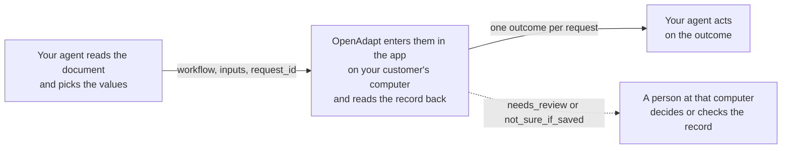

# OpenAdapt Agent

[](LICENSE)
[](https://www.python.org/downloads/)

Your AI agent decides what to enter. OpenAdapt enters it in the app and checks that it saved.

Use it if your agent reads referrals, intake forms, or authorizations and works out what belongs in the record, but a person still types the result into an app with no usable API. Examples are an electronic medical record (EMR) and a payer portal. This package is the tool your agent calls to do that typing.

- A person or your agent shows OpenAdapt the task in the real app. OpenAdapt replays those steps, and by default a run makes no AI model calls.
- Before it types, OpenAdapt checks that the right record is open. After it saves, it reads the record back.
- Your agent gets one of four outcomes: done and checked, stopped before saving, check the record, or didn't run. When OpenAdapt can't confirm a save, it says so, and a person checks the record.
- It runs on your customer's computer, one that can already open the app. Your agent, or a small program acting for it, has to run on that computer too, since it starts OpenAdapt and talks to it directly. If your agent runs in your own cloud, ask us about a hosted route.

Pick one task your agent hands to staff today and [talk to us about connecting it](https://openadapt.ai/qualify?why=embed). Engineers can [try the sandbox](#try-it-in-three-steps) first.

## Give your agent a program, not a mouse

Your agent doesn't send screenshots to a model and click. It calls a taught workflow as one typed tool, OpenAdapt runs the same steps every time, and by default your agent gets back an outcome and counts, not screens or recorded values.

```bash
openadapt-agent serve --mode production --bundles <bundle or directory of bundles>
openadapt-agent emit-skill <bundle> --out ~/.claude/skills
```

[Try it in three steps](#try-it-in-three-steps) runs a sandbox with no account. [Serve your own workflows](#serve-your-own-workflows) and [Write an Agent Skill](#write-an-agent-skill) cover both commands.

## What changes for your customer's team

| Step | Today | With OpenAdapt |
| --- | --- | --- |
| Read the document and decide what to enter | Your agent | Your agent |
| Open the app and find the right record | Staff | OpenAdapt, which checks that it has the right record before it types |
| Type the values and save | Staff, retyping your agent's output | OpenAdapt, in the same screens staff use |
| Confirm the save | Staff, if they look again | OpenAdapt reads the record back before it reports done |
| Something doesn't match | Staff notice while typing, or someone finds it later | OpenAdapt stops before saving, and the run waits for a person |
| What staff handle | Every document | Runs that stopped and records to check. Nobody is notified, so someone checks the list of stopped runs. |

For scale, two hospital time studies put keying one faxed referral into an electronic record at about 10 to 12 minutes ([UCSF, JAMIA Open 2020](https://pmc.ncbi.nlm.nih.gov/articles/PMC7660949/); [Calderdale and Huddersfield NHS Foundation Trust, HFMA 2024](https://www.hfma.org.uk/system/files/2024-04/Using%20digital%20technologies%20to%20process%20admin%20tasks%20Case%20Study%20v7.pdf)). We don't publish a time-saved number until a deployment measures one.

## Who builds what



| You build | OpenAdapt provides |
| --- | --- |
| The agent that reads documents and decides what to enter | A workflow built from one recording of a person doing the task in the real app |
| The call to `run_workflow`, with your own `request_id` | The run on your customer's computer, with a right-record check before it types and a record check after it saves |
| What your product does with each outcome | One result per request, and no second entry when your agent repeats a `request_id` |
| Your tests against the four outcomes | A sandbox that returns each outcome on demand |

Your customer provides the computer and a person for runs that stop. Someone who does the task today records it, or your agent drives the recording, in web apps, native Windows apps, and over Citrix or remote desktop. A person accepts the result before it runs. See [Record a first workflow](#record-a-first-workflow), or [talk to us](https://openadapt.ai/qualify?why=embed) about setting it up.

## Try it in three steps

The sandbox is a practice server that needs no account. It has one workflow, `add_triage_note`, which adds a note to the first referral in MockMed, a test clinic app with made-up patients.

You need [Claude Code](https://claude.com/claude-code) (signed in), [uv](https://docs.astral.sh/uv/), and git. To use a different client or your own code, see [Connect your own agent](#connect-your-own-agent).

1. Add the sandbox server. Claude Code saves it for the current folder only.

   ```bash
   claude mcp add openadapt -- uvx --python 3.12 --from git+https://github.com/OpenAdaptAI/openadapt-agent openadapt-agent serve
   ```

2. In the same folder, start Claude Code with `claude`. Claude Code starts the server.

3. Ask: "Use OpenAdapt to add the triage note 'Synthetic: recheck blood pressure in 2 weeks' with request id demo-0001."

Your agent should call `list_workflows`, then `run_workflow` with these arguments:

```json
{"workflow": "add_triage_note", "inputs": {"note": "Synthetic: recheck blood pressure in 2 weeks"}, "request_id": "demo-0001"}
```

The result looks like this (some fields left out):

```json
{
  "outcome": "done",
  "label": "Done and checked",
  "safe_to_retry": false,
  "what_happened": "Simulated sandbox result (no app was opened): Saved the change and read the record back to confirm it.",
  "next_step": "none",
  "proof": "simulated",
  "run_id": "run-31ecb9d66db84f1aba8cb5f6",
  "model_calls": 0
}
```

This install simulates each run without opening MockMed, and every result says so. To watch the real engine do the work, see [Drive MockMed with the real engine](#drive-mockmed-with-the-real-engine).

Version 2.1.0 on PyPI includes the sandbox, so step 1 can also be `claude mcp add openadapt -- uvx --python 3.12 openadapt-agent serve`.

### See every outcome

Ask for each case by adding `sandbox_case` to the inputs, with a new `request_id` each time. For example: "Now try the false_saved_banner case with request id demo-0002."

| `sandbox_case` | `outcome` | What MockMed does |
| --- | --- | --- |
| `normal` (default) | `done` | Saves the note, and the record check finds it. |
| `duplicate_record` | `needs_review` | Lists the same referral twice, so OpenAdapt can't tell which record to open. It stops before saving. |
| `false_saved_banner` | `not_sure_if_saved` | Shows a saved message, but the note wasn't stored. |
| `timeout_after_save` | `not_sure_if_saved` | Saves the note, then times out with an error. |
| `app_offline` | `did_not_run` | Doesn't answer, so nothing starts. |

The sandbox remembers each `request_id` across sessions. Sending a used `request_id` with the same inputs returns the earlier result. Sending it with different inputs, such as a new `sandbox_case`, returns `did_not_run` with the reason `request_id_conflict`. To start over, delete `~/.openadapt/agent-sandbox`, or set `OPENADAPT_AGENT_SANDBOX_DIR` to an empty folder.

### Drive MockMed with the real engine

The `tutorial` extra makes openadapt-flow (Flow), the engine behind OpenAdapt, drive MockMed in a hidden browser. Replace the sandbox server with this one:

```bash
claude mcp remove openadapt
claude mcp add openadapt -- uvx --python 3.12 --from 'openadapt-agent[tutorial] @ git+https://github.com/OpenAdaptAI/openadapt-agent' openadapt-agent serve
```

When the server starts, Flow records the workflow once and, if needed, downloads a browser (about 300 MB). The first request waits for that. In our test on a Mac, the first request took about 80 seconds. The call returned `running` after 60 seconds, and the agent called `get_run` for the result. If setup takes more than 15 minutes, the request ends `did_not_run`. With Flow, a `done` result has `proof: "local"` instead of `"simulated"`.

The simulated sandbox suggests the same command in its `list_workflows` result.

## What your agent gets back

`outcome` is one of four final values. While a run is still going, it's `running`.

| `outcome` (label) | What happened | What your agent does next |
| --- | --- | --- |
| `done` (Done and checked) | OpenAdapt saved the values and read the record back. | Mark the request complete and keep the `run_id`. Don't send it again. |
| `needs_review` (Stopped before saving) | It stopped before a save, and the run waits until someone at your customer's computer decides. Nothing was written, unless `record_changed` is `unknown`: while a run waits for a person to approve a save (label Waiting for approval), an earlier save in that run may have gone through. | Don't start the same work again. Call `get_run` later to see the decision. |
| `not_sure_if_saved` (Check the record) | A save may have gone through, but OpenAdapt couldn't confirm it. | Never retry. Have a person check the record in the app. |
| `did_not_run` (Didn't run) | This call wrote nothing. With `request_id_conflict`, an earlier request with the same `request_id` may have saved. | If `safe_to_retry` is true, fix the cause and resend the same request. Otherwise follow `next_action`. |
| `running` (Running) | The run didn't finish within `wait_seconds` (default 60). | Call `get_run` with the `run_id` until `outcome` changes. |

Branch on `outcome` and `safe_to_retry`. `next_step` names the next move as a fixed code, so your code doesn't have to parse `next_action`: `none`, `call_get_run`, `wait_for_person`, `check_record`, `fix_inputs`, `fix_setup`, or `retry`.

### Resend a request

`request_id` is your own id for the request, such as a referral id. Don't put patient details in it. A request is one `request_id` with one workflow and one set of inputs.

- Resending the same request never enters the values twice. It returns the latest result, marked `replayed: true`.
- If that result was `did_not_run` with `safe_to_retry: true`, resending starts a new attempt, up to 5 attempts per `request_id`.
- After `invalid_input`, you can fix the inputs and resend with the same `request_id`. After any other retryable result, send the same inputs.
- A different workflow or different inputs under a used `request_id` return `did_not_run` with `request_id_conflict`. Nothing new runs, and the earlier request may have saved. Call `get_run` with the result's `first_run_id` to see what happened to it.
- No tool clears `not_sure_if_saved`. If the person who checks finds the work still needs doing, send it as a new request with a new `request_id`.

The check that stops a second entry covers one runs folder. See `--runs-dir` under [Set server options](#set-server-options).

### Read the other fields

- `label`: a short status you can display, such as "Done and checked".
- `reason`: a code from a fixed list that names the cause, such as `invalid_input` or `request_id_conflict`. Every code is in `REASONS` in [contract.py](src/openadapt_agent/contract.py), and [docs/DESIGN.md](docs/DESIGN.md#the-result-contract) explains how each one is chosen.
- `what_happened` and `next_action`: fixed sentences you can show a person. They never contain input values or screen text.
- `proof`: `local` for a `done` that was checked on your customer's computer, `simulated` for a sandbox run that didn't open the app, and `none` for every other outcome.
- `model_calls`: on runs that reached Flow, how many AI model calls the run made. It's 0 unless model grounding, a fallback that asks an AI model where to click, is turned on (see [Security](#security)).
- `record_changed`: `yes`, `no`, or `unknown`. It's `no` only when OpenAdapt can show that nothing was written. `request_id_conflict` gives `unknown`, because the earlier request may have saved.
- `needs_repair`: on `needs_review` or `did_not_run` results where the run stopped at a step. It gives the step id, the reason, and a one-time `repair_token`, and never a screen. If a person turned on screen access for repairs, your agent can call `get_repair_screen` and `teach_repair` to propose a fix, which a person must approve. See [docs/REPAIR.md](docs/REPAIR.md).

## Three tools

| Tool | Arguments | Returns |
| --- | --- | --- |
| `list_workflows` | none | Each workflow's `name`, `purpose`, `done_means` (what counts as done), and `inputs` as JSON Schema. |
| `run_workflow` | `workflow`, `inputs`, `request_id`, and optional `wait_seconds` (0 to 600, default 60) | One result. |
| `get_run` | `run_id`, and optional `wait_seconds` (0 to 600, default 60) | The latest result for that run, including a person's decision on a stopped run. |

A `request_id` is 4 to 128 characters long. It starts with a letter or digit, and the rest can be letters, digits, `.`, `_`, `:`, or `-`.

A call with bad arguments, such as a missing `request_id`, returns a tool error instead of a result. For `run_workflow`, that error ends "Nothing ran." `get_run` finds only runs in the same runs folder.

The sandbox has all three tools. With your own workflows, `run_workflow` appears only when the server is started with `--mode production` or `--mode attended` (see [Serve your own workflows](#serve-your-own-workflows)).

## Developer setup

The package is a local Model Context Protocol (MCP) server that talks over stdio, plus an `openadapt-agent` command. It needs Python 3.10 to 3.12. It checks inputs, stops second entries, and turns Flow's report into one of the four outcomes. [openadapt-flow](https://github.com/OpenAdaptAI/openadapt-flow) records, replays, and checks the workflows.

To see Flow on its own, install the OpenAdapt launcher with `pip install openadapt`, then run `openadapt flow tutorial` or `openadapt quickstart --break-it`.

### Connect your own agent

Any MCP client can start the server with the command `uvx`. In a client that reads an `mcpServers` JSON file, such as Claude Desktop or Cursor, add:

```json
{
  "mcpServers": {
    "openadapt": {
      "command": "uvx",
      "args": ["--python", "3.12", "--from", "git+https://github.com/OpenAdaptAI/openadapt-agent", "openadapt-agent", "serve"]
    }
  }
}
```

From your own Python code, use the MCP Python SDK (`pip install mcp`):

```python
import asyncio
import json

from mcp import ClientSession, StdioServerParameters
from mcp.client.stdio import stdio_client

SERVER = StdioServerParameters(
    command="uvx",
    args=["--python", "3.12", "--from", "git+https://github.com/OpenAdaptAI/openadapt-agent",
          "openadapt-agent", "serve"],
)


async def main():
    async with stdio_client(SERVER) as (read, write):
        async with ClientSession(read, write) as session:
            await session.initialize()
            call = await session.call_tool("run_workflow", {
                "workflow": "add_triage_note",
                "inputs": {"note": "Synthetic: recheck blood pressure in 2 weeks"},
                "request_id": "demo-py-0001",
            })
            result = json.loads(call.content[0].text)
            print(result["outcome"], result["next_step"])


asyncio.run(main())
```

The SDK starts the server with only a few environment variables. To pass others, such as `OPENADAPT_BUNDLE_KEY`, add `env=` to `StdioServerParameters`.

[scripts/smoke_client.py](scripts/smoke_client.py) is a fuller example that runs every sandbox case. From a clone of this repository, run `pip install -e .`, then:

```bash
python scripts/smoke_client.py -- uvx --python 3.12 --from git+https://github.com/OpenAdaptAI/openadapt-agent openadapt-agent serve
```

If your agent runs in your own cloud, it can't reach this server, which has no network listener. The program that starts the server has to run on your customer's computer. One way to do that is a small worker there: it takes requests from your service over a connection it opens, starts this server, calls `run_workflow`, and sends each result back. The worker acts as your agent, so protect its connection like any other route to patient data. For a hosted route instead, [talk to us](https://openadapt.ai/qualify?why=embed).

### Serve your own workflows

A bundle is a compiled workflow folder that contains `workflow.json`, or `workflow.json.enc` with its key in `OPENADAPT_BUNDLE_KEY`. `--bundles` takes one bundle or a folder of bundles.

| Command | What your agent gets |
| --- | --- |
| `openadapt-agent serve` | The sandbox. |
| `openadapt-agent serve --bundles DIR` | Your workflows, listed but not runnable (`run_tools_enabled: false`), and read-only tools for past and stopped runs. |
| `openadapt-agent serve --mode production --bundles DIR --runs-dir /var/lib/openadapt/runs` | Runs of your workflows. |
| `openadapt-agent serve --mode attended --bundles DIR --runs-dir /var/lib/openadapt/runs` | Runs, plus decisions on stopped runs. |

`openadapt-agent serve --allow-run` is the older form of `--mode production`, or of the sandbox when there's no `--bundles`.

Each run goes through `openadapt-flow run`. Flow drives web apps in Chromium, with the address set by `--url`. It also drives desktop apps and RDP and Citrix sessions, which can need Flow's own target flags passed with `--extra-run-arg`. The [openadapt-flow README](https://github.com/OpenAdaptAI/openadapt-flow#readme) covers each kind of app.

### Get a workflow ready to run

Flow refuses a bundle that hasn't passed the checks it requires. Your agent then gets `did_not_run` with `not_ready_to_run`, and `failed_checks` names each missing check, such as `not_certified` or `no_readiness_test`. Expect this the first time you serve a new recording.

What Flow requires depends on the profile set in the deployment config (`--config`). The main differences:

- No profile: the bundle must be certified with `openadapt-flow certify` against the policy.
- `standard` or `regulated`: certification, an active admission (a signed readiness test) for that exact bundle version, and a record check that reads the saved record through a separate path, such as the app's API, its database, or a second session. Under `standard`, a Citrix session with no separate way to read the record can't end `done`.
- `demo`: no certification, but Flow doesn't confirm the save, so a finished run ends `not_sure_if_saved`.

Flow's [execution profiles](https://github.com/OpenAdaptAI/openadapt-flow/blob/main/docs/EXECUTION_PROFILES.md) page explains each profile.

### Set server options

| Flag | What it does |
| --- | --- |
| `--runs-dir DIR` | Where run records and Flow's evidence go. The default is `~/.openadapt/runs` (or `OPENADAPT_AGENT_RUNS_DIR` when it's set), never the folder where the client starts the server; the sandbox uses `~/.openadapt/agent-sandbox`. The server prints the folder it uses when it starts. The check that stops a second entry covers one runs folder, so give every server for the same work the same folder. Earlier versions used `./runs`; if that folder holds their records and you don't pass `--runs-dir`, the server won't start, so you choose which folder to keep. |
| `--url URL` | The app's address, passed to every Flow run. |
| `--config YAML` | Flow's deployment config ([example](https://github.com/OpenAdaptAI/openadapt-flow/blob/main/docs/deployment.example.yaml)), which sets the profile and whether model grounding is allowed. |
| `--policy NAME-OR-PATH` | The policy Flow certifies against, such as `clinical-write` or `permissive`. |
| `--timeout SECONDS` | How long one run may work (default 600). Time a person spends approving a save doesn't count. A run stopped at the limit is `not_sure_if_saved`. |
| `--approval-mode MODE` | Whether a person approves each save. Without it, Flow decides: under `standard` and `regulated` a run stops before each save until a person approves it (`each_item`). `not_gated` turns that off for every run this server starts; each result records it under `technical.approval_mode`. |
| `--headed` | Shows the browser. A person needs it to continue or skip a stopped run in a web app. |
| `--extra-run-arg ARG`, `--flow-cli CMD` | Change how Flow is called. Either one can relax Flow's checks, for example `--extra-run-arg=--allow-unencrypted`. |
| `--allow-protected-export`, `--allow-synthetic-recorded-defaults`, `--allow-model-grounding` | Off by default. See [Security](#security). |

Callers can't change `--url`, `--config`, `--policy`, `--timeout`, or `--approval-mode`. The one exception is `url` on the deprecated tools, when the server has `--allow-url-override`. If a workflow has its own input named `url`, that argument stays the workflow's input and the override is `target_url_override`. `openadapt-agent serve --help` lists every flag.

### Runs that wait for a person's approval

Under `standard` and `regulated`, Flow stops before each save and waits for a person to approve it (up to 15 minutes by default). While it waits, `run_workflow` and `get_run` return `needs_review` with reason `waiting_for_approval` and `record_changed: "unknown"`, because an earlier save in the same run may have gone through. The person sees the waiting save with `openadapt-flow item-approval show RUN_DIR`, where `RUN_DIR` is the `run_id` folder in the runs folder, and answers with `item-approval approve` or `decline`. If nobody answers in time, the run stops before saving and reads `needs_review` with reason `approval_needed`. This server has no tool that approves a save: a person does.

### Use the other tools

With `--bundles`, the server also registers read-only tools for workflows and runs: `get_workflow`, `get_run_report`, `list_needs_attention`, and `get_attention_item`. With `--mode production` or `--mode attended`, it also registers a deprecated `run_workflow_<id>` for each workflow. Those tools take no `request_id`, so a retry can enter the values twice. Use `run_workflow` instead.

`list_workflows`, `run_workflow`, and `get_run` return `structuredContent` that matches their `outputSchema`, defined in [contract.py](src/openadapt_agent/contract.py), plus the same JSON as text.

### Decide stopped runs

A run that stops for a person waits in Flow's Needs Attention list on that computer. Nobody is notified. `list_needs_attention` shows the list.

With `--mode attended`, your agent can send a decision with `continue_attention`, `skip_attention`, `reject_attention`, `teach_attention`, or `escalate_attention`. The person at the computer confirms each decision in a form. Continue and skip also need `--config`. If the client can't show forms, the server refuses the decision, and the person uses Flow's console instead:

```bash
openadapt-flow console --attend --allow-actions --bundles DIR --runs RUNS_DIR
```

[docs/DESIGN.md](docs/DESIGN.md#needs-attention) describes each decision. After a person decides, `get_run` shows the new outcome.

### Describe a workflow with a card

A card gives a workflow the `name`, `purpose`, `done_means`, and input descriptions that `list_workflows` shows your agent. Without a card, the workflow gets an opaque name. Put `openadapt-card.json` next to `workflow.json`:

```json
{
  "name": "enter_referral",
  "purpose": "Create an outgoing referral for an existing patient in the clinic EMR.",
  "done_means": "The referral appears in the EMR's referral report for that patient.",
  "inputs": {
    "patient_mrn": {"description": "Clinic MRN of the patient.", "pattern": "^[0-9]{6,10}$"},
    "referral_date": {"description": "Date of the referral.", "format": "date"}
  }
}
```

Card text reaches your agent's model, so keep patient details out of it. The server ignores the whole card and logs a warning if the card is malformed, if `purpose` or `done_means` is over 300 characters, if a description is over 200 characters, or if the text looks like it holds an identifier: 5 or more digits in a row, an email address, or a phone number.

### Write an Agent Skill

`openadapt-agent emit-skill BUNDLE --out ~/.claude/skills` writes a `SKILL.md` for one workflow: what it does, its inputs, how to call `run_workflow`, and what to do after each outcome. The skill holds no recorded values or secrets, and you still add the server separately. `--include-bundle` also copies the bundle next to the skill. That copy can contain values from the recording, so keep it as private as the recording.

Each skill is named after its workflow, so `enter_referral` becomes `enter-referral`. Two names are reserved:

- `computer-use`, because an assistant would load that skill for every request to control the screen.
- `openadapt-gui-write`, the general skill for any workflow that this repository ships at [skills/openadapt-gui-write/SKILL.md](skills/openadapt-gui-write/SKILL.md).

If a workflow's name would come out as either one, emit-skill names the skill `openadapt-` plus the workflow's id, such as `openadapt-workflow-1a2b3c4d5e6f7a8b9c0d1e2f`. An emitted skill never replaces the general skill in the same folder.

### Record a first workflow

`serve --authoring` adds recording tools, such as `observe`, `start_record`, `click`, `pause_for_input`, `stop_record`, `compile`, and `admit`. [docs/DESIGN.md](docs/DESIGN.md#recording-tools) lists all 14. Your agent uses them to record a task with a person: in a web app, a native Windows app, or an RDP or Citrix session. The recording server doesn't turn on runs.

1. Add a recording server. `--url` opens the app in a new Chromium window with no saved sign-ins, and `--headed` keeps that window visible so the person can sign in.

   ```bash
   claude mcp add openadapt-authoring -- uvx --python 3.12 --from 'openadapt-agent[tutorial] @ git+https://github.com/OpenAdaptAI/openadapt-agent' openadapt-agent serve --authoring --url https://app.example.com --headed
   ```

2. Ask your agent to record the task with the person. When the agent pauses for sign-in, the person signs in to the app in that window.
3. When the task is done, the agent calls `compile`. It writes the bundle to `<runs-dir>/authoring/bundle`, which is `~/.openadapt/runs/authoring/bundle` by default.
4. The agent calls `admit`. Your MCP client then shows the person a confirmation form, and only the person's answer there accepts the bundle. If the client can't show forms (MCP form elicitation), `admit` refuses and nothing is accepted.
5. Get the bundle ready to run (see [Get a workflow ready to run](#get-a-workflow-ready-to-run)). Then serve it with `--mode production --bundles <runs-dir>/authoring/bundle`.

Use `--url URL --headed` for a web app on every platform. Without `--url`, the server exits on Linux, and on macOS it uses whatever window is in front when the client starts the server, or exits.

For a native Windows app, start Flow's Windows agent server in the signed-in desktop session on that computer (`python -m openadapt_flow.backends.win_agent.server --port 5001`; see [its README](https://github.com/OpenAdaptAI/openadapt-flow/tree/main/openadapt_flow/backends/win_agent)) and pass `--windows-agent-url http://localhost:5001`. Your agent's clicks and keys go through the same synthetic-input path that replay uses, and the recording keeps each clicked control's UI Automation id when Windows reports one. Set `OAFLOW_AGENT_TOKEN` if the server uses a token.

For an RDP or Citrix session, pass `--remote-window APP` (the client app, for example `"Microsoft Remote Desktop"`) or `--citrix`, and `--remote-window-title` when the app has more than one window. A remote session is screen-only: there's no DOM or UI Automation tree, so `observe` returns no nodes and your agent clicks x,y pixels in the client window and presses keys, the way a person would. To let your agent see that window, add `--authoring-screens scrubbed`, which turns on a `screen` tool that returns the frame with identifiers scrubbed and shares nothing if scrubbing fails. `--authoring-screens unscrubbed` skips scrubbing. Screens are off by default.

The recording marks every step as the agent's or the person's (`actor` in `events.jsonl`, `demonstrated_by` in `meta.json`), and a person still accepts the result. On Windows with none of these flags, the tools can only tell the person what to click.

ChatGPT and Claude in a web browser can't start a server on your computer. To record from one of them, start at https://openadapt.ai/start. When openadapt.ai gives you a runner link for the recording job (it contains `bind=oab_`), run this on the computer that has the app:

```bash
openadapt-agent authoring connect '<runner link>'
```

It claims the job, polls openadapt.ai over outgoing HTTPS, and asks you in the terminal before a chat account may drive it. Don't confuse it with the launcher's `openadapt connect`, which pairs a computer with OpenAdapt Cloud. [docs/MAILBOX_CLI.md](docs/MAILBOX_CLI.md) has the details.

## Security

- The server talks only over stdio and has no sign-in. Anything that can write to its input acts as the OS account that started it, so don't expose it over a network or a tunnel.
- By default your agent sees only cards, fixed sentences, opaque ids, and counts. Recorded values, paths, reports, and screen text stay on your customer's computer. The exception is errors from the recording tools, which can include Flow's error message.
- `--allow-protected-export` sends recorded values, paths, reports, and Flow's output to your agent. Use it only when your agent's model may see the app's data.
- Inputs reach Flow through a temporary file that only the owner can read, never the command line. This package's own run records keep a fingerprint of the inputs, not the inputs.
- Flow keeps evidence for each run in a folder under `--runs-dir`. In our sandbox test, that folder held a report with the values entered and before-and-after screenshots of each step, and other accounts on the computer could read the screenshots. Treat the runs folder as patient data and limit who can read it.
- Model grounding sends a screenshot to an AI model to find where to click when the recorded control can't be found. It's off by default. The deployment config can turn it on, and `--allow-model-grounding` turns it on for decisions on stopped runs. When it's on, screenshots can leave the computer.
- `--allow-synthetic-recorded-defaults` fills missing inputs with values from the recording. Use it only for synthetic demos, because nothing checks that a workflow is synthetic.

Report vulnerabilities as described in [SECURITY.md](SECURITY.md).

## Seals

A Seal is OpenAdapt Cloud's Ed25519 signature on an Execute receipt. The agent reports `sealed: true` only when all of this holds:

1. The run is connected to a Cloud Execute execution: `FlowRunner.run(..., cloud_execution_id=...)`, or `openadapt-flow run --cloud-execution-id ID`, with `OPENADAPT_EXECUTE_API_KEY` set. After a VERIFIED outcome Flow fetches Cloud's receipt and writes it into `report.json` as `execute_receipt`. `openadapt-flow attach-seal RUN_DIR --execution-id ID` does the same later.
2. The receipt's signature verifies against keys a person pinned on this computer. The agent never fetches keys while it checks a run.

Pin the keys once. Compare the printed fingerprint with the one OpenAdapt publishes before you type the key id back:

```bash
openadapt-agent seal keys pin          # fetches https://app.openadapt.ai/api/public/seal-keys
openadapt-agent seal keys show
```

Run `pin` again when OpenAdapt rotates its key. A new key needs the same confirmation. A key that Cloud revokes is marked revoked without asking. A key Cloud stops listing stays pinned.

Anyone can check a Seal offline (a receipt, a run report, or a webhook body):

```bash
openadapt-agent seal verify runs/<run_id>/report.json
openadapt-agent seal verify https://example.com/receipt.json --json
```

## Limits

- Your agent, or a program acting for it, has to run on your customer's computer.
- Nobody is notified when a run stops. Someone has to check `list_needs_attention` or Flow's console.
- The check that stops a second entry covers one runs folder. Pass the same absolute `--runs-dir` every time.
- If the server exits during a run, the run reads as `not_sure_if_saved`, and Flow may still finish it.
- This server issues no signed receipts itself. `proof` is `sealed` only when a run is connected to OpenAdapt Cloud Execute, Cloud signed its receipt, and that signature verifies against keys you pinned (see [Seals](#seals)).
- With openadapt-flow 2, every save waits for a person's approval unless the operator names another mode (`serve --approval-mode problems_only` or `not_gated`). Your agent gets `needs_review` with the reason `waiting_for_approval`, and a person approves on the computer that runs OpenAdapt. Nothing is saved without that answer.
- Each call carries one request. There's no batch call.
- Accounts, separation between customers, fleet policy, and hosted runs belong to OpenAdapt Cloud.

## Release status

Check the [signed production record](https://openadapt.ai/production-lifecycle.json) before you use a release with real patient data. An admission lasts at most 30 days and can be revoked.

Under Flow's `standard` and `regulated` profiles, each workflow version also needs its own admission (see [Get a workflow ready to run](#get-a-workflow-ready-to-run)). On 2026-10-14, every entry in the [public list of workflow admissions](https://openadapt.ai/production-workflow-admissions.json) came from synthetic tests (`remote-safe-synthetic`).

## Package history

Before version 2, this package ran AI agents that drove the screen. The name now refers to the agents that call it. A customer's workflows are supplied with `--bundles` and never ship in this package or its registry listing, and an install from a registry starts read-only. The MCP registry reads [server.json](server.json), Smithery packs from [manifest.json](manifest.json), and [llms.txt](llms.txt) describes the package for AI assistants. See [docs/DISTRIBUTION.md](docs/DISTRIBUTION.md).

<!-- mcp-name: io.github.OpenAdaptAI/openadapt-agent -->

## Development

```bash
pip install -e ".[dev]"
ruff check src tests scripts
pytest -q
OPENADAPT_AGENT_E2E=1 pytest -q tests/test_sandbox_flow.py   # needs .[tutorial] and Chromium
python scripts/smoke_client.py                                  # the sandbox over real stdio
python -m build
python scripts/check_release_artifacts.py dist
python scripts/check_dist.py dist/*
npx -y @anthropic-ai/mcpb@2.1.2 validate manifest.json
npx -y @anthropic-ai/mcpb@2.1.2 pack . openadapt-agent.mcpb
```

## License

MIT. See [LICENSE](LICENSE). The full design is in [docs/DESIGN.md](docs/DESIGN.md), and product docs are at [docs.openadapt.ai](https://docs.openadapt.ai).
