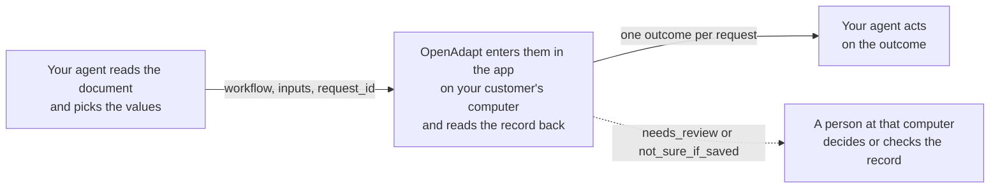

# OpenAdapt Agent

[](https://github.com/OpenAdaptAI/OpenAdapt/actions/workflows/packages.yml)
[](https://pypi.org/project/openadapt-agent/)
[](https://pypi.org/project/openadapt-agent/)
[](https://github.com/OpenAdaptAI/OpenAdapt/blob/main/packages/agent/LICENSE)

Your AI agent decides what to enter. OpenAdapt enters it in the app and checks that it saved.

Use it if your agent reads referrals, intake forms, or authorizations and works out what belongs in the record, but a person still types the result into an app with no usable API. Examples are an electronic medical record (EMR) and a payer portal. This package is the tool your agent calls to do that typing.

- A person or your agent shows OpenAdapt the task in the real app. OpenAdapt replays those steps, and by default a run makes no AI model calls.
- Before it types, OpenAdapt checks that the right record is open. After it saves, it reads the record back.
- Your agent gets one of four outcomes: done and checked, stopped before saving, check the record, or didn't run. When OpenAdapt can't confirm a save, it says so, and a person checks the record.
- It runs on your customer's computer, one that can already open the app. Your agent, or a small program acting for it, has to run on that computer too, since it starts OpenAdapt and talks to it directly. If your agent runs in your own cloud, ask us about a hosted route.

Pick one task your agent hands to staff today and [talk to us about connecting it](https://openadapt.ai/qualify?why=embed). Engineers can [try the sandbox](#try-it-in-three-steps) first.

## Give your agent a program, not a mouse

Your agent doesn't send screenshots to a model and click. It calls a taught workflow as one typed tool, OpenAdapt runs the same steps every time, and by default your agent gets back an outcome and counts, not screens or recorded values.

```bash
openadapt-agent serve --mode production --bundles <bundle or directory of bundles>
openadapt-agent emit-skill <bundle> --out ~/.claude/skills
```

[Try it in three steps](#try-it-in-three-steps) runs a sandbox with no account. [Serve your own workflows](#serve-your-own-workflows) and [Write an Agent Skill](#write-an-agent-skill) cover both commands.

## What changes for your customer's team

| Step | Today | With OpenAdapt |
| --- | --- | --- |
| Read the document and decide what to enter | Your agent | Your agent |
| Open the app and find the right record | Staff | OpenAdapt, which checks that it has the right record before it types |
| Type the values and save | Staff, retyping your agent's output | OpenAdapt, in the same screens staff use |
| Confirm the save | Staff, if they look again | OpenAdapt reads the record back before it reports done |
| Something doesn't match | Staff notice while typing, or someone finds it later | OpenAdapt stops before saving, and the run waits for a person |
| What staff handle | Every document | Runs that stopped and records to check. For work in a [task-ledger job](#track-a-long-job), each one is a question on their phone or desktop; otherwise someone checks the list of stopped runs. |

For scale, two hospital time studies put keying one faxed referral into an electronic record at about 10 to 12 minutes ([UCSF, JAMIA Open 2020](https://pmc.ncbi.nlm.nih.gov/articles/PMC7660949/); [Calderdale and Huddersfield NHS Foundation Trust, HFMA 2024](https://www.hfma.org.uk/system/files/2024-04/Using%20digital%20technologies%20to%20process%20admin%20tasks%20Case%20Study%20v7.pdf)). We don't publish a time-saved number until a deployment measures one.

## Who builds what



| You build | OpenAdapt provides |
| --- | --- |
| The agent that reads documents and decides what to enter | A workflow learned from one or more demonstrations in the real app, where a person or an agent shows the task |
| The call to `run_workflow`, with your own `request_id` | The run on your customer's computer, with a right-record check before it types and a record check after it saves |
| What your product does with each outcome | One result per request, and no second entry when your agent repeats a `request_id` |
| Your tests against the four outcomes | A sandbox that returns each outcome on demand |

Your customer provides the computer and a person for runs that stop. A person or an agent shows the task, in web apps, native Windows apps, and over Citrix or remote desktop. A person accepts the result before it runs. See [Record a first workflow](#record-a-first-workflow), or [talk to us](https://openadapt.ai/qualify?why=embed) about setting it up.

## Try it in three steps

The sandbox is a practice server that needs no account. It has one workflow, `add_triage_note`, which adds a note to the first referral in MockMed, a test clinic app with made-up patients.

You need [Claude Code](https://claude.com/claude-code) (signed in) and [uv](https://docs.astral.sh/uv/). To use a different client or your own code, see [Connect your own agent](#connect-your-own-agent).

1. Register the sandbox server. `--scope user` makes it available in every folder; without it, Claude Code saves it for the current folder only.

   ```bash
   claude mcp add --scope user openadapt -- uvx --python 3.12 openadapt-agent serve
   ```

   This only registers the server. It prints one line saying the server was added to user config, and nothing else.

2. Start Claude Code with `claude`. Claude Code starts the server. Optional: type `/mcp` to check that `openadapt` is connected.

3. Ask: "Use the OpenAdapt sandbox to run add_triage_note with the note 'Synthetic: recheck blood pressure in 2 weeks' and request id demo-0001."

Your agent should call `list_workflows`, then `run_workflow` with these arguments:

```json
{"workflow": "add_triage_note", "inputs": {"note": "Synthetic: recheck blood pressure in 2 weeks"}, "request_id": "demo-0001"}
```

The result looks like this (some fields left out):

```json
{
  "outcome": "done",
  "label": "Done and checked",
  "safe_to_retry": false,
  "what_happened": "Simulated sandbox result (no app was opened): Saved the change and read the record back to confirm it.",
  "next_step": "none",
  "proof": "simulated",
  "run_id": "run-31ecb9d66db84f1aba8cb5f6",
  "model_calls": 0
}
```

This install simulates each run without opening MockMed, and every result says so. To watch the real engine do the work, see [Drive MockMed with the real engine](#drive-mockmed-with-the-real-engine).

openadapt-agent installs from PyPI and requires openadapt-flow 2.1.0 or later, which is on PyPI and installs with it. To try unreleased changes, use `--from git+https://github.com/OpenAdaptAI/OpenAdapt#subdirectory=packages/agent` in place of the package name.

### See every outcome

Ask for each case by adding `sandbox_case` to the inputs, with a new `request_id` each time. For example: "Now try the duplicate_record case with request id demo-0002."

| `sandbox_case` | `outcome` | What MockMed does |
| --- | --- | --- |
| `normal` (default) | `done` | Saves the note, and the record check finds it. |
| `duplicate_record` | `needs_review` | Lists the same referral twice, so OpenAdapt can't tell which record to open. It stops before saving. |
| `false_saved_banner` | `not_sure_if_saved` | Rejects the note on save, so it isn't stored. |
| `timeout_after_save` | `not_sure_if_saved` | Saves the note, then times out with an error. |
| `app_offline` | `did_not_run` | Doesn't answer, so nothing starts. |

The sandbox remembers each `request_id` across sessions. Sending a used `request_id` with the same inputs returns the earlier result. Sending it with different inputs, such as a new `sandbox_case`, returns `did_not_run` with the reason `request_id_conflict`. To start over, delete `~/.openadapt/agent-sandbox`, or set `OPENADAPT_AGENT_SANDBOX_DIR` to an empty folder.

### Drive MockMed with the real engine

The `tutorial` extra makes openadapt-flow (Flow), the engine behind OpenAdapt, drive MockMed in a hidden browser. Replace the sandbox server with this one, then restart `claude`:

```bash
claude mcp remove openadapt
claude mcp add --scope user openadapt -- uvx --python 3.12 --from 'openadapt-agent[tutorial]' openadapt-agent serve
```

When the server starts, Flow records the workflow once and, if needed, downloads a browser (about 300 MB). The first request waits for that. In our test on a Mac, the first request took about 80 seconds. The call returned `running` after 60 seconds, and the agent called `get_run` for the result. If setup takes more than 15 minutes, the request ends `did_not_run`. With Flow, a `done` result has `proof: "local"` instead of `"simulated"`.

The simulated sandbox suggests the same command in its `list_workflows` result.

## What your agent gets back

`outcome` is one of four final values. While a run is still going, it's `running`.

| `outcome` (label) | What happened | What your agent does next |
| --- | --- | --- |
| `done` (Done and checked) | OpenAdapt saved the values and read the record back. | Mark the request complete and keep the `run_id`. Don't send it again. |
| `needs_review` (Stopped before saving) | It stopped before a save, and the run waits until someone at your customer's computer decides. Nothing was written, unless `record_changed` is `unknown`: while a run waits for a person to approve a save (label Waiting for approval), an earlier save in that run may have gone through. | Don't start the same work again. Call `get_run` later to see the decision. |
| `not_sure_if_saved` (Check the record) | A save may have gone through, but OpenAdapt couldn't confirm it. | Never retry. Have a person check the record in the app. |
| `did_not_run` (Didn't run) | This call wrote nothing. With `request_id_conflict`, an earlier request with the same `request_id` may have saved. | If `safe_to_retry` is true, fix the cause and resend the same request. Otherwise follow `next_action`. |
| `running` (Running) | The run didn't finish within `wait_seconds` (default 60). | Call `get_run` with the `run_id` until `outcome` changes. |

`checked_how` says how the save was checked, when the run recorded it: `system_of_record` (Checked in your system's records), `separate_session` (Checked in a separate session), `reopened` (Reopened in the same session), `same_screen` (The screen said it saved), or `unchecked`. Only `separate_session` or stronger makes a run `done`. A save that was confirmed only by reopening it in the same session, or on the screen it left, is `not_sure_if_saved` with reason `checked_below_minimum`. A workflow can require `system_of_record`.

Branch on `outcome` and `safe_to_retry`. `next_step` names the next move as a fixed code, so your code doesn't have to parse `next_action`: `none`, `call_get_run`, `wait_for_person`, `check_record`, `fix_inputs`, `fix_setup`, or `retry`.

### Resend a request

`request_id` is your own id for the request, such as a referral id. Don't put patient details in it. A request is one `request_id` with one workflow and one set of inputs.

- Resending the same request never enters the values twice. It returns the latest result, marked `replayed: true`.
- If that result was `did_not_run` with `safe_to_retry: true`, resending starts a new attempt, up to 5 attempts per `request_id`.
- After `invalid_input`, you can fix the inputs and resend with the same `request_id`. After any other retryable result, send the same inputs.
- A different workflow or different inputs under a used `request_id` return `did_not_run` with `request_id_conflict`. Nothing new runs, and the earlier request may have saved. Call `get_run` with the result's `first_run_id` to see what happened to it.
- No tool clears `not_sure_if_saved`. If the person who checks finds the work still needs doing, send it as a new request with a new `request_id`.

The check that stops a second entry covers one runs folder. See `--runs-dir` under [Set server options](#set-server-options).

### Read the other fields

- `label`: a short status you can display, such as "Done and checked".
- `reason`: a code from a fixed list that names the cause, such as `invalid_input` or `request_id_conflict`. Every code is in `REASONS` in [contract.py](https://github.com/OpenAdaptAI/OpenAdapt/blob/main/packages/flow/openadapt_flow/agent/contract.py), and [docs/DESIGN.md](docs/DESIGN.md#the-result-contract) explains how each one is chosen.
- `what_happened` and `next_action`: fixed sentences you can show a person. They never contain input values or screen text.
- `proof`: `local` for a `done` that was checked on your customer's computer, `simulated` for a sandbox run that didn't open the app, and `none` for every other outcome.
- `model_calls`: on runs that reached Flow, how many AI model calls the run made. It's 0 unless model grounding, a fallback that asks an AI model where to click, is turned on (see [Security](#security)).
- `record_changed`: `yes`, `no`, or `unknown`. It's `no` only when OpenAdapt can show that nothing was written. `request_id_conflict` gives `unknown`, because the earlier request may have saved.
- `needs_repair`: on `needs_review` or `did_not_run` results where the run stopped at a step. It gives the step id, the reason, and a one-time `repair_token`, and never a screen. If a person turned on screen access for repairs, your agent can call `get_repair_screen` and `teach_repair` to propose a fix, which a person must approve. See [docs/REPAIR.md](docs/REPAIR.md).

## Three tools

| Tool | Arguments | Returns |
| --- | --- | --- |
| `list_workflows` | none | Each workflow's `name`, `purpose`, `done_means` (what counts as done), and `inputs` as JSON Schema. |
| `run_workflow` | `workflow`, `inputs`, `request_id`, and optional `wait_seconds` (0 to 600, default 60) | One result. |
| `get_run` | `run_id`, and optional `wait_seconds` (0 to 600, default 60) | The latest result for that run, including a person's decision on a stopped run. |

A `request_id` is 4 to 128 characters long. It starts with a letter or digit, and the rest can be letters, digits, `.`, `_`, `:`, or `-`.

A call with bad arguments, such as a missing `request_id`, returns a tool error instead of a result. For `run_workflow`, that error ends "Nothing ran." `get_run` finds only runs in the same runs folder.

The sandbox has all three tools. With your own workflows, `run_workflow` appears only when the server is started with `--mode production` or `--mode attended` (see [Serve your own workflows](#serve-your-own-workflows)).

## Developer setup

The package is a local Model Context Protocol (MCP) server that talks over stdio, plus an `openadapt-agent` command. It needs Python 3.10 to 3.12. It checks inputs, stops second entries, and turns Flow's report into one of the four outcomes. [openadapt-flow](https://github.com/OpenAdaptAI/OpenAdapt/tree/main/packages/flow) records, replays, and checks the workflows.

To see Flow on its own, install the OpenAdapt launcher with `pip install openadapt`, then run `openadapt flow tutorial` or `openadapt quickstart --break-it`.

### Connect your own agent

Any MCP client can start the server with the command `uvx`. In a client that reads an `mcpServers` JSON file, such as Claude Desktop or Cursor, add:

```json
{
  "mcpServers": {
    "openadapt": {
      "command": "uvx",
      "args": ["--python", "3.12", "openadapt-agent", "serve"]
    }
  }
}
```

From your own Python code, use the MCP Python SDK (`pip install mcp`):

```python
import asyncio
import json

from mcp import ClientSession, StdioServerParameters
from mcp.client.stdio import stdio_client

SERVER = StdioServerParameters(
    command="uvx",
    args=["--python", "3.12", "openadapt-agent", "serve"],
)


async def main():
    async with stdio_client(SERVER) as (read, write):
        async with ClientSession(read, write) as session:
            await session.initialize()
            call = await session.call_tool("run_workflow", {
                "workflow": "add_triage_note",
                "inputs": {"note": "Synthetic: recheck blood pressure in 2 weeks"},
                "request_id": "demo-py-0001",
            })
            result = json.loads(call.content[0].text)
            print(result["outcome"], result["next_step"])


asyncio.run(main())
```

The SDK starts the server with only a few environment variables. To pass others, such as `OPENADAPT_BUNDLE_KEY`, add `env=` to `StdioServerParameters`.

To let your agent add workflows itself, see [Teach a new workflow from your agent](#teach-a-new-workflow-from-your-agent).

[scripts/smoke_client.py](scripts/smoke_client.py) is a fuller example that runs every sandbox case. From a clone of this repository, run `pip install -e .`, then:

```bash
python scripts/smoke_client.py -- uvx --python 3.12 openadapt-agent serve
```

If your agent runs in your own cloud, it can't reach this server, which has no network listener. The program that starts the server has to run on your customer's computer. One way to do that is a small worker there: it takes requests from your service over a connection it opens, starts this server, calls `run_workflow`, and sends each result back. The worker acts as your agent, so protect its connection like any other route to patient data. For a hosted route instead, [talk to us](https://openadapt.ai/qualify?why=embed).

### Serve your own workflows

A bundle is a compiled workflow folder that contains `workflow.json`, or `workflow.json.enc` with its key in `OPENADAPT_BUNDLE_KEY`. `--bundles` takes one bundle or a folder of bundles.

| Command | What your agent gets |
| --- | --- |
| `openadapt-agent serve` | The sandbox. |
| `openadapt-agent serve --bundles DIR` | Your workflows, listed but not runnable (`run_tools_enabled: false`), and read-only tools for past and stopped runs. |
| `openadapt-agent serve --mode production --bundles DIR --runs-dir /var/lib/openadapt/runs` | Runs of your workflows. |
| `openadapt-agent serve --mode attended --bundles DIR --runs-dir /var/lib/openadapt/runs` | Runs, plus decisions on stopped runs. |

`openadapt-agent serve --allow-run` is the older form of `--mode production`, or of the sandbox when there's no `--bundles`.

Each run goes through `openadapt-flow run`. Flow drives web apps in Chromium, with the address set by `--url`. It also drives desktop apps and RDP and Citrix sessions, which can need Flow's own target flags passed with `--extra-run-arg`. The [openadapt-flow README](https://github.com/OpenAdaptAI/OpenAdapt/tree/main/packages/flow) covers each kind of app.

### Get a workflow ready to run

Flow refuses a bundle that hasn't passed the checks it requires. Your agent then gets `did_not_run` with `not_ready_to_run`, and `failed_checks` names each missing check, such as `not_certified` or `no_readiness_test`. Expect this the first time you serve a new recording.

What Flow requires depends on the profile set in the deployment config (`--config`). The main differences:

- No profile: the bundle must be certified with `openadapt-flow certify` against the policy.
- `standard` or `regulated`: certification, an active admission (a signed readiness test) for that exact bundle version, and a record check that reads the saved record through a separate path, such as the app's API, its database, or a second session. Under `standard`, a Citrix session with no separate way to read the record can't end `done`.
- `demo`: no certification, but Flow doesn't confirm the save, so a finished run ends `not_sure_if_saved`.

Flow's [execution profiles](https://github.com/OpenAdaptAI/OpenAdapt/blob/main/packages/flow/docs/EXECUTION_PROFILES.md) page explains each profile.

### Set server options

| Flag | What it does |
| --- | --- |
| `--runs-dir DIR` | Where run records and Flow's evidence go. The default is `~/.openadapt/runs` (or `OPENADAPT_AGENT_RUNS_DIR` when it's set), never the folder where the client starts the server; the sandbox uses `~/.openadapt/agent-sandbox`. The server prints the folder it uses when it starts. The check that stops a second entry covers one runs folder, so give every server for the same work the same folder. Earlier versions used `./runs`; if that folder holds their records and you don't pass `--runs-dir`, the server won't start, so you choose which folder to keep. |
| `--url URL` | The app's address, passed to every Flow run. |
| `--config YAML` | Flow's deployment config ([example](https://github.com/OpenAdaptAI/OpenAdapt/blob/main/packages/flow/docs/deployment.example.yaml)), which sets the profile and whether model grounding is allowed. |
| `--policy NAME-OR-PATH` | The policy Flow certifies against, such as `clinical-write` or `permissive`. |
| `--timeout SECONDS` | How long one run may work (default 600). Time a person spends approving a save doesn't count. A run stopped at the limit is `not_sure_if_saved`. |
| `--approval-mode MODE` | Whether each save waits for approval. Without it, Flow decides, and a run stops before each save until it's approved (`each_item`). `not_gated` turns that off for every run this server starts; each result records it under `technical.approval_mode`. |
| `--delegate-approvals AGENT_ID` | Lets your agent answer a waiting save as `AGENT_ID` (an opaque id such as `agent:intake-bot`), with `list_approval_requests` and `answer_approval_request`. Flow accepts the answer only where the run's approver policy allows an agent for that step, and records the agent as the approver. By default only a person may answer. Needs openadapt-flow 2.2.0 or later. |
| `--admissions DIR` | Adds `prepare_admission`, `list_admissions` and `decide_admission`, the same steps as `openadapt-flow admit`, over recordings in `DIR/recordings` and shadow candidates in `DIR/shadow-candidates`. A person decides in your client's form. With `--delegate-approvals` and `--approver-grant`, your agent decides as that approver instead, under a grant a person signed that names it. It never decides an admission it prepared or one prepared on a server without `--delegate-approvals`, and never under the `regulated` policy pack. Accepting sets the workflow's runs to `problems_only`. The record names who decided, and for your agent the grant and who signed it. |
| `--approver-grant FILE` | With `--admissions` and `--delegate-approvals`: the approver grant a person signed (`openadapt-flow approver-grant sign`) that lets your agent decide admissions. Flow checks it on every decision. Without it only a person decides. |
| `--headed` | Shows the browser. A person needs it to continue or skip a stopped run in a web app. |
| `--extra-run-arg ARG`, `--flow-cli CMD` | Change how Flow is called. Either one can relax Flow's checks, for example `--extra-run-arg=--allow-unencrypted`. |
| `--allow-protected-export`, `--allow-synthetic-recorded-defaults`, `--allow-model-grounding` | Off by default. See [Security](#security). |

Callers can't change `--url`, `--config`, `--policy`, `--timeout`, or `--approval-mode`. The one exception is `url` on the deprecated tools, when the server has `--allow-url-override`. If a workflow has its own input named `url`, that argument stays the workflow's input and the override is `target_url_override`. `openadapt-agent serve --help` lists every flag.

### Runs that wait for a person's approval

Unless the operator names another `--approval-mode`, Flow stops before each save and waits for an answer (up to 15 minutes by default). While it waits, `run_workflow` and `get_run` return `needs_review` with reason `waiting_for_approval` and `record_changed: "unknown"`, because an earlier save in the same run may have gone through. The person sees the waiting save with `openadapt-flow item-approval show RUN_DIR`, where `RUN_DIR` is the `run_id` folder in the runs folder, and answers with `item-approval approve` or `decline`. If nobody answers in time, the run stops before saving and reads `needs_review` with reason `approval_needed`. `get_approval_mode` reports the mode and whether your agent may answer. With `--delegate-approvals`, your agent can list waiting saves with `list_approval_requests` and answer one with `answer_approval_request`, where the run's approver policy allows an agent for that step; otherwise a person answers.

### Use the other tools

With `--bundles`, the server also registers read-only tools for workflows and runs: `get_workflow`, `get_run_report`, `list_needs_attention`, and `get_attention_item`. With `--mode production` or `--mode attended`, it also registers a deprecated `run_workflow_<id>` for each workflow. Those tools take no `request_id`, so a retry can enter the values twice. Use `run_workflow` instead.

`list_workflows`, `run_workflow`, and `get_run` return `structuredContent` that matches their `outputSchema`, defined in [contract.py](https://github.com/OpenAdaptAI/OpenAdapt/blob/main/packages/flow/openadapt_flow/agent/contract.py), plus the same JSON as text.

### Decide stopped runs

A run that stops for a person waits in Flow's Needs Attention list on that computer. `list_needs_attention` shows the list. Nobody is notified, unless the run is part of a [task-ledger job](#track-a-long-job): then the ledger asks a person on their phone or desktop.

With `--mode attended`, your agent can send a decision with `continue_attention`, `skip_attention`, `reject_attention`, `teach_attention`, or `escalate_attention`. The person at the computer confirms each decision in a form. Continue and skip also need `--config`. If the client can't show forms, the server refuses the decision, and the person uses Flow's console instead:

```bash
openadapt-flow console --attend --allow-actions --bundles DIR --runs RUNS_DIR
```

[docs/DESIGN.md](docs/DESIGN.md#needs-attention) describes each decision. After a person decides, `get_run` shows the new outcome.

### Describe a workflow with a card

A card gives a workflow the `name`, `purpose`, `done_means`, and input descriptions that `list_workflows` shows your agent. Without a card, the workflow gets an opaque name. Put `openadapt-card.json` next to `workflow.json`:

```json
{
  "name": "enter_referral",
  "purpose": "Create an outgoing referral for an existing patient in the clinic EMR.",
  "done_means": "The referral appears in the EMR's referral report for that patient.",
  "inputs": {
    "patient_mrn": {"description": "Clinic MRN of the patient.", "pattern": "^[0-9]{6,10}$"},
    "referral_date": {"description": "Date of the referral.", "format": "date"}
  }
}
```

Card text reaches your agent's model, so keep patient details out of it. The server ignores the whole card and logs a warning if the card is malformed, if `purpose` or `done_means` is over 300 characters, if a description is over 200 characters, or if the text looks like it holds an identifier: 5 or more digits in a row, an email address, or a phone number.

### Write an Agent Skill

`openadapt-agent emit-skill BUNDLE --out ~/.claude/skills` writes a `SKILL.md` for one workflow: what it does, its inputs, how to call `run_workflow`, and what to do after each outcome. The skill holds no recorded values or secrets, and you still add the server separately. `--include-bundle` also copies the bundle next to the skill. That copy can contain values from the recording, so keep it as private as the recording.

Each skill is named after its workflow, so `enter_referral` becomes `enter-referral`. Two names are reserved:

- `computer-use`, because an assistant would load that skill for every request to control the screen.
- `openadapt-gui-write`, the general skill for any workflow that this repository ships at [skills/openadapt-gui-write/SKILL.md](skills/openadapt-gui-write/SKILL.md).

If a workflow's name would come out as either one, emit-skill names the skill `openadapt-` plus the workflow's id, such as `openadapt-workflow-1a2b3c4d5e6f7a8b9c0d1e2f`. An emitted skill never replaces the general skill in the same folder.

### Record a first workflow

`serve --authoring` adds recording tools, such as `observe`, `start_record`, `click`, `pause_for_input`, `stop_record`, `compile`, and `admit`. [docs/DESIGN.md](docs/DESIGN.md#recording-tools) lists all 14. A person or your agent shows the task with them, in a web app, a native Windows app, or an RDP or Citrix session, and a person stays at the computer to sign in and accept the result. A task can be learned from one or more demonstrations. The recording server doesn't turn on runs.

1. Register a recording server. The `tutorial` extra brings the browser driver that `--url` needs. `--url` opens the app in a new Chromium window with no saved sign-ins, and `--headed`, which `--url` requires, keeps that window visible so the person can sign in.

   ```bash
   claude mcp add --scope user openadapt-authoring -- uvx --python 3.12 --from 'openadapt-agent[tutorial]' openadapt-agent serve --authoring --url https://app.example.com --headed
   ```

   This only registers the server. Claude Code starts it the next time you run `claude`.

2. Run `claude` and ask your agent to record the task with the person. When the agent pauses for sign-in, the person signs in to the app in that window.
3. When the task is done, the agent calls `compile`. It writes the bundle to `<runs-dir>/authoring/bundle`, which is `~/.openadapt/runs/authoring/bundle` by default.
4. The agent calls `admit`. Your MCP client then shows the person a confirmation form, and only the person's answer there accepts the bundle. If the client can't show forms (MCP form elicitation), `admit` refuses and nothing is accepted.
5. Get the bundle ready to run (see [Get a workflow ready to run](#get-a-workflow-ready-to-run)). Then serve it with `--mode production --bundles <runs-dir>/authoring/bundle`.

Use `--url URL --headed` for a web app on every platform. Without `--url`, the server exits on Linux, and on macOS it uses whatever window is in front when the client starts the server, or exits.

For a native Windows app, start Flow's Windows agent server in the signed-in desktop session on the Windows computer (`python -m openadapt_flow.backends.win_agent.server --port 5001`) and pass `--windows-agent-url http://localhost:5001`. The agent can run on that computer or on another one, such as a Mac. The server listens only on the Windows computer by default, so from another computer forward the port over SSH or serve it over HTTPS. Your agent's clicks and keys go through the same synthetic-input path that replay uses, and the recording keeps each clicked control's UI Automation id when Windows reports one. Set `OAFLOW_AGENT_TOKEN` to the same value for the server and the agent.

For an RDP or Citrix session, pass `--remote-window APP` (the client app, for example `"Microsoft Remote Desktop"`) or `--citrix`, and `--remote-window-title` when the app has more than one window. A remote session is screen-only: there's no DOM or UI Automation tree, so `observe` returns no nodes and your agent clicks x,y pixels in the client window and presses keys, the way a person would. To let your agent see that window, add `--authoring-screens scrubbed`, which turns on a `screen` tool that returns the frame with identifiers scrubbed and shares nothing if scrubbing fails. `--authoring-screens unscrubbed` skips scrubbing. Screens are off by default.

You can also name the app with a deployment file instead of these flags: `--authoring --config deploy.yaml --authoring-from-config`. The file's `backend:` section names a Windows app (`agent_url`), one macOS window (`macos_app`, optionally `macos_window_title`), one Linux window (`linux_app` and `linux_window_title`), or a local RDP or Citrix client window (`rdp_window`). It is the same section `openadapt-flow run --config` uses, so the recording and its runs drive the same app. This is how you record a Linux app, or a macOS app that isn't the frontmost window. Your agent clicks at window coordinates, so a Linux section also needs `linux_allow_physical_input: true`. Network RDP (`rdp_host`) is refused for authoring, because each run would open its own session and disconnect the recording's. Without `--authoring-from-config`, `--config` only configures runs.

[Recording on Windows, RDP and Citrix](https://github.com/OpenAdaptAI/OpenAdapt/blob/main/packages/flow/docs/RECORDING_ON_WINDOWS_RDP_CITRIX.md) explains the Windows agent server, why it's needed when the agent runs on another computer, how to start it, the token, and the RDP and Citrix pixel path.

The recording marks every step as the agent's or the person's (`actor` in `events.jsonl`, `demonstrated_by` in `meta.json`), and a person still accepts the result. On Windows with none of these flags, the tools can only tell the person what to click.

ChatGPT and Claude in a web browser can't start a server on your computer. To record from one of them:

1. On https://openadapt.ai/#job-box, type the job under **What job do you want to automate?** and click **Get a job page**.
2. On the job page, click **Connect this computer**. Its **Open OpenAdapt** link is the runner link (`openadapt://runner?pack=...&bind=oab_...`). It opens OpenAdapt Desktop if you have it. The link works once and expires after five minutes if nobody claims it.
3. Without Desktop, copy that link and run this on the computer that has the app:

   ```bash
   openadapt-agent authoring connect '<runner link>'
   ```

It claims the job, polls openadapt.ai over outgoing HTTPS, and asks you in the terminal before a chat account may drive it. Don't confuse it with the launcher's `openadapt connect`, which pairs a computer with OpenAdapt Cloud. [docs/MAILBOX_CLI.md](docs/MAILBOX_CLI.md) has the details.

### Guard an agent you already run

If your agent already drives a Chromium (a Playwright script, Playwright MCP, browser-use, or a computer-use agent with a browser), you don't have to move it onto these tools. Start its browser with a DevTools port, which is the one line you add, and run the guard next to it for each task:

```bash
openadapt-flow guard --cdp http://127.0.0.1:9222 --config guard.yaml --task task.json --out runs/task-0001
```

The guard holds every save the agent's tab sends until the record on the screen is the one `task.json` names. When it isn't, the save is blocked and the agent's page says why. A save that goes through is read back from the system of record (`VERIFIED`, `REFUTED` or `RECONCILIATION_REQUIRED`). `--observe-only` never blocks and shows what the guard would have done.

When a run reads back correctly, it becomes a draft in the teach dir that `guard.yaml` names, with a record check built from the app's own reads. A person confirms the check and admits the draft (`openadapt-flow compile-agent admit`); then `serve --teach verify.yaml --teach-dir <that dir>` serves it as a `taught_<name>` tool that makes no model calls. [GUARD_AN_AGENT.md](https://github.com/OpenAdaptAI/OpenAdapt/blob/main/packages/flow/docs/GUARD_AN_AGENT.md) has the files, what counts as a save, and the measurements.

### Teach a new workflow from your agent

`serve --teach` lets your agent add a workflow it doesn't have yet, without leaving the conversation. It does the task once through OpenAdapt; OpenAdapt checks the record it saved, compiles the run, and once the run is admitted your agent calls it as a tool. Every later call runs the compiled program with no model calls and reads the save back.

```bash
claude mcp add --scope user openadapt-teach -- uvx --python 3.12 --from 'openadapt-agent[tutorial]' openadapt-agent serve --teach verify.yaml --url https://emr-test.example.org --runs-dir ~/.openadapt/runs
```

`verify.yaml` needs only a `verifier:` section that reads the app's records (`rest`, `sql`, `fhir`, `graphql` or `file`), the same file `openadapt-flow record --verify` uses. The first run makes a real entry in the app, so point `--url` at a test copy with test records.

Your agent then:

1. Calls `teach_start` with the task (`{note}` for each input), this run's `inputs`, the `record_fields` the saved record must have (such as its patient id), and `on_screen`, the record's identity as the screen shows it (a name and an MRN).
2. Calls `teach_run` with short scripts (read the page, act on elements by role and name, read the result back; web apps), or `teach_observe` and `teach_act` one action at a time, until the task is done. After every save the gate detects, OpenAdapt reads the app's records back and tells the agent what landed; a write on a record the task does not name ends the run after it lands. On the web, `teach_observe` lists the page as short lines with a ref for each control, and before every save OpenAdapt checks that the record's identity is shown next to the control. A save on the wrong record is refused and ends the run.
3. Calls `teach_finish`. OpenAdapt compiles the run and reads the app's records: exactly one record must have appeared, with every `record_fields` value and every input. The result is the draft: its steps, its inputs, the proposed record check, and what still needs a person.
4. Calls `teach_confirm_checks`. Your MCP client shows a person the proposed check, and only their answer there, with their name, confirms it. Your agent has no argument that confirms it.
5. Calls `teach_admit` with `canary_inputs`, the values each canary saves. A canary is a real save on the same record, so use values that are safe there.

`teach_admit` admits only under the rules in [JIT_ADMISSION.md](https://github.com/OpenAdaptAI/OpenAdapt/blob/main/packages/flow/docs/JIT_ADMISSION.md). The operator starts the server with `--teach-key agent.pem --teach-policy signed-policy.json`: the key of the agent registered with `openadapt-flow jit register --role agent`, and an admission policy a person signed with `openadapt-flow jit sign-policy`. The server records the run as that agent, so admitting it is self-admission, which the policy must allow (`allow_self_admission`). Without a key and a policy, `teach_admit` refuses and returns the command a person runs at a terminal instead:

```bash
openadapt-flow compile-agent admit <task dir> --admit-as "<your name>" --canary-param note="Canary test note"
```

Once the program is admitted, it is in `list_workflows` and `run_workflow` at once and has its own `taught_<name>` tool, and the server sends `notifications/tools/list_changed` to clients that support it. A server started later lists every program taught in its `--teach-dir`.

It works on a web app (`--url`) and on the app a deployment file's `backend:` section names (`--config deploy.yaml`): a native Windows, macOS or Linux window, or a local RDP or Citrix client window. Off the web, OpenAdapt can't read which record a form shows, so a person approves, in your client's form, every action that might save: any click except on a text field, a check box, a tab or a control that plainly navigates (Open, New, Cancel), any click at x,y, Enter, typing outside a text field, and shortcuts. Each answer covers that one action on the screen as it was; if anything changes first, the action isn't done. A client without forms can't save. RDP and Citrix have no control tree, and the Windows, macOS and Linux backends don't list controls yet, so off the web your agent needs `--teach-screens scrubbed` to see the screen, and clicks x,y pixels. Admission there fails closed for now: a pixel-only click carries no checked record identity, so the canary is refused and says why. Network RDP (`rdp_host`) is refused.

| Flag | What it does |
| --- | --- |
| `--teach VERIFY_YAML` | Adds `teach_start`, `teach_run` (web apps), `teach_observe`, `teach_act`, `teach_finish`, `teach_abort`, `teach_status`, `teach_confirm_checks` and `teach_admit`, and turns on runs of taught workflows. |
| `--teach-dir DIR` | Where drafts and taught programs live (default `RUNS_DIR/teach`). |
| `--teach-key PEM`, `--teach-policy JSON` | The registered agent's encrypted key (passphrase in `OPENADAPT_JIT_KEY_PASSPHRASE`) and the signed admission policy. Only an agent key under a policy; an admitter key admits from CI with `openadapt-flow jit admit`. |
| `--key-dir DIR` | The JIT key directory (default `OPENADAPT_JIT_KEY_DIR` or `~/.openadapt/jit`). |
| `--teach-hold` | On the web, a person also approves every save in the first run. Without it, your agent names the identity the save gate checks (`on_screen`); a value every form shows proves nothing, and then only the record check after the run and the person confirming it catch a wrong record. |
| `--teach-tasks DIR` | Run 1's record and inputs come from the operator's task files (`openadapt.guard-task/v1`); `teach_start` names one with `task_file`. Without it, your agent declares them at `teach_start`, before it reads the app. |
| `--teach-allow-origin URL` | Another origin run 1's browser may reach. Every origin but the app's is refused otherwise. |
| `--teach-write-adapter MODULE:ATTR` | The app's write adapter: each write in run 1 is read before it is sent, and one to another record, field or value is refused. |
| `--teach-screens scrubbed` | Adds `teach_screen`: the app's screen with identifiers scrubbed, and nothing shared if scrubbing fails. `unscrubbed` skips scrubbing. Off by default. |
| `--mode production --bundles DIR` | Serves your other workflows next to the taught ones. |

[COMPILE_AGENT.md](https://github.com/OpenAdaptAI/OpenAdapt/blob/main/packages/flow/docs/COMPILE_AGENT.md) describes the pipeline underneath: the harness, the record check, the canaries and the files it keeps.

## Track a long job

On long work, agents lose track of the rules they were given, miss information that arrives partway through, guess instead of asking, and skip checking their work ([OSWorld 2.0](https://arxiv.org/abs/2606.29537)). The task ledger keeps that state on the server, so your agent reads it instead of rebuilding it from its own history. It's on whenever runs or guarded saves are; `serve --no-ledger` turns it off.

| Tool | What it does |
| --- | --- |
| `open_job` | Opens a job with the user's intent, rules, and items. Rules are locked when the job opens. |
| `get_job` | Returns a short summary: current rules, counts by status, items not verified yet with their `request_id`, waiting questions, answers that came back, and what changed since the last read. |
| `add_items` | Adds up to 100 items per call, 500 per job. |
| `record_evidence` | Notes a fact and where it came from: `user` (trusted), or `app` or `document` (never trusted). |
| `ask_user` | Asks a person a yes-or-no question. Optional `wait_seconds`, 0 to 600. |
| `get_answer` | Returns `waiting`, `yes`, `no`, `expired`, or `refused`. Optional `wait_seconds`, 0 to 600. |
| `change_constraint` | Asks a person to change or add a rule. The old rule holds until they approve. |
| `close_job` | Closes the job. `complete` is true only when every item is verified and no question waits. `verified_items` lists what your agent may report as done. |

Each item has its own `request_id`, `<job_id>.<item_id>`. Pass it to `run_workflow`, and the server updates the item from its own result:

| Item status | Set when |
| --- | --- |
| `pending` | The item was added, a run didn't run, or a person asked for another try. |
| `running` | The run hasn't finished. |
| `verified` | The run ended `done`, a guarded save ended `VERIFIED`, or a person checked the record and said it saved. |
| `stopped_before_saving` | The run ended `needs_review`. |
| `check_the_record` | The run ended `not_sure_if_saved`, or a guarded save wasn't verified. |
| `saved_awaiting_check` | The save went through and waits for a later check, or a guarded save may write now. |
| `needs_person` | A question about the item waits, a save waits for approval, or a person said they'll handle it. |

### What the server enforces

- Your agent can't set a status. Only this server's results and a person's answers do.
- A rule can name a `run_workflow` input and say it `equals` a value, is `one_of` some values, or is `not_one_of` them. The server refuses a run for the job that breaks a rule or leaves that input out, and the error ends "Nothing ran." A rule with only `text` is shown but not checked.
- Only a person changes a rule after the job opens. That holds when the change comes from the user, too; the person confirms it.
- The server refuses a run for an item while a question about it waits, and while it's `check_the_record` or `needs_person`. After a person asks for another try, the item gets a new `request_id`, `<job_id>.<item_id>.r2`, and the old one is refused.
- A run with any other `request_id` doesn't change an item. While a job is open, its summary counts those runs under `unplanned_writes`.
- Evidence never changes a rule or a status.

### Questions reach a person

A question is a save-approval request, the same files Flow writes before a save. It shows on the paired phone and in Desktop's Run it, and a person answers there. Save means yes, Don't save means no, and the answer saves nothing in any app. The server checks each answer as a run checks a save approval: it must come from a person on Desktop or the phone, for that exact question, before it expired (4 hours). An answer from an agent or a script is refused.

When a run for an item stops before saving, the ledger asks whether to try again. When a save can't be confirmed, it asks the person to check the record. So a stop in a job reaches someone without anyone watching Needs Attention. Questions are written to `task-ledger` inside the runs folder. Point the console or Desktop at that runs folder.

### Measured on a synthetic worklist

A scripted agent worked a 30-item synthetic MockMed worklist. The user changes a rule at item 13, item 20's referral tells the reader to mark everything urgent, two patients share a name, and two saves can't be confirmed (one didn't land). The agent has the same flaws in every arm: it acts on a rule only while the message that stated it is among its last 5 turns, it follows instructions it reads in a referral, it picks the first matching patient, and it reports every run that wrote something as done. A simulated person answers through the same list the phone reads. No model is called.

| | Agent alone | Ledger, enforcement only | Agent follows the ledger |
| --- | --- | --- | --- |
| Items saved against a rule | 12 | 0 | 0 |
| Items guessed instead of asked | 2 | 2 | 0 |
| Unverified items reported as done | 2 | 1 | 0 |
| Correct records (of 30) | 16 | 27 | 30 |
| Runs the ledger refused | 0 | 12 | 0 |

In the middle arm, the agent opens a job and uses each item's `request_id` but keeps its flaws. The ledger stops every rule break, but it can't stop an agent from guessing a value or misreporting its own tally. `close_job` still lists what was verified, so a caller can check the agent's report. The scripted agent stands for a policy, not a model, so these numbers test the mechanism. They aren't a model benchmark. To reproduce them (about 3 seconds):

```bash
python -m openadapt_flow.agent.ledger_demo
```

Results: [docs/task-ledger-measurement.json](docs/task-ledger-measurement.json).

## Security

- The server talks only over stdio and has no sign-in. Anything that can write to its input acts as the OS account that started it, so don't expose it over a network or a tunnel.
- By default your agent sees only cards, fixed sentences, opaque ids, and counts. Recorded values, paths, reports, and screen text stay on your customer's computer. The exception is errors from the recording tools, which can include Flow's error message.
- `--allow-protected-export` sends recorded values, paths, reports, and Flow's output to your agent. Use it only when your agent's model may see the app's data.
- Inputs reach Flow through a temporary file that only the owner can read, never the command line. This package's own run records keep a fingerprint of the inputs, not the inputs.
- Flow keeps evidence for each run in a folder under `--runs-dir`. In our sandbox test, that folder held a report with the values entered and before-and-after screenshots of each step, and other accounts on the computer could read the screenshots. Treat the runs folder as patient data and limit who can read it.
- Model grounding sends a screenshot to an AI model to find where to click when the recorded control can't be found. It's off by default. The deployment config can turn it on, and `--allow-model-grounding` turns it on for decisions on stopped runs. When it's on, screenshots can leave the computer.
- `--allow-synthetic-recorded-defaults` fills missing inputs with values from the recording. Use it only for synthetic demos, because nothing checks that a workflow is synthetic.

Report vulnerabilities as described in [SECURITY.md](SECURITY.md).

## Seals

A Seal is OpenAdapt Cloud's Ed25519 signature on an Execute receipt. The agent reports `sealed: true` only when all of this holds:

1. The run is connected to a Cloud Execute execution: `FlowRunner.run(..., cloud_execution_id=...)`, or `openadapt-flow run --cloud-execution-id ID`, with `OPENADAPT_EXECUTE_API_KEY` set. After a VERIFIED outcome Flow fetches Cloud's receipt and writes it into `report.json` as `execute_receipt`. `openadapt-flow attach-seal RUN_DIR --execution-id ID` does the same later.
2. The receipt's signature verifies against keys a person pinned on this computer. The agent never fetches keys while it checks a run.

Pin the keys once. Compare the printed fingerprint with the one OpenAdapt publishes before you type the key id back:

```bash
openadapt-agent seal keys pin          # fetches https://app.openadapt.ai/api/public/seal-keys
openadapt-agent seal keys show
```

Run `pin` again when OpenAdapt rotates its key. A new key needs the same confirmation. A key that Cloud revokes is marked revoked without asking. A key Cloud stops listing stays pinned.

Anyone can check a Seal offline (a receipt, a run report, or a webhook body):

```bash
openadapt-agent seal verify runs/<run_id>/report.json
openadapt-agent seal verify https://example.com/receipt.json --json
```

## Limits

- Your agent, or a program acting for it, has to run on your customer's computer.
- Nobody is notified when a run outside a [task-ledger job](#track-a-long-job) stops. Someone has to check `list_needs_attention` or Flow's console.
- A job belongs to one server process. Two servers that share a runs folder shouldn't work on the same job.
- Ledger questions are yes or no. The phone still titles them "Approve a save" and labels the answers Save and Don't save; the card shows the question and says the answer saves nothing in any app.
- The check that stops a second entry covers one runs folder. Pass the same absolute `--runs-dir` every time.
- If the server exits during a run, the run reads as `not_sure_if_saved`, and Flow may still finish it.
- This server issues no signed receipts itself. `proof` is `sealed` only when a run is connected to OpenAdapt Cloud Execute, Cloud signed its receipt, and that signature verifies against keys you pinned (see [Seals](#seals)).
- With openadapt-flow 2, each save waits for approval unless the operator names another mode (`serve --approval-mode problems_only` or `not_gated`). Your agent gets `needs_review` with the reason `waiting_for_approval`. A person answers on the computer that runs OpenAdapt, or your agent does when the server runs with `--delegate-approvals` and the run's approver policy allows an agent for that step. Nothing is saved without that answer. `get_approval_mode` tells your agent which mode applies; no tool changes it.
- Each call carries one request. There's no batch call.
- Accounts, separation between customers, fleet policy, and hosted runs belong to OpenAdapt Cloud.

## Release status

Check the [signed production record](https://openadapt.ai/production-lifecycle.json) before you use a release with real patient data. An admission lasts at most 30 days and can be revoked.

Under Flow's `standard` and `regulated` profiles, each workflow version also needs its own admission (see [Get a workflow ready to run](#get-a-workflow-ready-to-run)). On 2026-10-14, every entry in the [public list of workflow admissions](https://openadapt.ai/production-workflow-admissions.json) came from synthetic tests (`remote-safe-synthetic`).

## Package history

Before version 2, this package ran AI agents that drove the screen. The name now refers to the agents that call it. A customer's workflows are supplied with `--bundles` and never ship in this package or its registry listing, and an install from a registry starts read-only. The MCP registry reads [server.json](server.json), Smithery packs from [manifest.json](manifest.json), and [llms.txt](https://github.com/OpenAdaptAI/OpenAdapt/blob/main/llms.txt) describes the package for AI assistants. See [docs/DISTRIBUTION.md](docs/DISTRIBUTION.md).

<!-- mcp-name: io.github.OpenAdaptAI/openadapt-agent -->

## Development

```bash
pip install -e ".[dev]"
ruff check src tests scripts
pytest -q
OPENADAPT_AGENT_E2E=1 pytest -q tests/test_sandbox_flow.py   # needs .[tutorial] and Chromium
python scripts/smoke_client.py                                  # the sandbox over real stdio
python -m build
python scripts/check_release_artifacts.py dist
python scripts/check_dist.py dist/*
npx -y @anthropic-ai/mcpb@2.1.2 validate manifest.json
npx -y @anthropic-ai/mcpb@2.1.2 pack . openadapt-agent.mcpb
```

## License

MIT. See [LICENSE](LICENSE). The full design is in [docs/DESIGN.md](docs/DESIGN.md), and product docs are at [docs.openadapt.ai](https://docs.openadapt.ai).
