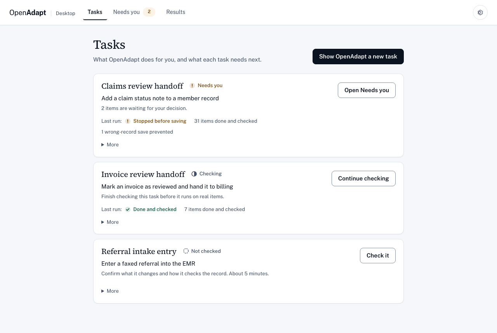
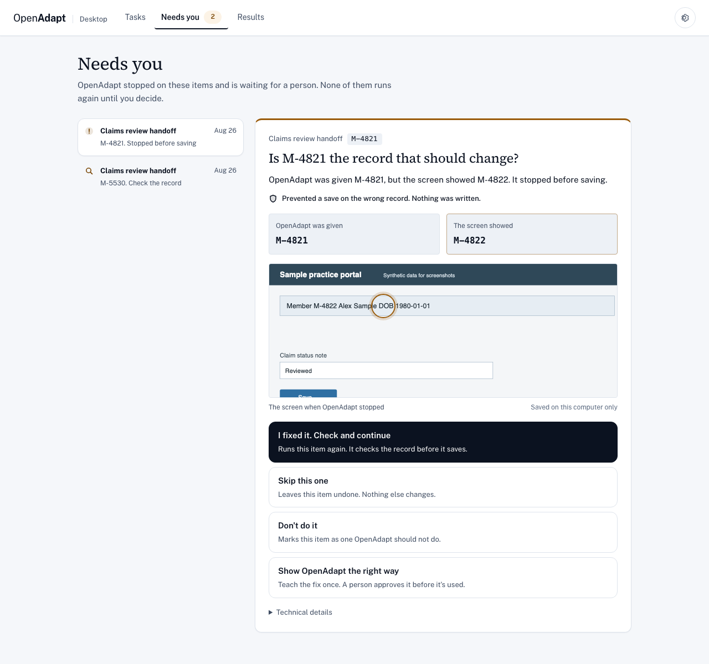
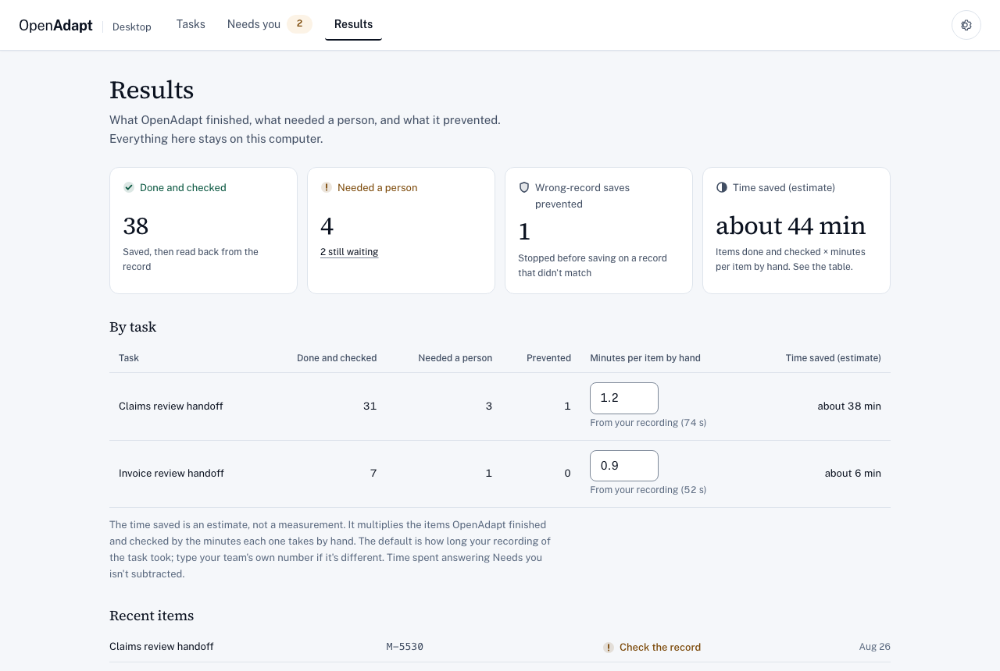
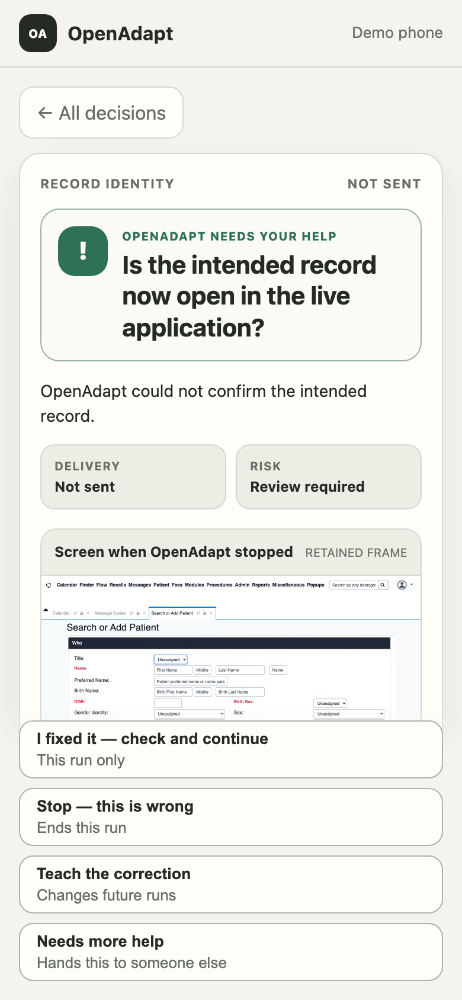

# OpenAdapt Desktop

[](https://github.com/OpenAdaptAI/openadapt-desktop/actions/workflows/test.yml)
[](https://www.python.org/downloads/)
[](LICENSE)

OpenAdapt Desktop takes the last manual step off your team: entering approved
information into the systems you already use, like EMRs, payer portals, and
desktop or Citrix apps, and checking that it saved. When something doesn't
match, it stops and asks a person instead of guessing.

<p align="center">
  
</p>

## What changes in your team's day

| | Today | With OpenAdapt Desktop |
| --- | --- | --- |
| The repeated entry | A person keys the same fields into the app for every item on the list | OpenAdapt enters them in the same app, one item after another |
| The right record | The person rereads the screen before saving | OpenAdapt checks that the record on screen matches the item before it types |
| Did it save? | Found out later, if at all | OpenAdapt reads the saved record back and marks the item done and checked |
| Something doesn't match | Someone notices downstream | OpenAdapt stops before saving and asks one question in Needs you |
| The app's screen changes | Staff work around it | OpenAdapt finds the same field again, or stops at that step so a person can show it the right way once |

## How it works

1. **Show it.** Do the task once, on a test record, in the app where you
   already do it.
2. **Check it.** Confirm what the task changes, how OpenAdapt makes sure it's
   the right record, and how it confirms the save. Run one practice item, then
   approve.
3. **Run it.** Paste a list, open a spreadsheet saved as CSV, or type one item.
   OpenAdapt works through the list and checks each record.

Three tabs cover the rest of the day. **Tasks** shows each task's next step.
**Needs you** holds every item OpenAdapt stopped on, each with one question to
answer. **Results** shows what got done and checked, what needed a person, the
wrong-record saves it prevented, and an estimate of time saved that shows its
own baseline. Settings and the expert tools sit behind the gear.

<p align="center">
  
  
</p>

Every result comes from the engine's own outcome for that run:

| Result | What it means |
| --- | --- |
| Done and checked | It saved the entry and read the record back to confirm it. |
| Stopped before saving | Something didn't match, so it stopped before changing anything. Nothing was written. |
| Check the record | A save may have gone through. A person checks the record before anything is retried, and OpenAdapt never retries it on its own. |
| Finished, not checked | It did the steps but didn't confirm the saved result. |
| Didn't finish | It couldn't complete the task. The result says whether anything could have been written. |

"Nothing was written" appears only when the engine proved it. The screenshots
use synthetic data from the app's own fixture harness
([provenance](docs/assets/operator/provenance.json)).

## Try it

In the app, **See it work on a sample app** runs a built-in sample clinic app
with made-up patients in a hidden browser on your computer. It needs no account
and no operating-system permission. You see one run that saves and checks, and
one where the app says "saved" but the record disagrees.

**There is no trusted signed build to download right now.** The next native
release is blocked until macOS has Developer ID plus notarization, Windows has
Authenticode, and the exact Linux bytes verify under GitHub OIDC attestation.
The latest engine wheel is `v0.16.0`. Native is still `desktop-v0.15.0`; skip
those installers. They keep their original ad-hoc and unsigned labels. To try
the same sample without the app, use the launcher:

```bash
python -m pip install --upgrade openadapt
openadapt flow tutorial
```

To watch a run catch a bad save and stop:

```bash
openadapt quickstart --break-it
```

[Documentation](https://docs.openadapt.ai) ·
[openadapt-flow](https://github.com/OpenAdaptAI/openadapt-flow) ·
[Which release to download](RELEASES.md) ·
[The operator screens](docs/OPERATOR_SCREENS.md) ·
[Implementation status](docs/IMPLEMENTATION_STATUS.md)

## For engineers and IT

> **Role: installed authoring and operation companion.** The compiler and the
> governed runtime are `openadapt-flow`; this repository publishes release
> candidates around them. A release becomes the
> active Production default only while the canonical signed lifecycle ledger
> holds a current admission for its exact artifacts. Absent, inactive, expired,
> or revoked, and that release is **not actively admitted**.

Start without an account, or connect a Cloud workspace with system-browser PKCE
or a one-time token held in the OS keychain. The shell has three tabs and a
gear menu over the live engine:

| Screen | What it does |
| --- | --- |
| Tasks | One card per recorded task with one status and one next step: Check it, Run it, Show it, or Needs you |
| Needs you | Every stopped item, with the plain question, what was prevented, the stopped screen, and only the choices the transaction outcome allows |
| Results | Items done and checked, items that needed a person, wrong-record saves prevented, and a labeled time estimate |
| Check it | The short readiness test, built on the same qualification commands as the exact checks |
| Run it | Runs a checked task on a pasted list, a CSV, or one typed item through a private params file per item |
| Gear: Settings | Account, where data stays, PHI mode, how OpenAdapt finds fields on screen, the overlay, updates |
| Gear: Advanced | Exact checks (the full qualification contract), every task version with replay and governed run, recording with all options, the Cloud runner, phone pairing, and recording setup |

Teach opens from a task or a stopped item: resolve a stopped step and write a
governed repair back toward the task. What each screen calls in the engine,
the safety rules it keeps, and the engine gaps it depends on are in
[docs/OPERATOR_SCREENS.md](docs/OPERATOR_SCREENS.md).

In a plain dev checkout the shell shows an engine-stopped state, because the
frozen sidecar is built only in CI.

## Answering a stop from your phone

When a governed run needs a person, Desktop pairs a phone with a one-use QR
code and a matching code. The phone gets one signed task, whatever evidence the
customer-controlled runner is allowed to show, and only the actions Flow
permits at that pause.

<p align="center">
  
</p>

The screen is a request, not an approval. Tapping it doesn't bless a stale
screenshot and doesn't prove a business effect. The runner goes back to the
live application, repeats the state, identity, and target checks, and returns a
typed result; a refusal leaves the run paused where it was.

The local portal can serve an approved retained raster frame over the
customer's own HTTPS origin behind a reverse proxy or VPN. The hosted outbound
lane carries a signed, remote-safe task with no pixels in it. One limit worth
knowing before you design a policy around this: pairing authenticates the
device session, not the named operator principal that a qualification contract
may require for attribution.

The screenshot is the real phone shell with synthetic data. Its
[capture provenance](docs/assets/mobile-decision/provenance.json) is recorded,
and the full contract, including pairing, evidence handling, reconciliation,
escalation, and terminal receipts, is in
[docs/DECISION_PORTAL.md](docs/DECISION_PORTAL.md).

## How the two processes fit together

```text
Desktop authoring/teaching cockpit (Tauri + React)
        |
        | local IPC (JSON lines over sidecar stdio)
        v
Frozen Python engine sidecar (capture, review, auth, sync, FlowBridge,
                              pinned openadapt-flow runtime)
        |     ^
        |     | token-authenticated loopback socket (openadapt-tray)
        |
        | isolated subprocess mode in the same signed executable
        v
openadapt-flow
  record -> compile -> qualify propose/accept -> lint/certify -> replay -> halt/repair/teach
```

The engine owns consent, OS permissions, recording and review, hosted
authentication and push, and a `FlowBridge` that runs the pinned Flow build as
an isolated subprocess. The engine also runs a token-authenticated loopback
socket so [`openadapt-tray`](https://github.com/OpenAdaptAI/openadapt-tray) can
mirror status and send local commands.

None of the compiler or the runtime lives here. That's all `openadapt-flow`,
and this repository is the cockpit and the local wiring around it.

## The engine CLI

The Python engine runs from a plain checkout, without the shell. A source
checkout resolves Flow from the locked build extra; native packages embed the
exact runtime.

| Command | Purpose |
|---|---|
| `record`, `list`, `info` | Capture a session and inspect its metadata |
| `scrub`, `review`, `approve`, `dismiss` | Drive the local review state machine; a dismissal keeps the raw data local |
| `compile`, `qualify`, `replay`, `run` | Call the bundled Flow runtime on a capture or a bundle. `qualify --recording` fills application, environment, identity, and effect pins from the demo; missing pins HALT. |
| `login`, `credential`, `rotate`, `push`, `report-break` | Authenticate to the control plane, check or renew the stored credential, push a bundle, report a halted run |
| `backends`, `upload` | Inspect the legacy customer-owned storage adapters. Hosted uses governed `push`; customer-owned upload is paused behind a fail-closed gate. |
| `storage`, `health`, `cleanup` | Inspect and maintain local storage |
| `config`, `capabilities`, `doctor` | Local configuration, execution-surface availability, and dependency checks |

Recordings are local by default. Any egress path still needs you to look at the
selected adapter, the configuration, the logs, and your data-classification
policy. Nothing in this repository by itself makes a deployment HIPAA-compliant.

`push` delegates to Flow's exact-hash sanitized derivative contract and never
falls back to a direct upload when Flow is missing or errors. The old direct
hosted-ingest backend refuses every upload. Full semantics:
[docs/IMPLEMENTATION_STATUS.md](docs/IMPLEMENTATION_STATUS.md).

## Build it

```bash
git clone https://github.com/OpenAdaptAI/openadapt-desktop.git
cd openadapt-desktop
uv sync --extra dev --extra build

uv run openadapt-desktop doctor
uv run openadapt-desktop list
uv run pytest tests -q
uv run ruff check engine tests
```

Recording needs the OS permissions and runtime that
[`openadapt-capture`](https://github.com/OpenAdaptAI/openadapt-capture)
requires:

```bash
uv run openadapt-desktop record --task "Inspect capture path"
```

For the shell you also need Rust, Node.js, and the Tauri CLI. A dev shell runs
frontend-only and reports the engine as offline until a CI-built sidecar binary
is present.

```text
engine/       Python capture, review, auth, sync, and FlowBridge code
src-tauri/    Rust/Tauri shell, sidecar lifecycle, tray socket wiring
src/          React cockpit (screens, engine client, primitives)
tests/        Python unit and end-to-end tests, largely mocked at the boundaries
```

[DESIGN.md](DESIGN.md) is a historical reference. Where it disagrees with this
file or with `openadapt-flow`, this file wins.

## What isn't proven yet

- The frozen `openadapt-engine` binary comes only from CI. A dev checkout runs
  frontend-only.
- CI proves the frozen binary's browser record, compile, and replay loop on
  Windows, macOS, and Linux, and it installs, launches, and uninstalls every
  package on clean runners. That's packaging evidence. It isn't workflow
  qualification, which stays specific to the workflow and the environment.
- Native packages are unadmitted release candidates until the central
  Production lifecycle activates an exact release.
- Signing credentials have to be provisioned before the next native release. A
  partial set stops it. The updater and rollback stay disabled until there's an
  independent signing-key lifecycle.
- This repository serves the tray's loopback IPC contract, but Desktop and the
  shipped tray client have never been validated together end to end.
- Desktop starts without downloading a browser. The first browser workflow
  pulls the Chromium revision pinned by the bundled Playwright runtime into
  `~/.openadapt/browser-runtime`, showing progress and a retryable failure, and
  no workflow action starts until it's ready. Air-gapped packages point
  `PLAYWRIGHT_BROWSERS_PATH` at a version-matched prebundle. Native, RDP, and
  Citrix workflows never touch that path.

Area-by-area detail, including the substrate evidence boundaries:
[docs/IMPLEMENTATION_STATUS.md](docs/IMPLEMENTATION_STATUS.md).

## Native installers

Native packages ship under a `desktop-vX.Y.Z` prerelease channel, separate from
the engine's `vX.Y.Z` PyPI and GitHub releases. CI keeps the native version
synchronized to each engine release, so a native prerelease mirrors the engine
it was built from. It's packaging evidence, and
not a separate supported desktop release. Every filename encodes its platform,
architecture, and signing state. New release filenames require
`developer-id-notarized` on macOS, `authenticode` on Windows, and
`github-attested` for the exact Linux bytes.

On macOS, ad-hoc CI uses a non-hardened overlay, because an identity-less
hardened launcher can't load PyInstaller's identity-less embedded libraries.
Developer ID builds keep the hardened runtime and pass the same Apple identity
into both PyInstaller and Tauri, and the installed-app smoke test runs bundled
Flow after the final signing pass, so a structurally valid but unloadable app
can't get out.

Third-party licenses sit beside the components they cover and are verified
against the actual frozen archive; pinned sources, hashes, and modification
status are in [`third_party/README.md`](third_party/README.md).

- [RELEASES.md](RELEASES.md): which release to download, and the two-lane policy.
- [docs/RELEASE_CANDIDATE_INSTALLERS.md](docs/RELEASE_CANDIDATE_INSTALLERS.md):
  artifact names, verification scope, provenance.
- [docs/CODE_SIGNING.md](docs/CODE_SIGNING.md): the activation runbook, what to
  buy, which secrets to add, and what each surface may then truthfully claim.

## License

[MIT](LICENSE)
