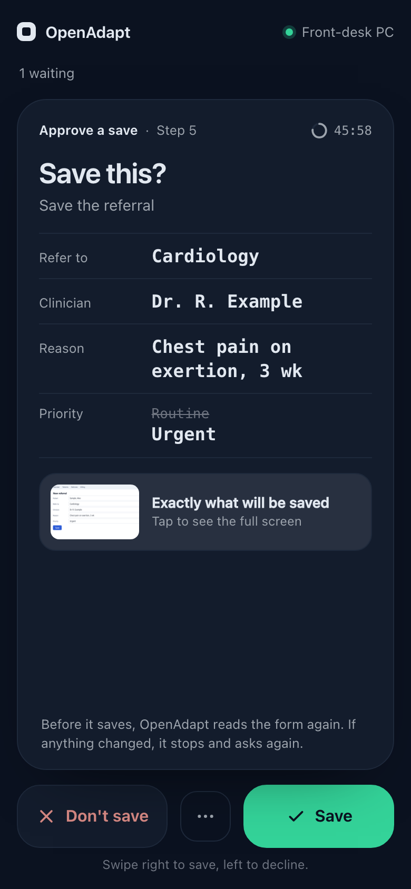
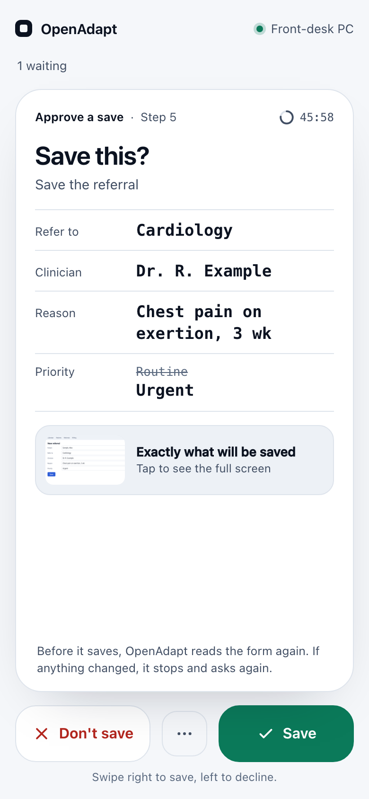
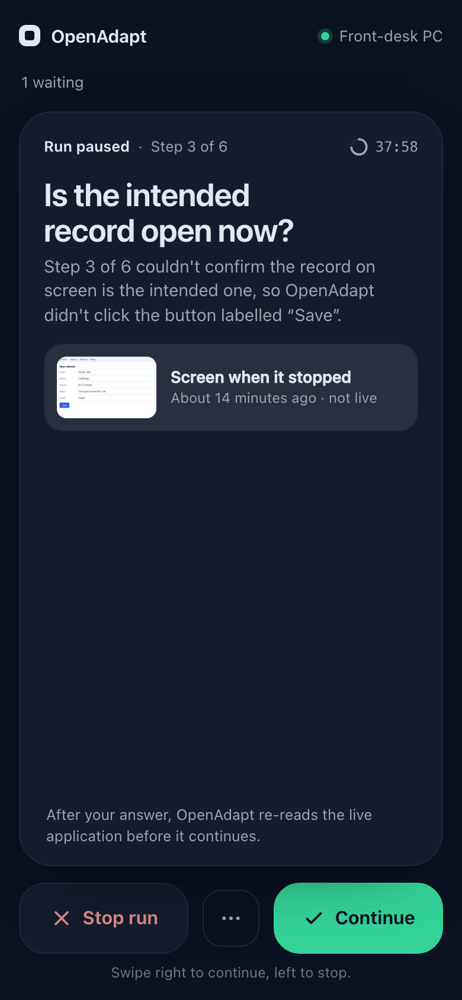
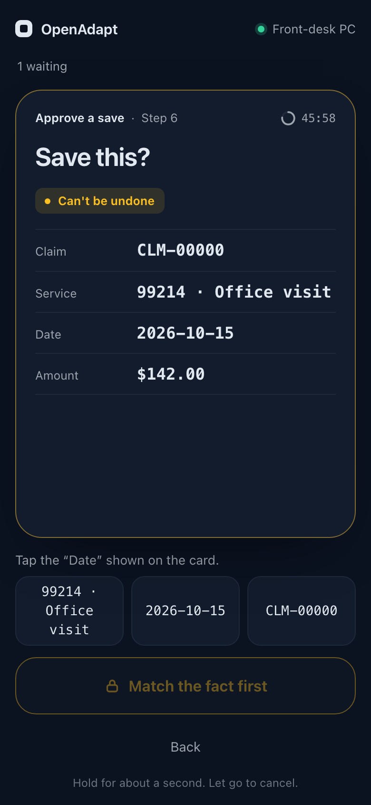

# The mobile decision portal

When a governed run cannot confirm something, OpenAdapt halts instead of
guessing. This portal is how that question reaches a staff member's phone with
the approved local evidence -- raster screen crops, the gated control label,
and the typed halt detail -- without sending that evidence to OpenAdapt Cloud.
The phone fetches it through a customer-operated HTTPS origin, published by a
reverse proxy or VPN.

Customers can use this full-evidence local portal or Flow's hosted outbound
lane. The local portal needs a customer-operated HTTPS origin, published by a
reverse proxy or VPN. The hosted lane dials **out** to the control plane and
needs no inbound port; it
carries the signed remote-safe task and the closed halt context, never pixels.
See
[Answering a halt with no ingress](#answering-a-halt-with-no-ingress).

Desktop owns the **lifecycle, the network boundary, device pairing, and the
generic notification**. It owns no decision semantics. The task fields, the
evidence references, the allowed actions, the revalidation contract, and the
outcome all come from `openadapt-flow`'s attended console. Desktop relays those
machine fields without rewriting them. The phone shell maps the closed enums to
its reviewed operator copy.

## What it is (and is not)

- A **responsive PWA** served by the runner. There is no iOS or Android
  project, and none is planned for this path.
- A **relay**, not a second engine. The phone's answer is forwarded to Flow,
  which validates the signed task digest, the engine pause capability, and the
  allowed-action list, then re-reads the live application before anything
  continues. An accepted tap is never a verified business effect.
- **Loopback-only by default.** Publishing it to a phone is an explicit,
  documented customer decision.

## Current interface

The phone shows one card per decision. A card asks one question and shows only
what that answer changes. Paused runs and saves waiting for approval share the
same card and the same rules:

- **Two visible answers.** Buttons are the main way to answer, sized at least
  44 px. Swiping the card is a shortcut for the same two buttons: right for the
  answer that lets the work go on, left to stop or not save. The arrow keys do
  the same. Every other allowed answer, the full screenshot and the details are
  one tap away under **⋯**.
- **Five seconds to undo.** An answer is held on the phone for five seconds
  before it is sent. Undo sends nothing. If the phone goes offline, the page is
  closed, or the request expires during that time, the answer is dropped.
  Nothing is queued to send later.
- **Can't be undone means match and hold.** When the signed task's
  `risk_class` is `irreversible`, a swipe or tap only arms the answer. The
  person taps one fact from the card (a value with a digit in it, such as a
  date or amount, or the step number) and then holds the button for about a
  second. There is no undo after the hold.
- **The filled answer.** The continuing answer is filled only when it is the
  single continuing answer and the step can be undone. Nothing is filled on an
  irreversible step.
- **What will be saved.** A save shows the field values it writes, in large
  monospace type, with the value each replaces struck through. The exact
  screenshot is behind a tap. When Flow sends no field list, the card shows the
  screenshot itself. Save is offered only after that screenshot has loaded as a
  PNG whose SHA-256 matches the request's `screenshot_sha256`. No picture, no
  approval; Don't save stays available.
- **Results.** A result that needs nothing more from the person (approved,
  not saved, checks passed, run stopped) moves the deck on and stays in the
  receipts list. A result that does (paused again, result uncertain, unknown
  outcome) stays on screen until the person acknowledges it. Receipts show
  the time Flow recorded the answer, not the phone's clock.
- **Dark first.** The phone follows the system light or dark setting, and
  respects reduced motion.

<table>
  <tr>
    <th>Approve a save (dark)</th>
    <th>Approve a save (light)</th>
  </tr>
  <tr>
    <td></td>
    <td></td>
  </tr>
  <tr>
    <th>A paused run</th>
    <th>A save that can't be undone, armed</th>
  </tr>
  <tr>
    <td></td>
    <td></td>
  </tr>
</table>

These images are deterministic renders of the exact Desktop shell at the
commit recorded in
[`assets/mobile-decision/provenance.json`](assets/mobile-decision/provenance.json).
They use synthetic data, and the form in the screenshot is a synthetic page.
They are not a customer run.

### What a 404 or 403 means

- `401` or `403` from any portal route: the phone goes back to pairing. Neither
  records an answer.
- A `404` carrying one of Flow's closed codes (`request_not_waiting`,
  `request_unknown`, `already_answered`) means that save is gone. The phone
  says it is no longer waiting.
- Any other `404` means the computer isn't answering that route right now (an
  older console, or nothing attending it). It is never shown as "nothing
  waiting" or "gone". A save list that returns `404` makes the empty screen say
  that saves aren't reaching the phone.

## Add a human decision during qualification

A workflow does not need a separate policy author or manual JSON edit. In the
Desktop qualification cockpit, an operator can add a decision before an
existing workflow step. The form records:

- one reviewed question;
- the roles that can answer it;
- two to four finite answers;
- the exact qualified successor for each answer;
- optional local evidence that an answer requires;
- the answer expiry; and
- the live application check that must still pass before execution continues.

Desktop sends these fields to Flow's canonical
`openadapt.business-decision/v1` contract. Flow derives the guarded graph
transitions. Saving the change advances the qualification revision and
invalidates the prior certification. The qualification cases must pass again
before production use.

This decision is optional. A workflow that has no institutional-knowledge
branch does not need one. One signed answer selects one qualified branch for
one run. It does not prove the business effect and it does not change the
workflow policy for later runs.

## Network boundary

| Setting | Default | Meaning |
| --- | --- | --- |
| `OPENADAPT_PORTAL_INGRESS_MODE` | `loopback` | `loopback` (this computer only) or `customer_ingress` |
| `OPENADAPT_PORTAL_PUBLIC_ORIGIN` | *(unset)* | The exact `https://` origin your reverse proxy or VPN publishes |
| `OPENADAPT_PORTAL_INGRESS_ACKNOWLEDGED` | `false` | Explicit record that your organization operates that ingress |
| `OPENADAPT_PORTAL_BIND_HOST` | *(unset)* | Optional literal IP when your ingress is not on this host |
| `OPENADAPT_PORTAL_PORT` | `0` | `0` selects an ephemeral loopback port |
| `OPENADAPT_PORTAL_CONSOLE_PORT` | `7863` | Loopback port for the supervised Flow attended console |

The rules, all enforced in `openadapt_desktop/portal/ingress.py` and all fail-closed:

1. The default binds `127.0.0.1` and advertises a loopback URL. A phone cannot
   reach it, and the pairing screen says so rather than minting a dead link.
2. `customer_ingress` **still binds loopback** unless you name a specific
   address. The expected deployment is your own reverse proxy beside the runner
   forwarding to `127.0.0.1`.
3. A wildcard bind address (`0.0.0.0`, `::`, empty, `*`) is refused in every
   mode. So is a plaintext origin, an origin with a path or credentials, a
   hostname as a bind address, and a `customer_ingress` without both a public
   origin and the acknowledgement.
4. Any invalid combination raises and the portal does not start. It never
   widens its own exposure to become reachable.

There is no self-signed-certificate bypass and no test-only wide bind. The test
suite exercises the shipped loopback configuration on a real socket.

## Answering a halt with no ingress

Everything above is about publishing **this** surface, which serves protected
evidence. A customer who does not operate an ingress uses Flow's hosted lane
instead: the engine makes outbound HTTPS requests only, so there is no inbound
port, no port forward, no certificate, no reverse proxy and no static address,
and it works behind NAT.

Desktop turns it on when the operator's `deployment.json` sets
`human_decisions.remote.enabled: true`. It then passes `--remote-decisions` to
the attended console and hands it the runner credential from the keychain in the
child process's environment -- never in `argv`, where it would sit in the
process table for every user on the machine.

Two things are checked **before** the console is spawned, because afterwards the
failure is an opaque "the local decision service did not start":

- this computer must be registered with the control plane, or Desktop refuses
  and names the host; and
- the resolved Flow must be at least `MIN_FLOW_FOR_REMOTE_DECISIONS`
  (`openadapt_desktop/portal/service.py`), because an older one exits on the unknown flag
  before printing its capability banner.

`enabled` must be literally `true`. A truthy string or a `1` means no. Neither
check degrades: a lane that looks on and is not is worse than one that is
plainly off, because nothing on either surface would say the phone will never
ring.

The two paths are independent. A deployment may run the local portal, the hosted
lane, both, or neither.

## Pairing a phone

Desktop shows a QR code; the phone shows a short code back. Following RFC
8628's device-flow shape:

- The QR link is `https://<your-ingress>/pair#c=<secret>`. The secret rides in
  the **fragment**, which browsers never transmit, so it cannot land in a proxy
  access log or a referrer header.
- The QR carries **only a pairing secret** — no console capability, no pause
  capability, no tenant, run, or pause identifier.
- The secret is **claimable exactly once**, atomically. Two phones scanning the
  same code cannot both pair; the second is refused with `already_claimed`.
- It **expires in five minutes**, enforced server-side and re-checked at
  approval. Both clocks are consulted: monotonic so a wall-clock change cannot
  extend a deadline, and wall time because `CLOCK_MONOTONIC` stalls while a
  machine is suspended. No UI countdown is involved.
- Claiming yields a session that is **unusable until approved**. The
  confirmation code is generated **at claim time** and returned only to the
  claiming device; Desktop asks the operator to type what their phone is
  showing. Attempts are bounded, and exhausting them cancels the pairing.

  The direction matters. If the code were derived from the pairing and shown on
  Desktop, an attacker who photographed the QR from across the room and claimed
  it first would be shown the very code the operator's screen was displaying —
  the "matching code" would confirm the attacker. Minting per claim means a
  remote attacker's phone shows a code the operator cannot see.
- Showing a new QR retires every earlier unapproved pairing, including one that
  has already been claimed, so a stolen code cannot sit latent waiting for a
  mis-click.
- Secrets and session tokens are stored only as SHA-256 digests and compared
  in constant time. The portal secret prefix (`oapp_`) is deliberately distinct
  from the Cloud local-bridge prefix (`oap_`), and neither surface accepts the
  other's credential.
- Devices are listed and revocable; sessions expire after twelve hours.
- The QR is rendered locally as an inert `data:image/png` URI rather than raw
  SVG markup, so a secret-bearing value is never injected as HTML.

### Operator identity and attribution

Pairing authenticates one device session to one runner. It does not establish
the human operator's name, role, or authority. A production deployment must
supply its authenticated operator principal through the qualified deployment
boundary before a policy that requires named decision attribution can accept a
consequential continuation. The phone cannot supply a self-asserted name to
weaken that requirement.

The decision remains bound to the exact task digest, signature, pause, allowed
action, and one-use idempotency key. After an accepted answer, Flow re-reads the
live application and repeats its required state, identity, and target checks
before any action continues.

## Approving a save

Under an approval mode (`each_item`, or `problems_only` once earned) a run stops
before a save and waits for a person. The paired phone answers that wait the
same way it answers a paused run: Flow signs a decision task, and the portal
relays it without adding authority. This section is the contract the phone
screens build on.

| Portal route | Flow console route | What it returns |
|---|---|---|
| `GET /api/portal/save-approvals` | `GET /api/save-approvals` | Waiting saves: `request_id`, `step_class`, `created_at`, `expires_at` |
| `GET /api/portal/save-approvals/{request_id}` | `GET /api/save-approvals/{request_id}` | `task` (signed `openadapt.human-decision-task/v1`, `task_kind: save_approval`, question `approve_save`), `task_digest`, and a local-only `presentation` block |
| `GET /api/portal/save-approvals/{request_id}/frame` | `GET /api/save-approvals/{request_id}/frame` | The exact screenshot the request was opened with (PNG, digest-checked by Flow, `no-store`) |
| `POST /api/portal/save-approvals/{request_id}/actions/{action}` | `POST /api/save-approvals/{request_id}/actions/{action}` | A `HumanDecisionReceiptV1` |

`request_id` is 32 lowercase hex characters; anything else is refused before
Flow is called. `presentation` carries `question`, `step_intent`,
`step_index`, `step_class`, `explanation`, `screenshot_sha256`,
`decline_reasons` and `expires_at`. Its `screenshot_route` names the Flow
console path; the phone loads the portal's `.../frame` route above. A newer
Flow also sends `presentation.fields`, a list of `{label, before, after}` for
the values the save writes, bound into the request digest and served
`no-store`. The phone shows those values when they are present and the
screenshot when they are not. A malformed list is dropped as a whole.

The task's `allowed_actions` are `verify_and_resume` (approve this save) and
`reject` (don't save). The POST body is
`{"action", "task_digest", "task_signature"}` plus, for `reject` only, one
`decline_reason`: `wrong_values`, `wrong_record` or `screen_problem`. The same
origin and session CSRF checks as every other decision apply. Flow refuses a
task that changed or belongs to another save, and writes the answer once, so a
second tap gets `409 request_not_waiting`. The receipt is
`accepted_pending_runner` for an approval (the run re-reads the form before it
saves and stops if anything changed) or `rejected` for a decline.

As with every portal decision, pairing proves a device, not a person: Flow
records a save answered here as an unauthenticated person on the
`decision_portal` route. Save approvals stay on the runner. The hosted lane
does not carry them, because the screenshot never leaves the runner and a
person must see exactly what will be saved before approving it.

## Protected evidence

Task projections, decision outcomes, and evidence crops are served
`Cache-Control: no-store` (plus `Pragma: no-cache`) and are never written to a
cache by the shell. The service worker in `openadapt_desktop/portal/shell/sw.js` precaches
one frozen literal list of shell assets, has no after-the-fact cache write, and
its fetch handler is an allowlist that returns without intercepting anything
else — so a newly added protected route is excluded by default. Shell assets
themselves are served network-first with the precached copy only as an offline
fallback, so a fix shipped in `app.js` still reaches an already-paired phone.
`tests/test_portal/test_shell.py` asserts each of those clauses structurally.

Only raster crops are relayed: `image/png`, `image/jpeg`, and `image/webp`.
`image/svg+xml` is refused, because an SVG is an active document rather than a
screenshot. Upstream 5xx bodies are replaced with a fixed message so a
traceback or deployment path cannot reach a phone; 4xx refusals from Flow are
passed through intact because they are operator-actionable.

The phone never receives Flow's console bearer capability. It authenticates
with a portal session token bound to the runner and the approved pairing.

## What the phone says

For the local full-evidence path, Flow sends the qualified presentation
projection, evidence references, and closed enums. Desktop relays those fields
without changing their meaning. The phone shell owns the fixed action-effect
copy and the receipt copy that it derives from the closed result enums. It does
not call a model to write a question or interpret an answer.

The hosted outbound lane has a narrower remote-safe projection and does not
carry the local evidence image. The remote task names a custom entity class
only if it is in the reviewed remote-safe vocabulary; otherwise it uses the
signed neutral `record` or `item` fallback.

The primary screen is intentionally short: one question, the delivery and risk
signals, one retained application frame, and what OpenAdapt will check next.
The resolution ladder, evidence counts, expiry, and full action consequences
remain available under **Technical details and action effects**. A terminal
receipt replaces the request with a visually distinct result screen. A
non-terminal refusal leaves the request in place so the operator can correct
the live application and answer again.

**Why it stopped.** `presentation.halt` carries the engine's typed halt category,
the step's ordinal, its action kind, the target's role, and the target's label
*only when Flow proved that label is static control chrome rather than record
content*. The shell composes "Step 1 of 6 could not start: OpenAdapt could not
find the button labelled “Open” on the screen, so it did not click anything."
When the label is withheld the role noun stands alone, so a TYPE step degrades
to "could not find the text field" — never to the typed value.

**What was tried, and what continuing costs.** The resolution ladder is shown
per rung with its verdict, and rungs with no recorded evidence are reported as
never attempted rather than as failures. `will_recheck` becomes the list the
engine re-proves after a continue, so "I fixed it" is visibly not a
repeat-the-step button.

**What each answer does.** The actions differ in whether the saved workflow
changes and in what becomes of the run, and neither is inferable from their
names. Each button carries its consequence, and the card states it in full:
*check and continue* is this run only and the same drift stops the next run;
*stop — this is wrong* ends this run and it cannot be resumed; *teach the
correction* changes future runs and continues nothing now; *needs more help*
leaves the run paused and untouched.

**Reconcile is not retry.** A signed `reconcile` action is shown only when
Flow records that an earlier action was delivered or may have been delivered.
It asks Flow to prove the already-requested business effect. It never sends the
earlier action again. The phone reports reconciliation success only when the
receipt has both `report_success=true` and the bound transition receipt digest.
If either is absent, it reports an incomplete receipt instead of success.

**Stop and needs-more-help are not two phrasings of one answer.** Escalation
*parks* the run: the durable pause stays intact and a qualified operator can
still continue it. A rejection *terminates* it — the engine marks the pause
rejected, no approval resumes it, and the run report records the terminal
transaction outcome. The two exist separately because merging them would leave
the recorded answer distribution unable to distinguish "I don't know" from
"stop", which is the only signal a disagreement action is worth its cost for.
Without one, an operator who looks at the live application and concludes the
engine was right to stop has no answer that says so, and the only one-tap
resolution on the screen is the agreeable one.

**No answer is the recommended one, including this one.** The accent used to
follow `allowed_actions[0]`, which Flow sets from a predicate about what it can
re-verify rather than about what the operator should do. Emphasising the
disagreement answer instead would be the same mistake pointed the other way.
Nothing on the task means "recommended", so nothing is emphasised.

**Four buttons is the ordinary bar, and five is reachable.** Measured in
headless Chromium at 360x640, the tightest device that still ships: three
buttons 207px, four 248px, five 286px, against a 44px touch-target floor that
is not crossed. The page reserves the bar's *measured* height, never a
constant, so the outcome line is never left underneath it.

**What came back.** Flow returns `HumanDecisionReceiptV1`: a `state` and a
`reason_code` from fixed enums, and no message. The shell maps every
`(state, reason_code)` pair to its own copy in `RECEIPT_COPY`. A pair it does
not recognise is reported as an unknown outcome, never as a refusal — showing a
real `halted` as "that decision was refused" is the exact defect that mapping
prevents. A runner still returning the older decision record is mapped through
Flow's own status table so it renders identically. `src/portalShell.test.ts`
drives the shipped `app.js` in a DOM and pins each of those outcomes.

## Synthetic phone screenshots

Use the deterministic fixture generator when a document, review or demo needs
current phone screens. It drives the real shell with a stubbed transport and
real taps and drags, and renders every state in dark and light at 390x844. The
form in the save screenshots is a synthetic page the script renders itself. It
does not start a runner and does not read customer evidence:

```bash
uv run --extra build python scripts/capture_portal_scenarios.py \
  --out /tmp/openadapt-phone-states
```

The command writes `<state>-dark.png` and `<state>-light.png` for each state in
`CAPTURES`: pairing, a save, a queue of three, mid-swipe both ways, the undo
window, decline reasons, screenshot-only, the full screen, details, no
picture, an irreversible save (initial, armed, matched, holding), changed,
gone, not attended, a paused run and its other answers, paused again, result
uncertain, not accepted, offline, expired, all clear (empty and with a
receipt), saves not attended, and unreachable. `--only <state> ...` limits the
run. The generator requires `--out` so generated images do not enter the
Desktop package or source tree by accident.

The repository keeps reviewed reference captures under
`docs/assets/mobile-decision/`. Their provenance records the exact Desktop
commit, generator, dimensions, and SHA-256 values. Regenerate and review them
when the shipped phone shell changes.

## Notifications

Operating-system notifications are generic by construction. Desktop reads a
single integer count from Flow's PHI-free notification endpoint and renders the
body from a fixed template; no upstream string is ever forwarded. The payload
may carry only `{title, body, open_count, route}`, and
`assert_generic_notification` refuses anything wider — in the portal service, in
the dispatcher, and again in the shell before the plugin is called.

## Current wiring status

### Packaging: done

The frozen sidecar now carries the console. `pyproject.toml` pins
`openadapt-flow[browser,console]==2.4.1`, `scripts/build_frozen_engine.py`
collects uvicorn's run-time string imports and `openadapt_flow.console`, and
the executable is built unbuffered so the console's one-time capability banner
survives the pipe the portal reads it from. `scripts/smoke_test_frozen_flow.py`
proves this behaviourally against the built artifact on every sidecar build: it
starts the frozen attended console, parses the banner with the portal's own
parser, and drives `/api/session`, `/api/attention`,
`/api/attention/{run_id}`, and an unauthenticated probe through
`openadapt_desktop.portal.flow_client`.

### Runtime: wired

Both remaining portal-side gaps are closed, and both still fail closed.

1. **The console is bound to the operator's deployment target.**
   `PortalService` spawns `console --attend --allow-actions --config <staged>`.
   Flow deliberately refuses attended mutations with no target (`requires an
   explicit --config or --backend target`), and that refusal is still asserted
   against the frozen binary. Desktop supplies the same governed config its runs
   use, `data_dir/deployment.json`, staged privately through
   `engine.private_flow_config`. A missing or unparseable config refuses on
   Desktop's side of the wire, before anything is spawned, so the operator is
   told which file to write instead of seeing "the console did not start".
2. **Readiness is a bounded wait, not a sleep.** Flow prints the banner
   *before* `uvicorn.run()` binds, so the first `flow.request("session")` can
   legitimately hit a closed port. `PortalService._await_console_session` polls
   until the console answers, bounded by `CONSOLE_READY_TIMEOUT_S`, and gives up
   immediately if the console process exited rather than burning the deadline.

### How long the staged deployment config lives, and why

The staged file is **not** session-lived. `data_dir/deployment.json` carries
reusable credentials — `rdp_password`, `rdp_username`, `rdp_domain`,
`agent_token`, `agent_tls_pin` — alongside PHI-capable window/URL selectors;
`private_flow_config` already treats every `password`/`token`/`secret` key as
sensitive when it derives log redactions. A file like that is not eligible to
sit on disk for the hours a portal session can last.

Re-staging it per run would also be theatre. In the pinned
`openadapt-flow==2.4.1`, `_attended_service_from_args` resolves `--config`
eagerly through `load_deployment` **before** it yields, and
`AttendedActionService` is built from the parsed `DeploymentConfig` object and
never sees the path again. Rewriting the file later changes nothing about what
the console executes with; it only writes the same secret to disk more times.

So the lifetime is set to the only thing it can usefully bound: **the console's
startup**. The config is staged 0600, the console is spawned, and the file is
removed the instant the capability banner arrives. `serve()` prints that banner
strictly downstream of the config load, in the same `with` statement, so the
banner is a happens-after proof rather than a timing guess. What this actually
protects against is a same-user backup, file-sync client, crash reporter, or
support bundle sweeping the staged copy — duration is the whole exposure there,
and it drops from hours to about five seconds. It does not protect against an
attacker with same-user code execution, who already has the operator's own
`deployment.json` and the console's in-memory copy; no file lifetime changes
that, and this one does not pretend to.

Removal is guaranteed by the `finally` in
`private_flow_config.stage_private_yaml`, which covers normal exit, a console
that never announces itself, an unparseable config, and any raised exception.
The one thing a `finally` cannot survive is `SIGKILL`, so portal start also
sweeps `.deployment-*.yaml` files older than `STALE_STAGING_AGE_S` from its
staging directory. The age bound is deliberate: a config belonging to a console
that is still starting is younger than the start timeout, so a concurrent start
can never have its own file deleted out from under it.

`scripts/smoke_test_frozen_flow.py` proves this against the built artifact
rather than asserting it from a code reading. It stages a config through the
same `private_flow_config` call the portal uses, starts the frozen console with
`--allow-actions --config`, **deletes the staged file the moment the banner is
parsed**, and only then drives every portal route. A future Flow that began
re-reading the path would fail that smoke.

Whether an attended session can attach is classified from **Flow's own
refusal**, not from a hardcoded platform list. Flow implements a window-scoped
replay client on macOS (Quartz) and Windows (Win32) and refuses elsewhere by
design, so on Linux the smoke records `console_attended_session:
"no-host-window-client"`. Any *other* startup failure still fails the smoke —
a genuinely broken frozen build cannot be mistaken for an unsupported host.

Every platform, including Linux, still proves the frozen binary **read** the
staged file: the smoke stages a config whose `backend.kind` marker exists
nowhere in Flow, and Flow echoes it back verbatim.

One upstream seam is worth closing: the attended console generates its bearer
capability inside `serve()` and only prints it on stdout, so
`openadapt_desktop/portal/service.py` parses the exact banner line. A narrow
`--capability-file` option in Flow would replace that with a supported
interface. The parser is strict and fails loud rather than guessing.
