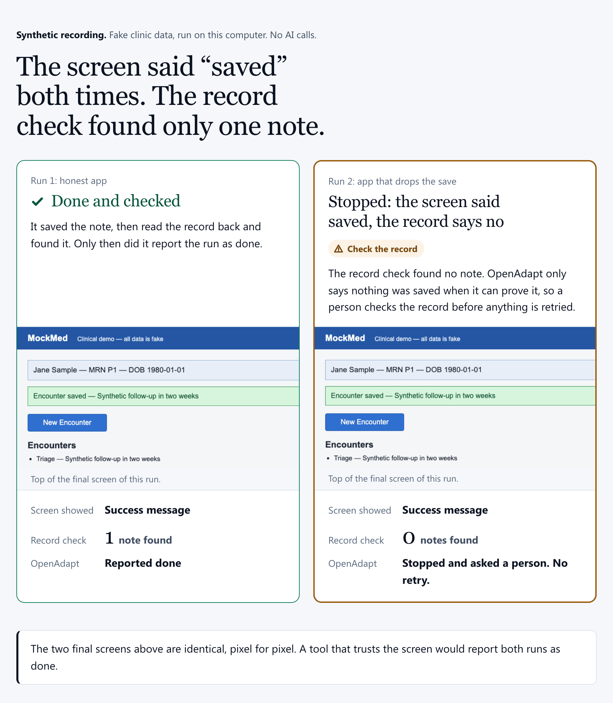
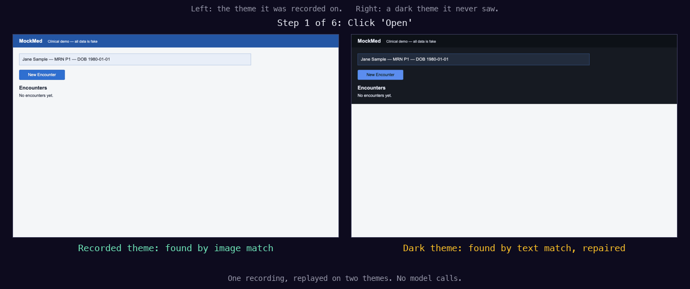

# openadapt-flow

[](https://github.com/OpenAdaptAI/openadapt-flow/actions/workflows/ci.yml)
[](https://pypi.org/project/openadapt-flow/)
[](https://pypi.org/project/openadapt-flow/)
[](LICENSE)

openadapt-flow records a task you do once in a web or desktop app and compiles
it into a program that runs on your own machine. A healthy run makes no AI
model calls. It's built for data entry that repeats every week and has to be
right, such as claims, referrals, eligibility checks, and invoice posting.

Two checks guard the writes. Before a click on a record, the run compares the
text around the target, such as the patient name in that row, with the
recording, and stops if it differs. After a save, a production run reads the
record back through a second channel, such as an API, a read-only SQL query,
or a report export. It reports success only when the record matches what it
entered.

It drives web apps through Playwright; Windows, macOS, and Linux apps through
their accessibility APIs; and Citrix or remote desktops through screen pixels.
Agents can call a compiled workflow as a tool over MCP.

[Docs](https://docs.openadapt.ai) ·
[Try it in your browser](https://app.openadapt.ai/demo) ·
[Website](https://openadapt.ai) ·
[Discussions](https://github.com/OpenAdaptAI/openadapt-flow/discussions)

## See it run

```bash
pip install 'openadapt-flow[browser]'
openadapt-flow demo
```

The demo runs one recorded task twice against a fake clinic app on your
computer. The first run uses an honest app. The second uses an app that shows
"Encounter saved" and then drops the note. When both runs finish, the demo
opens a page with the two results side by side. The first run can take a few
minutes while Playwright downloads Chromium. With the
[OpenAdapt launcher](https://github.com/OpenAdaptAI/OpenAdapt) installed,
`openadapt flow demo` runs the same command.



*Synthetic recording. A screenshot of the page that `openadapt-flow demo`
wrote on 2026-10-09 against the bundled fake clinic app; regenerate it with
[`scripts/make_demo_proof_image.py`](scripts/make_demo_proof_image.py).*

| | Run 1: honest app | Run 2: app drops the note |
|---|---|---|
| The screen said | Encounter saved | Encounter saved |
| The record check found | 1 note | 0 notes |
| openadapt-flow | Done and checked | Stopped and asked a person to check the record, with no retry |

The two final screens are identical, pixel for pixel. Only the record check
tells the runs apart. To watch each stage in the terminal instead, run
`openadapt-flow tutorial`, then `openadapt-flow tutorial --break-it`;
[docs/TUTORIAL.md](docs/TUTORIAL.md) shows the output.

<!-- TODO(readme-links): link the 60-second demo here once it is published. -->

## How it compares

| | Playwright codegen | Model-driven agent (browser-use, computer use) | openadapt-flow |
|---|---|---|---|
| Authoring | Record in a browser, then edit and maintain the generated script | Write the task in plain language | Record once, then declare what each write changes and how to read it back |
| Surfaces | Browsers | Browser or desktop, depending on the agent | Browsers; Windows, macOS, and Linux apps; RDP; Citrix by pixels |
| Model calls per run | None | One for each step | None on a healthy run |
| Median time per run, bundled clinic app | Not measured | 37.5 s | 4.9 s |
| Model cost per run, bundled clinic app | $0 | About $0.27 | $0 |
| When the UI changes | Locators use role, text, or test id, so style and layout changes don't affect them. A renamed label or a removed element makes the step time out, and you edit the script. | The model reads the screen again on every run. In our one dark-theme trial it finished in 87.4 s using 23 of its 25 allowed actions; an earlier trial ran out of actions. | Each step falls back from the recorded element to image, text, and position matching, logs a proposed repair, and stops when nothing matches. In the same dark-theme trial it finished in 9.7 s with 8 repairs. [Tested changes](#when-the-ui-changes) |
| Checks the saved record | Only if you write that check; generated assertions check the page | The model judges success from the screen unless you add a check | Yes, in a production run: reads the record back through a second channel and stops on a mismatch |

The time and cost rows come from one matched comparison on MockMed, the
bundled fake clinic app: 100 compiled runs and 20 agent runs, all scored by the
same OCR check of the final screen
([method](benchmark/BENCHMARK.md)). The agent was `claude-sonnet-5` with the
computer-use tool, driving the same browser through screenshots, and cost is
model API usage at list price. On the public OpenEMR demo, compiled replay
completed 19 of 20 runs (the 20th stopped before saving) with a 39.2 s median;
the agent completed 10 of 10 with a 70.4 s median at about $0.55 per run
([method](benchmark/openemr/BENCHMARK.md)). Both comparisons ran on 2026-07-08
with Flow 0.1.0. The Playwright column describes Playwright's documented
behavior: we haven't timed a codegen script on the same task or run one
through our UI-change fixtures. A side-by-side comparison with UiPath, Power
Automate, and browser agents is at
[openadapt.ai/compare](https://openadapt.ai/compare).

## When the UI changes

Each recorded step keeps several kinds of evidence for its target: the DOM
element or accessibility node where the surface has one, an image crop, the
label text, and the target's position relative to nearby landmarks. At replay
the run tries them in that order and uses the first match. A step that
resolves through a fallback is logged as a proposed repair under the run's
`heals/` folder. `--save-healed-to` writes a repaired copy of the bundle for
review; Flow never swaps it in by itself. When nothing matches, the run stops
instead of clicking something plausible. If an irreversible step, such as a
final submit, can only be found by position, the run refuses to click. On a
step with an identity check, the target goes through that check before the
click, however it was found.

<!-- TODO(readme-links): link the drift proof here once it is published. -->

These are the changes the tests cover, on MockMed or a synthetic test page.
Except where a row says otherwise, the tests switch off the element locator,
to test the fallbacks that pixel-only surfaces such as Citrix depend on.

| Change | What happened | Evidence |
|---|---|---|
| Dark theme | Finished. No step matched its recorded image, so each was found another way and logged as a repair. The repaired copy then replayed on image matches alone. | [`test_record_compile_replay.py`](tests/e2e/test_record_compile_replay.py) |
| Two buttons moved | Finished. The moved buttons were found by a whole-screen image or text search and repaired. | Same file |
| Labels renamed (Save to Submit, Open to View) | The renamed buttons were found by position or approximate text, and the repairs recorded the new labels. Flow classes a save as irreversible and refuses an irreversible step it can find only by position, so this run finished only with the save marked reversible. | Same file |
| A pop-up blocks the screen after Save | The expected screen after the save didn't appear, so the run stopped at the save step and named the check that failed. | Same file |
| A look-alike row above the target, or the target row removed | Stopped before the click: the row showed a different patient name. | [`test_perturbation.py`](tests/e2e/test_perturbation.py) |
| Targets moved, relabeled, and re-themed, with their DOM ids unchanged (element locator on) | The element locator found 15 of 15. Image, text, and position matching alone found 0 of 15. | [`benchmark/structural_action/`](benchmark/structural_action/STRUCTURAL_ACTION.md) |
| Browser zoom, display scaling, font size, or font family changed | Zoom, scaling, and font-size changes stopped the run at the first step. In a 21-point sweep there were no wrong actions and no crashes; only the recorded settings and two serif font swaps finished, and a monospace font stopped at the identity check. With the element locator on, four of these changes produced no wrong writes. | [`benchmark/cosmetic_drift/`](benchmark/cosmetic_drift/COSMETIC_DRIFT.md), [`test_structural_action.py`](tests/e2e/test_structural_action.py) |

<!-- TODO(readme-visual): re-cut docs/showcase/demo.gif with
scripts/make_demo_gif.py. Its first frame is a black title card (what a still
preview shows), four frames show the login, the captions are engine telemetry
(step ids, coordinates, rungs, milliseconds), and the end card says "Both runs
succeeded". Keep it here, next to the resolution ladder it illustrates, not at
the top of the README. -->


Left: the UI the task was recorded on. Right: a dark theme the recording never
saw. Neither run makes a model call. The run artifacts are in
[`docs/showcase/`](docs/showcase), and the order of fallbacks is in
[docs/RESOLUTION_LADDER.md](docs/RESOLUTION_LADDER.md).

## Try it on your app

Record the task once against a test copy of your web app, compile it, and
replay it:

```bash
pip install 'openadapt-flow[browser]'
openadapt-flow record --backend web --url https://your-test-app.example --out rec
openadapt-flow compile rec --out bundle --name my-task
openadapt-flow lint bundle
openadapt-flow replay bundle --url https://your-test-app.example
```

Python 3.10 through 3.12 is supported. On Windows `cmd.exe`, use double
quotes: `pip install "openadapt-flow[browser]"`.

`lint` lists what the bundle doesn't cover yet, such as a write with no record
check. It exits 1 only for an `error`; a fresh recording usually has a few
warnings. `replay` is a rehearsal: it runs the steps but doesn't read the
record back. It ends `COMPLETED_UNVERIFIED` (finished, not checked) and exits
0, so exit 0 from `replay` doesn't mean the save was confirmed.

To have OpenAdapt set up a workflow with your team, start at
[openadapt.ai](https://openadapt.ai).

### Add the record check

A production run reports success only after it reads back every write it
declared. Each workflow needs two things:

1. A description of what each write changes. `openadapt-flow
   scaffold-verifier rec` drafts one from the recording's write steps. The
   draft checks nothing until a person edits it.
2. A second way to read the record. A database connection isn't required.
   A read-only REST, FHIR, or GraphQL API works, and so does a read-only SQL
   query, a file, report, or email the app exports, or, when you have none
   of those, the app's own record page opened in a separate signed-in
   browser session
   ([`ui_readback`](docs/EFFECT_KIT.md#separate-session-ui-read-back-ui_readback),
   a weaker check). You configure it once in `deploy.yaml`, and nothing
   changes in the app. See [docs/EFFECT_KIT.md](docs/EFFECT_KIT.md).

Reading the screen the run just used doesn't count, because an app can show
"Saved" and drop the write, as the demo shows. Without a second read, Flow can
still rehearse the workflow, but a production run can't report a checked save:
it stops, or it hands the result to a person.

```bash
openadapt-flow certify bundle --config deploy.yaml
openadapt-flow run bundle --profile standard --config deploy.yaml
```

`certify` checks the bundle against a policy. `clinical-write` is the strict
built-in policy, and `permissive` is a smoke check. A new recording usually
fails `clinical-write` until its contracts are complete; `lint` lists the
gaps. `run --profile standard` checks the policy again, replays, and reads the
record back.

### Exit codes

| Command | Exit 0 | Exit 1 | Exit 2 |
|---|---|---|---|
| `demo` | Run 1 was done and checked, and run 2 stopped | The pair didn't show that difference | The demo couldn't start, a stage lacked evidence, or a usage error |
| `replay` | The steps finished, not checked | The run didn't finish, or an input couldn't be used | Refused before acting (for example, a program recorded on another surface), or a usage error |
| `run --profile standard` | `VERIFIED`: done and checked | Any other ending | Refused before acting, or a usage error |
| `certify` | Passes the policy | No policy given, or it couldn't load | Fails the policy, or a usage error |
| `lint` | No `error` gap (with `--strict`, no warnings either) | A gap at the threshold | Usage error |

For anything a script acts on, read `transaction_outcome` in `report.json`.
Only `VERIFIED` is a checked save, and only `HALTED_BEFORE_EFFECT`,
`REJECTED_POLICY`, `CANCELED`, and `FAILED_PLATFORM` prove nothing was
written. `RECONCILIATION_REQUIRED` means a person checks the record before
anything is retried.

## Surfaces

Install the extras for the surface that records and replays the workflow:

| Surface | Install |
|---|---|
| Browser | `pip install 'openadapt-flow[browser]'` |
| Native Windows | `pip install "openadapt-flow[capture,windows]"` |
| Native macOS | `pip install 'openadapt-flow[capture,macos]'` |
| Native Linux | `pip install 'openadapt-flow[capture,linux]'`, plus the AT-SPI packages in [`docs/desktop/LINUX_NATIVE.md`](docs/desktop/LINUX_NATIVE.md) |
| Network RDP | Install `openadapt-flow[capture]` in the recorded session and `openadapt-flow[rdp]` on the runner |
| Local RDP or Citrix client window | On macOS: `pip install 'openadapt-flow[capture,macos]'`. On Windows: `pip install "openadapt-flow[capture,windows]"` |

[docs/SURFACES.md](docs/SURFACES.md) has the record and replay commands for
each surface, and [docs/PRODUCT_STATUS.md](docs/PRODUCT_STATUS.md) lists the
evidence for each one. A bundle is bound to the surface it was recorded on.

One bundle drives one surface: one browser tab, one desktop app, or one
remote desktop session. For a task that crosses surfaces, record one bundle
per surface and chain them with `openadapt-flow compose`. Each child starts
only after the one before it ends with a checked save, unless you allow a
specific stop with `--allow-halt`.

## Call a workflow from an agent

```bash
pip install 'openadapt-flow[execute]'
openadapt-flow serve-execute --port 8787 --seed-mockmed
```

This starts a local HTTP server on loopback. It speaks MCP at `POST /mcp`,
with tools to start a run (`create_execution`), poll it (`get_execution`), and
fetch its signed result (`get_execution_receipt`). The same operations are
available as plain HTTP under `/v1/executions`, and requests carry the bearer
token the server generates on first start. The server runs only bundles
registered in its data directory, each pinned by its digest, and runs them
under the standard profile, so the result says whether the record check
passed. `--seed-mockmed` registers two simulated MockMed workflows, an honest
app and one that drops the save, which return results without opening a
browser.

`openadapt-flow emit-mcp bundle --out server.py` writes a standalone MCP
server for one bundle. It replays without the record check.

### From Claude Code

[`examples/claude-code-demo`](examples/claude-code-demo) records one form fill
in a small expenses app backed by SQLite, compiles it, and serves it to Claude
Code over MCP with
[openadapt-agent](https://github.com/OpenAdaptAI/openadapt-agent). Claude Code
passes a description and an amount. OpenAdapt fills in the form with no model
calls, then reads the `expenses` table itself. The tool returns `success` only
when exactly one new row with those values is there. If the app shows "Expense
saved." without writing the row, the tool returns `halt`.


```bash
examples/claude-code-demo/demo.sh   # install, start the app, record, compile
cd examples/claude-code-demo
claude --mcp-config mcp.json        # then ask: Add an 18.75 expense for parking
```


## What runs where

Recording, compiling, replaying, and production runs all happen on your
machine. A healthy run makes no model calls, and model-assisted target finding
is off unless you turn it on in the CLI or deployment config. That isn't the
same as no network: the app you drive and the record check still talk to
their own services.

For regulated data, the `privacy` extra scrubs PHI from the shareable report
and the console logs:

```bash
pip install 'openadapt-flow[privacy]' && python -m spacy download en_core_web_sm
export OPENADAPT_FLOW_SCRUB=on
```

The bundle and `report.json` keep literal identifiers, because the identity
check and the audit trail need them ([docs/PRIVACY.md](docs/PRIVACY.md)). With
`OPENADAPT_BUNDLE_KEY` set, `openadapt-flow seal ./bundle --out ./bundle-sealed`
encrypts `workflow.json` and the image crops with AES-256-GCM. Other bundle
files aren't encrypted, so treat every source bundle as PHI
([docs/phi_at_rest.md](docs/phi_at_rest.md)).

OpenAdapt Cloud at `app.openadapt.ai` is an optional hosted control plane for
browser workflows. Desktop and Citrix runs are self-hosted
([docs/HOSTED.md](docs/HOSTED.md)).

## Limits

- If the app has an API for the task, call the API.
- Each workflow takes setup: a recording, a description of its writes, and a
  second read path. For a task you'll run a few times, doing it by hand or
  pointing an agent at it costs less.
- A record check sees only what its read path covers. In a fault test with
  injected bad writes, a check that trusted the success message passed 54 of
  the 72 runs that left the record wrong. One API read let 9 of the 72
  through, all writes to a table it didn't read
  ([`EFFECT_E2E.md`](benchmark/effect_e2e/EFFECT_E2E.md)).
- The identity check runs only on steps where the recording captured
  identifying context. The live OpenEMR bundle had it on 4 to 7 of 12 clicks.
- In our tests on the pixel path, any change in zoom, display scaling, or
  font size stopped the run at its first step.
- The Citrix path was tested on a stand-in with no DOM (3 healthy runs and 3
  stops on drift), not a live Citrix ICA/HDX session. Each deployment has to
  be tested on its own Citrix setup.
- A stop isn't a rollback. Steps before the stop may already have changed the
  app.
- The comparison numbers above are from July 2026, on Flow 0.1.0, with 20
  or fewer agent runs per task. They haven't been measured again on a later
  release.

The full list, capability by capability: [docs/LIMITS.md](docs/LIMITS.md).

## More documentation

- [Production setup](docs/PRODUCTION.md): qualifying a bundle from its
  recording, policies, multi-step processes, signed results, and release
  status.
- [docs/CAPABILITIES.md](docs/CAPABILITIES.md): workflow programs with branches
  and loops, `for-each` over a worklist, `induce` from several recordings,
  durable checkpoint and resume, and Agent Skill output.
- [docs/BENCHMARKS.md](docs/BENCHMARKS.md): every benchmark, with method and
  caveats.
- [docs/REWARD_WORKER.md](docs/REWARD_WORKER.md): `serve-reward` scores a
  model's training episode by reading the record after it ends.
- [docs.openadapt.ai](https://docs.openadapt.ai): the full documentation set.

## Development

```bash
git clone https://github.com/OpenAdaptAI/openadapt-flow && cd openadapt-flow
pip install -e '.[dev]'
python -m playwright install chromium  # optional browser pre-provisioning
pytest -q
```

On Linux, Flow checks the Chromium host libraries before an automatic browser
download. A minimal host may need a one-time system-library install. Flow stops
before the download and prints a command for the exact Python environment that
runs it.

Contributions are welcome; see [CONTRIBUTING.md](CONTRIBUTING.md). For a first
contribution, pick a module off the mypy type-debt list
(`[[tool.mypy.overrides]]` in `pyproject.toml`), tighten its annotations, and
delete it from the list.

The demo GIF is generated from real run artifacts by
`scripts/make_demo_gif.py`. The proof image at the top of this page comes from
a real `openadapt-flow demo` run through `scripts/make_demo_proof_image.py`.

## License

OpenAdapt-authored package code is licensed under the [MIT License](LICENSE).

A Git checkout or GitHub-generated source archive also contains an isolated
openIMIS reference environment with adapted configuration files under
`AGPL-3.0-only`. The MIT license does not relicense those files. Their exact
provenance, file-local scope, and complete upstream license are recorded in the
repository-only
[third-party notice](https://github.com/OpenAdaptAI/openadapt-flow/blob/main/THIRD_PARTY_NOTICES.md).

Published PyPI wheels and source distributions exclude the openIMIS benchmark
surface and stay within the declared MIT package boundary.
