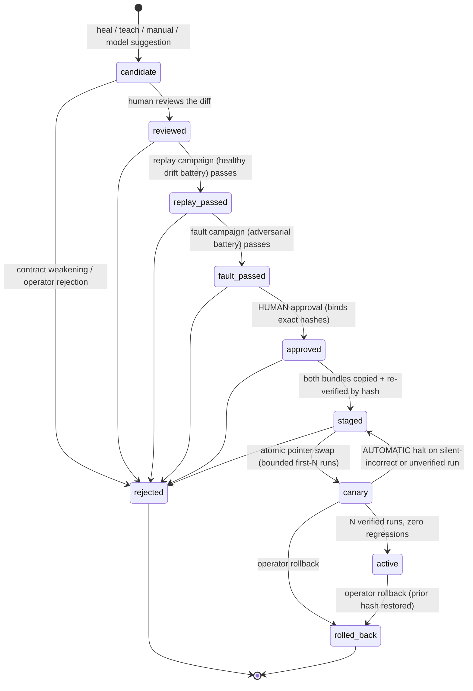

# Governed repair promotion lifecycle

A heal or a taught correction produces a PROPOSED bundle. Under the governed
lifecycle (roadmap Section 9), that proposal is never the active bundle just
because it exists on disk: it becomes a **repair candidate** that must earn
activation through explicit, auditable, fail-closed gates.

Package: `openadapt_flow/repair/` (candidate model, contract invariants,
campaigns, lifecycle store, CLI). Tests: `tests/test_repair_lifecycle.py`.

## The state machine



Anything not drawn above is an illegal transition and is refused
(`RepairLifecycleError`). A candidate can never skip a gate.

## How a repair enters the lifecycle

Where a repair used to become usable immediately, the engine now ALSO writes a
detached candidate record (`repair/candidate.json`) inside the proposed
bundle:

- **Heal path** (`openadapt_flow/runtime/replayer.py`): a replay with
  `--save-healed-to` still runs each heal through the existing in-run
  regression gate (`openadapt_flow/runtime/healing/`), and still writes the
  healed bundle at the end. That healed bundle is now registered as a repair
  candidate (source `heal`) with the run's heal evidence attached.
- **Teach path** (`openadapt_flow/learning/teach.py`): a promoted taught
  bundle is registered as a repair candidate (source `teach`). The fix comes
  from a recording of the operator's correction, and the taught step clicks
  the target that recording captured, with its template crops copied into the
  taught bundle. Where the step goes depends on where the run stopped:
  - The stopped step never acted (a dialog covered its target): the fix runs
    before it, only when the dialog's text is on screen.
  - The stopped step acted and its expected screen didn't appear: the fix
    becomes that step's exception handler. If the recording repeats the step,
    the learned program retries it after the fix. If not, the fix must also
    reach the step's expected screen.
  - teach refuses to retry a step that can write (irreversible, or with
    system-of-record effects), because nothing shows that its first delivery
    wrote nothing. It also refuses a fix with no recorded target, and a halt
    where no text on screen was new (the guard needs text that earlier screens
    of the run did not show).

Registration failure fails CLOSED by absence: a proposed bundle without a
candidate record cannot enter the lifecycle at all.

The candidate record is **privacy-safe by construction**: binding values are
stored as SHA-256 digests, failure evidence as path + hash references, and
failure fingerprints as structured labels plus digests. No raw observation
(frame, OCR text, identity band) enters the record, so candidates can sync to
Desktop / runners / Cloud.

## What a candidate records

- the changed binding: per-step, per-field anchor diffs (values digested)
- why the old binding failed: failure fingerprints
  (`step_id` + bounded `failure_class` + evidence digest) and evidence refs
  into the run directory (`heals/<step>/patch.json`, `report.json`)
- what supports the new binding: campaign results, the approval record,
  canary metrics
- lineage: prior and proposed whole-bundle content digests (the same digests
  `BundleManifest.content_digest` seals), the qualification environment
  contract hash (compatibility scope), and the full transition history

## The gates

### 1. Reviewed diff

`repair review` records a human reviewer. `repair show` renders the diff
summary; the full value-level diff is rendered live from the two local
bundles, never stored in the candidate.

### 2. Replay campaign (healthy cases)

The repaired binding is replayed against the evidence frame plus the reused
deterministic drift battery (`openadapt_flow/runtime/healing/perturbation.py`:
shift, scale, retheme, reflow). Every case must locate the target AND verify
its identity band.

### 3. Fault campaign (adversarial cases)

The repaired binding is replayed against `openadapt_flow/repair/campaign.py`'s
adversarial battery: **ambiguity** (duplicated target on the same row),
**wrong entity** (the identity band names someone else), **stale target**
(the control is gone), **unexpected dialog** (a modal covers the target), and
**verifier failure** (the band is unreadable). Every case must be REFUSED:
either the resolver finds nothing (or raises a refusal), or the identity band
fails verification so the pre-click gate halts. Confidently acting on any
fault frame is a silent wrong action and fails the campaign. An unarmed
binding (no identity band) that acts on an adversarial frame always fails.

Both campaigns are recorded on the candidate; a failed campaign never
advances the state and approval refuses until both pass.

### 4. Contract invariants (fail closed, checked twice)

`openadapt_flow/repair/invariants.py` diffs the prior and proposed bundles'
safety contracts and HARD-REFUSES any weakening of:

- **identity**: lost anchor evidence tiers, removed identity policies,
  lowered quorums, removed signals, changed enforcement
- **effect**: dropped step effects, weakened minimum effect tier, removed or
  weakened effect verification policies
- **risk**: `irreversible -> reversible`, dropped `consequential`, removed
  steps, downgraded or de-confirmed risk classifications
- **environment**: any change to the qualified environment boundary, removed
  required capabilities
- **policy**: removed qualification project, removed requalification
  conditions, grown exclusions

The only path through is an **explicit new qualification revision** on the
proposed bundle (`qualification.revision` strictly advanced and chained via
`previous_revision_sha256`, i.e. produced by the reviewed qualification
APIs). The check runs at registration (a weakening candidate is created
already `rejected`) and again at approval against the bundles on disk.

### 5. Human approval

`repair approve` requires a human identity and refuses unless the state is
`fault_passed` with both campaigns green. The approval record binds the EXACT
prior and proposed content digests. For automation there is
`--non-interactive`, which still requires an explicit `--approved-by` human
identity; automation may never approve on its own authority.

### 6. Staged, canary, active (atomic, hash-verified)

`repair stage` copies BOTH bundles into the store under
`bundles/<content-digest>/` and re-verifies each copy byte-exact (the prior
bundle too, so rollback is always local). `repair canary` atomically swaps
the active pointer (`ACTIVE.json`, written via temp file + `os.replace`)
to the proposed digest, in `canary` mode, after re-verifying the staged copy.
A tampered staged bundle refuses activation.

The canary window is bounded (`--max-runs`, default 5): each run is recorded
(`repair canary-record --run-dir <run>`), distilled to two triggers via
`observation_from_report` (fail-safe: an unknown outcome counts as a
regression):

- **silent-incorrect**: `COMPLETED_UNVERIFIED` / `RECONCILIATION_REQUIRED`
  transaction outcomes, or a step observing a conflicting business effect
- **verification regression**: any non-`VERIFIED` outcome

Either trigger IMMEDIATELY reverts the pointer to the prior digest and drops
the candidate back to `staged`. After N fully verified runs the candidate
completes to `active`.

### 7. Rollback

`repair rollback` is one command: it restores the prior content digest as the
active pointer (verified against the staged prior copy) and marks the
candidate `rolled_back`. Lineage stays in the candidate history.

## Hard rule: models never actuate or self-promote

Every lifecycle transition asserts the acting party is not a model
(`assert_not_model_actor`); `review` and `approve` additionally require a
human. A runtime model suggestion may only produce a candidate (source
`model_suggestion`) that flows through the SAME human-gated path. This is
enforced in code and covered by tests
(`test_model_actor_cannot_perform_any_transition`,
`test_model_suggestion_source_still_requires_full_human_gate`).

## Sync and fingerprints

The approved / staged / active states are identified by exact whole-bundle
content digests, so Desktop, runners, and Cloud can sync deterministically:
fetch `bundles/<digest>/`, re-verify the digest locally, and trust nothing
else. `RepairCandidate.record_sha256()` digests the full candidate record for
the same purpose. Failure fingerprints in the candidate are privacy-safe
(labels + digests only).

## Store layout

```
repair-store/
  candidates/<candidate-id>.json   # the candidate records (atomic writes)
  bundles/<content-digest>/        # immutable staged copies, by hash
  ACTIVE.json                      # atomic active pointer + lineage
```

## CLI reference

All commands accept `--store DIR` (default `repair-store/`).

| Command | Purpose |
| --- | --- |
| `openadapt-flow repair register <proposed> --prior <bundle> [--source heal\|teach\|manual\|model_suggestion] [--evidence <run-dir>]` | Register a bundle pair as a candidate (or import the detached `repair/candidate.json` when `--prior` is omitted). Refuses contract weakenings. |
| `openadapt-flow repair list` | List candidates and lifecycle states. |
| `openadapt-flow repair show <id> [--json]` | Reviewable diff, campaigns, approval, canary metrics. |
| `openadapt-flow repair review <id> --reviewed-by <name>` | Record the human diff review. |
| `openadapt-flow repair campaign <id> --kind replay\|fault` | Run a campaign against the candidate's evidence frames with the production resolver + OCR. |
| `openadapt-flow repair approve <id> [--approved-by <name>] [--non-interactive]` | Human approval; `--non-interactive` requires an explicit `--approved-by`. |
| `openadapt-flow repair stage <id>` | Stage both bundles by hash and re-verify byte-exact. |
| `openadapt-flow repair canary <id> [--max-runs N]` | Atomically activate in canary mode. |
| `openadapt-flow repair canary-record <id> --run-dir <run>` | Record one canary run; auto-revert on regression; auto-complete to active after N verified runs. |
| `openadapt-flow repair rollback [--candidate-id <id>] [--by <name>]` | One-command rollback to the prior hash. |
| `openadapt-flow repair status` | Show the active pointer and its lineage. |

## Relationship to the in-run heal gate

The existing in-run governance (`openadapt_flow/runtime/healing/`: the
identity-never-weakened `RegressionGate`, quarantine, and perturbation
harness) still guards each heal DURING a run: a weakening heal quarantines
and halts the run exactly as before. This lifecycle governs the next level
up: whether the resulting proposed BUNDLE may ever replace the active one.
The in-run gate protects the run; the lifecycle protects the fleet.

## Repairs taught by a calling agent

`openadapt-agent` serves workflows to other agents over MCP. When a run halts
there, the server can return a one-time repair token. If an administrator
turned on screen access for that workflow or organization, the calling agent
may demonstrate the stuck step once while OpenAdapt records it.
`openadapt_flow.repair.agent_teach.teach_from_calling_agent` turns that
recording into a candidate:

- It runs the same `teach` loop as the CLI. If the loop refuses the fix, or
  any later step fails, the taught bundle and its evidence are deleted and the
  workflow keeps halting.
- It copies the frame the agent clicked on to
  `<proposed>.evidence/heals/<step_id>/screen.png` and lists the step under
  `taught_steps`, so `openadapt-flow repair campaign` replays the taught step.
  Before this change, a taught candidate had no changed bindings, so the
  campaigns refused it.
- It records `provenance`: the agent id, the halted run and step, a SHA-256 of
  the repair token, who turned on screen access, the screen-sharing mode
  (`scrubbed_only`, `ask_each_time`, or `allow_unscrubbed`), how many screens
  the agent saw, whether they were scrubbed and by which openadapt-privacy
  provider, and who approved sharing for this token in `ask_each_time` mode.
  The model refuses combinations that break those rules, such as unscrubbed
  screens outside `allow_unscrubbed` or sharing the agent approved itself.

The candidate starts in `candidate` and needs the usual review, campaigns,
approval, staging, and canary. `RepairStore.review` and `RepairStore.approve`
refuse the actor whose id matches `provenance.agent_id`, whatever kind it
claims to be. Model actors are refused for every transition, as before.

### Identity for a taught dialog dismissal

A click that closes a dialog usually has no field value or row text to check,
so the fault campaign used to find no identity evidence for it and refused
the candidate. `openadapt_flow.repair.dialog_identity` gives such a step the
dialog itself as its identity:

- `teach_from_calling_agent` takes the dialog box from the caller (for
  example, from the DOM) through `dialog_region`. Without one, it looks for the
  smallest closed box around the click in the frame the agent clicked on. The
  box must be at least four times the control's area and at most 60% of the
  screen. When no box qualifies, nothing is marked and the step stays unarmed,
  so the fault campaign still refuses it.
- The box is recorded on the click as `identifier_region`. The compiler reads
  its title and body text with OCR into the step's identity evidence, takes the
  button label under the click as the target text, and snaps the click to the
  label's center.
- At replay, the step acts only when the same dialog text is present around
  the same button. The `verifier_failure` fault grays the whole dialog, so a
  dismissal that ignores the dialog's text fails the campaign. This is the same
  bar the campaigns set for every other step.

`openadapt_flow.repair.dialog_fixture` is a rendered app with such a dialog.
`tests/test_agent_teach_repair.py` runs the real replayer, teach loop, and
replay and fault campaigns on it.

### Keeping the halted page open

`openadapt-flow run --hold-on-halt SECONDS` keeps a halted browser run's page
open so the repair acts on the page that halted rather than a new one. After
writing `report.json`, Flow writes `<run_dir>/repair-hold.json` (mode 0600)
with a Unix socket path in a private directory, a random secret, and the run's
exit code. The socket accepts `viewport`, `screenshot`, `click`, and `release`
requests that carry the secret. The hold ends on `release` or after the given
time, at most 1800 seconds. Then the socket, its directory, and the hold file
are removed and the browser closes. `openadapt-agent serve --repair-access`
passes this flag and releases the hold after `teach_repair`.

## Branches taught from several halts

`openadapt-flow teach` learns a fix from one halted run. Its condition is text
that was new where that run stopped, so it can key on details of that one run,
such as a payer name or a reference number. `openadapt-flow teach-branch`
learns the same kind of branch from two or more halts that a person resolved
the same way:

```bash
openadapt-flow teach-branch \
  --example runs/halt-1 fixes/dismiss --example runs/halt-2 fixes/dismiss \
  --normal-run runs/ok-1 \
  --bundle bundles/save-encounter --out bundles/save-encounter-branch
```

- **Same place, same fix.** Every example must stop at the same step in the
  same way and have the same corrective steps. Otherwise it refuses.
- **Shared screen signature.** The condition is text that was new on every
  example's halt screen: a whole line, or a run of at least two words (for
  example, "Prior Auth Required" from "Prior Auth Required - Aetna ref 4471"
  and "Prior Auth Required - Cigna ref 9032").
- **Narrowing by a parameter.** A `--normal-run` is a run that went the usual
  way. If the signature also appears in a normal run, the condition must also
  compare one declared enum or boolean parameter (for example, `payer_type`)
  that has one value in every example and a different one in every such
  normal run. Secret and free-text parameters are never used. If no single
  parameter separates them, it refuses.
- **The same governed learn loop.** All example corrections and the normal runs
  go through induction, the regression gate and held-out validation together.
  After promotion, each example and each normal run must still be explained by
  the learned program. Only then is a bundle written.
- **A candidate, not an active bundle.** The output carries
  `repair/candidate.json` (source `teach`) and `repair/branch_induction.json`
  (example count, the stopped step, the fix, and a digest of the condition).
  It goes through the same campaigns, human approval and canary as any repair.

At runtime the branch is an ordinary guarded state: an OCR text check and, when
narrowed, a parameter compare. It makes no model calls. Limits: only one new
corrective step is spliced (as with `teach`), the condition is text or text
plus one parameter, and a parameter alone (with no shared screen text) is not
accepted. When a run's earlier frames can't be read, all of its halt-screen
text counts as new, so text that every screen shows could become the
condition; pass a `--normal-run` to rule that out. Tests: `tests/test_teach_branch.py` (MockMed save scenario on the
fake backend; no browser).
