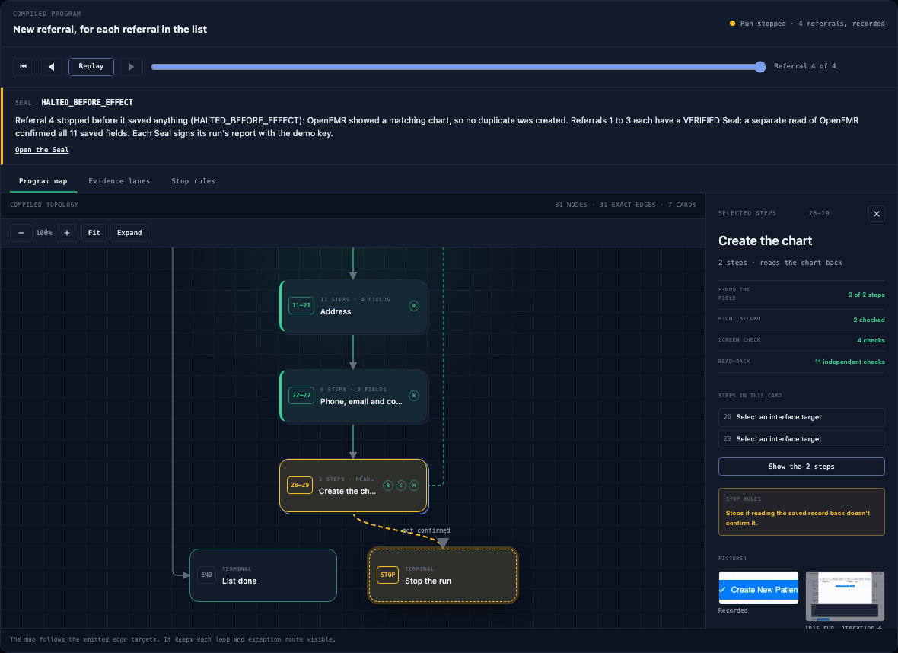

# @openadapt/program-graph

The OpenAdapt program map as one React component. Give it the program graph
that `openadapt-flow visualize --format json` emits for a compiled bundle, and
it draws every step, every exact edge, the loops and the stop rules. Give it a
run trace as well, and it plays that run over the map: steps light up as the
run reaches them, the loop counts its iterations, and a stop shows where the
run stopped and why.

OpenAdapt Desktop, app.openadapt.ai and openadapt.ai render the same graph
with this package.



## What it shows

- **Program map.** One card per compiled step, with its step number, kind and
  checks (R checks the right record, C reads the saved record back, H has a
  stop rule). A loop's body sits under the loop. A loop's return runs in a lane
  on the right, and an edge that skips steps (a loop's exit, a branch to the
  end) runs in a lane on the left, so no edge crosses a card.
- **Selected-step inspector.** How the step finds its target (the recorded
  resolution evidence, strongest first), whether it checks the right record,
  its screen and read-back checks, and when it stops before acting.
- **Evidence lanes.** The declared checks for every step in one table.
- **Stop rules.** Every step that can stop the run, and every end state.
- **Folds.** A long program can show each section as one card ("Name, 9
  steps, 3 fields"). A viewer can open any card to see its exact steps and fold
  it again.
- **Run trace.** Play, pause, step and scrub a recorded run. The current step
  stays in view, the inspector shows what happened at the step (the rung that
  found the target, the record check, the screen check, read-back results and
  time taken), and a stop lights the exit to a "Stop the run" card.

Keyboard: the arrow keys, Home and End move between tabs and between cards on
the map. Only the selected card is in the tab order. Every card has a spoken
description, every edge is listed for screen readers, and the player
announces each new iteration and the stop.

## Use it

```tsx
import { ProgramWorkbench } from "@openadapt/program-graph";
import "@openadapt/program-graph/styles.css";

<ProgramWorkbench spec={spec} />;

// With sections and a recorded run:
<ProgramWorkbench
  spec={spec}
  folds={folds}
  stopExits={folds.stops}
  trace={trace}
  iterationNoun="referral"
/>;
```

| Prop | What it does |
| --- | --- |
| `spec` | The program graph. Required. |
| `title`, `kicker` | Heading and the small label over it. The heading defaults to the bundle name. |
| `folds` | `{ groups: [{ id, title, subtitle, nodes }] }`. Each group shows as one card. |
| `stopExits` | `[{ node, label }]`. Draws each stop rule as an exit to a "Stop the run" card. |
| `trace` | A run trace (below). Adds the player. |
| `initialCursor`, `autoPlay`, `speed` | Where the trace starts, whether it plays on load (never when the viewer prefers reduced motion), and how much faster than recorded time it plays. |
| `cursor`, `onCursorChange` | Controlled trace position, for a host that runs its own play bar. |
| `playhead` | `{ node, iteration, status: "running" \| "saved" \| "stopped", reason }`. Lights one step without a trace: earlier steps show as reached, a loop on a later iteration animates its return edge, and a stop lights the exit to the stop card with its reason. |
| `selectedId`, `onSelect`, `initialSelectedId` | Controlled or initial selection. |
| `expanded`, `onExpandedChange` | Controlled open folds. |
| `views`, `initialView` | Which tabs to show (`program`, `evidence`, `stops`) and which opens first. One view shows no tab bar. |
| `showHeader`, `showPlayer`, `showInspector` | Hide the title bar, the player or the inspector. |
| `plainStopRules` | Show stop rules in plain words (`stopRuleWords`), not Flow's rule names. Use it with the public projection, which names rules only "declared stop rule N". |
| `numbering` | `index` (default) numbers every node, so a loop counts as a step. `actions` numbers only the actions, 1 to N, and shows the loop as "LOOP". |
| `compact` | A fixed-height stage (500 px; 380 px below 520 px of width) with zoom, fit, drag to pan and Ctrl or Cmd with the wheel to zoom; an inspector the viewer can close; straight runs of steps folded when `folds` is not given (`null` turns folding off); and an "Expand" control for the full height. |
| `resolveMedia` | `(ref, { node, kind, iteration }) => url \| null`. Turns step media references into URLs. Without it, no pictures show. |
| `tour`, `tourSeen`, `onTourEnd` | A guided tour (`true` for the default stops, or your own `TourStop[]`). It opens unless `tourSeen`; `onTourEnd("done" \| "skipped")` lets the host store the seen flag. |
| `titleFor` | Replaces a node's displayed title. |
| `notes` | Replaces or hides (`null`) the note under the map and under the evidence table. |
| `theme` | `dark` (default) or `light`. The workbench keeps its own colours whatever the host page's theme. |
| `layout` | Card size and spacing. |

A host that lays out its own page can use the parts on their own:
`ProgramMap` (the map only), `StepInspector` (one step's inspector),
`EvidenceLanes` and `StopRules`. Each takes `spec`, `theme` and `titleFor`.

The layout follows the workbench's own width: below 760 px the inspector
stacks under the map, and the map pans in both directions; below 520 px the
title bar wraps. While a run plays, the card it is at stays in view.

The package also exports the pieces: `layoutProgramGraph`, `rankNodes`,
`deriveDisplayGraph`, `foldSequences` (folds for a program that has none),
`validateFolds`, `traceStateAt`, `traceStateFromPlayhead`, `stopRuleWords`,
and the spec and trace types.

### Step media

A node can carry `media: { recorded: { crop, frame }, alt }`, and a trace
event can carry `frame`. Both hold references (a bundle-relative path, an
asset id), never image data. The inspector shows the recorded picture and
this run's frame side by side, and the player shows the frame of the step the
run is at. Every reference goes through the host's `resolveMedia`, which
returns a URL or `null`; the package never fetches, embeds or guesses a URL.
Pictures load lazily.

The host decides what is safe to show:

- **Desktop** may show local frames from the machine's own recordings and
  runs.
- **Cloud** shows only scrubbed or approved derivatives, never a raw frame.
- **The public site** shows only pictures of synthetic data.

Flow's public projection removes `media`. To show pictures with a public
spec, add them on purpose with `withMedia(spec, media)`.

### Receipt

A trace can end with `receipt: { kind: "seal" | "record", status, label,
summary, href }`. When playback reaches the end, a card shows it, with a link
to the Seal or to the run record. Use `kind: "seal"` only for a signed Seal.

### Guided tour

`tour` adds a tour of up to six stops, each built from the spec and the trace:
the recording, one step and how it finds its target, the loop, the
right-record check, a stop, and the receipt. A stop the program or the run
cannot show is left out. Each stop selects its step and moves the trace to the
moment that shows it. Back, Next and Skip are buttons; the arrow keys move and
Escape skips. Focus moves to the tour only when the viewer starts it.
`defaultTourStops(spec, { trace })` returns the stops for a host that wants to
change the words.

### Theme

Every colour, face and size is a CSS variable on `.opg-root`. The defaults
are the dark surface Desktop uses for execution evidence. To match a host:

```css
.opg-root {
  --opg-bg: var(--my-bg);
  --opg-panel: var(--my-panel);
  --opg-ok: var(--my-green);
  --opg-font-sans: var(--my-font);
}
```

The full list is at the top of [`src/styles.css`](src/styles.css).

## The two inputs

**Program graph.** [`schema/program-graph-v2.json`](schema/program-graph-v2.json)
is a byte-identical copy of the schema Flow publishes
(`packages/flow/schemas/program-graph-v2.json`). Flow's test suite checks that
its pydantic models, that schema and this package's TypeScript types agree, so
any bundle Flow can visualize renders here.

```bash
openadapt-flow visualize path/to/bundle --format json -o program-graph.json
```

**Run trace.** [`schema/run-trace-v1.json`](schema/run-trace-v1.json): an
outcome and a list of events, each naming a node id with its status, loop
iteration, timing and check verdicts. A trace never carries the values a run
typed.

## The demo fixture

[`fixtures/openemr-referral/`](fixtures/openemr-referral/) holds a real
compiled program and a real recorded run, both on synthetic data:

- `spec.json`: the OpenEMR referral bundle certified for clinical-write (29
  steps, compiled from one recorded referral on a local OpenEMR test copy with
  made-up patients; its content digest is in `folds.json`), wrapped in a loop
  over `worklist.csv`, in the public projection, which carries no recorded
  text or values.
- `folds.json`: the five form sections the steps fill, and the save step's
  stop rule.
- `media.json` and `media/`: the bundle's recorded target crop for each click
  step, and the screen after each step of the first and the fourth referral,
  640 px wide. Synthetic data only. `media/` is in the vendored copy, not in
  the npm package. With `withMedia(spec, media)` and a `resolveMedia` that maps
  each reference to where the host serves `media/`, the inspector and the
  player show them.
- `trace.json`: the four certified runs of that bundle (standard profile, no
  model calls), played in run order. Referrals 1 to 3 end VERIFIED: a
  separate read of OpenEMR confirmed all 11 saved fields. On referral 4,
  OpenEMR finds a matching chart, the screen check after "Create New Patient"
  fails, and the run stops before it saves anything (HALTED_BEFORE_EFFECT).
  Each run has a Seal signed with the demo key over its report; the builder
  checks each Seal against its report and each report against the bundle
  digest. The trace ends with referral 4's Seal, and `source` links every
  run's Seal.

[`scripts/build_openemr_fixture.py`](scripts/build_openemr_fixture.py)
regenerates all of them from the bundle and the certified runs.

## Install

A repository outside this monorepo carries a pinned, checksummed copy:

```bash
# In an OpenAdapt checkout, at the commit you want:
cd packages/program-graph && npm ci
node scripts/vendor.mjs --out ../../../openadapt-web/vendor/program-graph

# In the consuming repository's CI:
node vendor/program-graph/check.mjs
```

`vendor.mjs` refuses uncommitted changes, writes the build with
`VENDOR.json` (the commit, the version and the sha256 of every file) and
`check.mjs`, which fails when a vendored file is edited, added or removed. To
confirm a copy is exactly what its commit builds, check out that commit and
run `node scripts/vendor.mjs --verify <copy>`. Import from the copy's
`index.js` and `styles.css`; React comes from the consuming app.

The npm package is released from this directory by the `Release program
graph` workflow; [RELEASING.md](RELEASING.md) covers it and how a consumer
moves from the vendored copy to the npm package.

Inside this monorepo, Desktop imports the source directly through a path
alias.

## Develop

```bash
npm ci
npm test            # unit and DOM snapshot tests (vitest, jsdom)
npm run typecheck
npm run build       # dist/: ESM, type declarations and styles.css
npm run demo        # the fixture and Desktop's preview graph on 127.0.0.1:4517
node test/visual/shots.mjs   # pixel snapshots against test/visual/baseline/
```

The build has no runtime dependency beyond React; `scripts/build.mjs` fails if
the output imports anything else.

## License

MIT.
